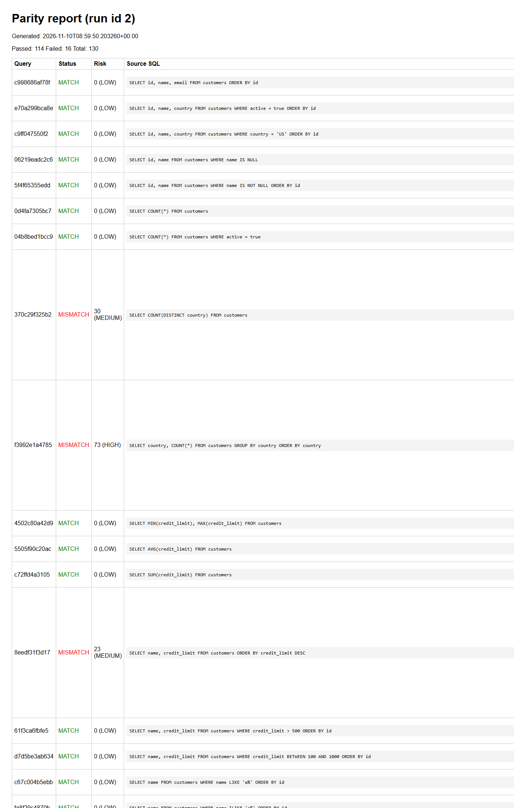

# Parity

> **One-Line Pitch:** Parity proves that SQL gives the same answer on PostgreSQL and on IBM Db2 before a team cuts over. It runs the same queries on both databases, compares the results row by row, lets an agent try a fix, and keeps every proven lesson in Db2.

---

## Table of Contents
- [Problem Statement](#problem-statement)
- [Solution Overview](#solution-overview)
- [IBM Db2 Integration](#ibm-db2-integration)
- [AI / LLM Architecture](#ai--llm-architecture-if-applicable)
- [Tech Stack](#tech-stack)
- [Prerequisites](#prerequisites)
- [Setup & Installation](#setup--installation)
- [Configuration](#configuration)
- [Running the Project](#running-the-project)
- [Testing & Verification](#testing--verification)
- [Screenshots & Demo](#screenshots--demo)
- [Known Limitations & Future Roadmap](#known-limitations--future-roadmap)
- [Team Members & Credits](#team-members--credits)

---

## Problem Statement

When an application moves from PostgreSQL to IBM Db2, the SQL is usually converted, not verified. A converted query can run with no error and still return a different answer. The difference reaches a report, an invoice, or a dashboard, and nobody knows for weeks. This is a silent bug.

Silent bugs survive because:

- Tests almost never use edge case data. NULL values, empty strings, trailing spaces, unusual characters, rounding and time zones are usually missing.
- Comparing two databases by hand is slow, so teams check a handful of queries.
- The knowledge about dialect differences sits with a few senior people, and every new team learns the same lessons again.

The target users are the database administrators and application teams who own a migration, and the platform teams who want a repeatable check for every change.

Existing tooling does not close this gap. SQL converters change the syntax and stop there. Schema comparison tools compare the structure, not the answers. Test suites check the queries someone thought to write, on the data they had. None of them answer the only question that matters: does this query return the same rows on the new database?

## Solution Overview

Parity runs your SQL on both databases and compares the results. A verdict comes from plain Python code, never from a model.

The core rule is simple:

> The model proposes. Execution decides.

1. **Ingest.** Read SQL from files, tag the unsafe queries, the tables they touch, and the ones with random values.
2. **Translate.** Apply safe rules first. Only what the rules cannot handle goes to an agent.
3. **Generate edge case data.** NULL, empty string, single space, trailing space, mixed case, Unicode, long strings, extreme numbers, rounding values and timezone dates. The same rows load into both databases.
4. **Run and compare.** Execute on PostgreSQL and on Db2, normalize the values, and compare. The result is MATCH, MISMATCH, ERROR, or NOT_COMPARABLE, with the first wrong row.
5. **Diagnose.** On a mismatch, the agent looks at the first difference and names the likely cause.
6. **Fix and re-prove.** The agent proposes a rewrite. It runs on both databases. It is accepted only when the engine proves it matches. After three tries it goes to a human.
7. **Learn.** Every proven rewrite is stored in Db2 with the run that proved it. A human approves it, and the next run can search for it.
8. **Report.** One command gives an HTML report and an exit code for a pipeline.

## IBM Db2 Integration

Db2 is not a mock in this project. It is the real target under test, the knowledge base, and the system of record.

- **Db2 Edition and environment:** IBM Db2 Community Edition 12.1.5.0 in Docker, started by the bundled Compose file. The version is pinned so a fresh clone gets the database that was tested.
- **Connector and driver:** the official `ibm_db` driver (ibm_db 3.3.0). Two ways to reach it. Directly with `Db2Admin` and `Db2Executor` on Linux and macOS. Through a Linux bridge container with `Db2BridgeAdmin` on Windows, because the Windows driver cannot reach a Db2 server. The bridge sends the statement and its parameters, and the container binds the parameters with the driver, so a value never becomes part of the SQL text.
- **Database schema:** the tables Parity owns live in Db2. `run` holds one row per pipeline run with its start time, end time, and exit code. `comparison_result` holds one row per query with the status, the risk score, the note, both SQL texts, and the first differences. `known_difference` holds the lessons with an `embedding VECTOR(384, FLOAT32)` column, the cause, the fix template, the verified flag, and the run id that proved it. `llm_cache` holds every model call so a run can repeat offline.
- **Key operations:** knowledge base search uses `VECTOR_DISTANCE(embedding, ?, COSINE)` with `WHERE verified = 1` and the five closest entries. The schema sync maps PostgreSQL types to Db2 types and keeps the width of a text column and the precision of a decimal, because a wider Db2 column would accept a value the source rejects. The primary key of the source table is kept in the Db2 table. Every insert, update, and delete uses bound parameters.

## AI / LLM Architecture

- **Framework:** a custom agent flow in plain Python (`src/parity/agents/`), with a CrewAI adapter for the four roles. The controller owns the limits: three fix tries, then a human. The limits are code, not a promise from a model.
- **Model provider and model:** any OpenAI compatible endpoint, set with `PARITY_LLM_BASE_URL`, `PARITY_LLM_MODEL`, and `PARITY_LLM_API_KEY`. The gateway falls back through a provider chain, from a hosted model to a local model such as Ollama. A local model double is included so the whole path can be demonstrated without a key.
- **Retrieval and tool workflow:** the Diagnostician searches the Db2 knowledge base for a similar known difference, then reads the first difference and writes a hypothesis. The Fixer receives that hypothesis and the current Db2 SQL and returns a rewrite. The rewrite is executed on both databases and the engine compares the results. A retrieved lesson never decides anything on its own.
- **Cost and safety:** one gateway handles every model call. It checks the cache first, it counts tokens against a budget, and it records what it spent. In replay mode it never touches the network, so a recorded run repeats with no key.

## Tech Stack

- **Core:** Python 3.11, plain standard library for the engine. The engine has no third party dependency and no model call.
- **Database:** IBM Db2 12.1.5.0 as the target and the system of record. PostgreSQL 16 as the source.
- **Interface:** a command line tool with four commands, plus a self contained HTML report.
- **Libraries and tools:** `ibm_db` 3.3.0, `psycopg` 3.3.8, `crewai` 1.15.39 as an optional extra, pytest and ruff for the tests and the lint, Docker for the databases and the bridge image.

## Prerequisites

- Docker, for the PostgreSQL and Db2 containers.
- Python 3.11 or later.
- pip.
- A model endpoint and a key, only if you want the agent fix loop. Everything else works without one.

## Setup & Installation

```bash
# 1. Clone the repository and go into the submission folder
cd submissions/parity

# 2. Create a virtual environment and install
python -m venv .venv
source .venv/bin/activate        # Windows PowerShell: .venv\Scripts\Activate.ps1
pip install -e ".[dev,db]"

# 3. Start the databases
docker compose up -d
```

The first start of Db2 takes a few minutes because the image is large.

## Configuration

Copy `.env.example` to `.env` and fill in the values for your databases.

```bash
cp .env.example .env
```

> **Security Warning:** Never commit `.env` or any real API key or database password. The values in `.env.example` are for the local containers only.

| Variable | Meaning |
|---|---|
| `PARITY_SOURCE_*` | The PostgreSQL source. |
| `PARITY_DB2_*` | The IBM Db2 target. |
| `PARITY_LLM_BASE_URL` | The OpenAI compatible endpoint for the agents. |
| `PARITY_LLM_MODEL` | The model name. |
| `PARITY_LLM_API_KEY` | The key. Leave it empty for replay mode. |

## Running the Project

```bash
# Look at a workload before you run it
python -m parity.cli ingest --dir samples

# Compare both databases and write the report
python -m parity.cli run --dir samples \
  --out parity-report.html --json-out parity-summary.json \
  --history parity-history.json --bridge

# Let the agent try to fix a mismatch, and prove the fix on both databases
export PARITY_LLM_BASE_URL=https://your-endpoint/v1
export PARITY_LLM_MODEL=your-model
export PARITY_LLM_API_KEY=your-key
python -m parity.cli run --dir samples --fix-loop --bridge

# Keep the proven lessons and review them
python -m parity.cli kb-capture --history parity-history.json --store db2
python -m parity.cli kb-review --action list --store db2

# Repeat a recorded run with no key and no network
python -m parity.cli replay --dir samples --cache parity-llm-cache.json --bridge
```

The `--bridge` flag is only needed on Windows. It runs the Db2 side inside the Linux bridge container.

## Testing & Verification

```bash
# Unit tests and lint
pytest tests/
ruff check src tests

# Seed the sample data and run the whole workload on both databases
docker run --rm --add-host=host.docker.internal:host-gateway \
  -v $PWD/scripts:/app/scripts \
  -e PARITY_SOURCE_HOST=host.docker.internal \
  -e PARITY_SOURCE_USER=parity -e PARITY_SOURCE_PASSWORD=change-me \
  -e PARITY_SOURCE_DB=parity_source \
  -e PARITY_DB2_HOST=host.docker.internal \
  -e PARITY_DB2_USER=db2inst1 -e PARITY_DB2_PASSWORD=change-me \
  -e PARITY_DB2_DB=parity \
  parity-bridge python /app/scripts/seed_workload.py

python -m parity.cli run --dir samples --bridge
```

339 tests pass and the lint is clean.

The live results that were measured on PostgreSQL 16 and Db2 12.1.5.0:

| Run | Result |
|---|---|
| Sample workload, clean data | 130 of 130 MATCH, exit 0 |
| Sample workload, edge case data | 113 MATCH, 17 MISMATCH |
| The same run with the agent fix loop | 114 MATCH, 16 MISMATCH, 0 errors |

The nine confirmed differences between the two databases are listed in `docs/divergence-catalog.md`, each one with the probe that shows it.

## Screenshots & Demo

- **Project repository:** https://github.com/Amitk003/Parity
- **Demo video:** not recorded yet
- The report is a single HTML file with no external assets, so it can be attached to a ticket as is.



The report shows one row per query with the status, the risk score, both SQL texts, and the first difference.

The other files in this folder are the real output of that run:

- `docs/screenshots/fix-loop-run.txt` — the agent fix loop, step by step, on real databases.
- `docs/screenshots/summary-clean-data.json` — the JSON summary of the clean run: 130 of 130 matched.
- `docs/screenshots/summary-edge-cases.json` — the JSON summary of the run with the edge case rows and the agent fix loop.

## The guides

Thirty five guides live in `docs/`. These are the ones that matter first.

| Guide | What it covers |
|---|---|
| [docs/migration-guide.md](docs/migration-guide.md) | a migration from end to end |
| [docs/divergence-catalog.md](docs/divergence-catalog.md) | every known difference with a probe |
| [docs/architecture.md](docs/architecture.md) | how the parts fit together |
| [docs/engine.md](docs/engine.md) | the rules that decide MATCH |
| [docs/sql-translate.md](docs/sql-translate.md) | the translation rules |
| [docs/fuzz-run.md](docs/fuzz-run.md) | the edge case run |
| [docs/agent-fix-loop.md](docs/agent-fix-loop.md) | diagnose, fix, and prove |
| [docs/kb-capture.md](docs/kb-capture.md) | keeping the lessons |
| [docs/regression.md](docs/regression.md) | catching a break against the last good run |
| [docs/ops-runbook.md](docs/ops-runbook.md) | running it day to day |
| [docs/supported-versions.md](docs/supported-versions.md) | what is tested and what is not |
| [docs/release-notes.md](docs/release-notes.md) | what is in this release |

## Known Limitations & Future Roadmap

- **Current limitations:** Parity gives strong evidence from real execution, not a formal proof. It cannot find a difference that its data never triggers. Only read only queries run, because the source is never written to. The sample workload is one domain. The agent fix loop was proved against a local model double that speaks the same shape as a real model, so the model quality is not proved yet. The continuous integration workflow exists on a branch and is not merged.
- **Next steps:** run the agent loop against a real model, add the remaining Db2 tables for translation history and fuzz cases, make the fuzzer schema aware for every column type, add a held out validation set for the fixer, and support Oracle and MySQL sources with the same engine.

## Team Members & Credits

| Name | GitHub Handle | Role / Contribution |
|---|---|---|
| Amit Kumar | [@Amitk003](https://github.com/Amitk003) | Engine, Db2 integration, translator, agent fix loop, knowledge base |

Built with the `ibm_db` driver and IBM Db2 Community Edition.
