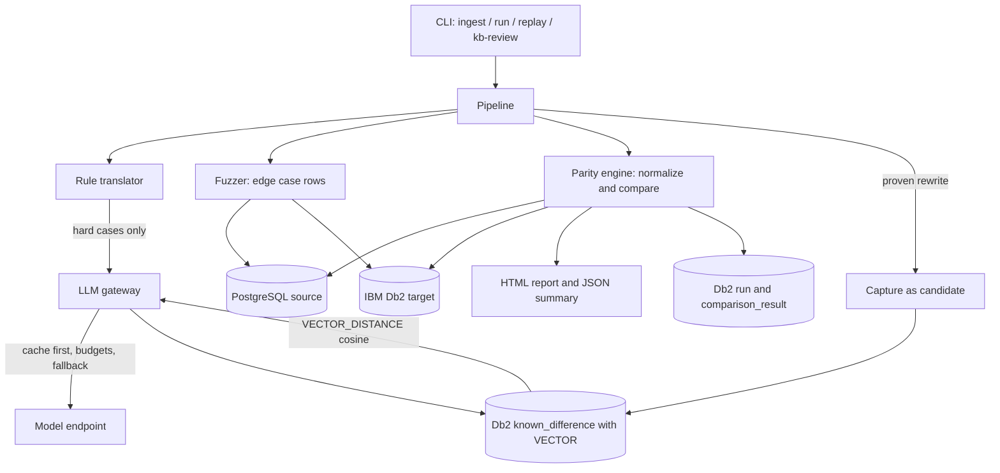

# System Architecture

## Overview

Parity is a command line tool with a plain Python engine in the middle and IBM Db2 on both sides of it. The engine is the only judge. The agents propose, and the databases decide.



## Component Breakdown

1. **Command line layer** (`src/parity/cli.py`)
   Four commands. `ingest` looks at a workload. `run` compares both databases and writes the report. `replay` repeats a recorded run with no key. `kb-review` is the human gate for the knowledge base. Exit codes: 0 all matched, 1 at least one mismatch, 2 an error or a query that could not be compared.

2. **Engine layer** (`src/parity/engine/`)
   The judge. It normalizes the values from both databases, compares the rows, and returns the verdict. Decimal values never go through float. NULL never becomes an empty string. A trailing space difference gets its own category. A statement without a result set never reaches the driver. No model call happens in this layer.

3. **Data layer** (`src/parity/sync/`)
   Reads the PostgreSQL schema, maps the types to Db2 with the width and the precision kept, builds the DDL, copies the rows with bound parameters, and prints a checksum. The checksum proves both databases hold the same rows before any comparison runs.

4. **Translation layer** (`src/parity/translate/`)
   Seven named rules run first. A select list scanner, not a regex, decides which items get a name, so a rewrite never touches a WHERE clause or an ORDER BY. A type aware rule casts an integer column to a bigint inside SUM, because Db2 overflows there. Only what the rules cannot handle goes to an agent.

5. **Agent layer** (`src/parity/agents/`)
   The Diagnostician reads the first difference and writes a hypothesis. The Fixer writes a rewrite. A plain Python controller owns the limits: three tries, then a human. The rewrite is executed on both databases and the engine decides. The CrewAI adapter maps the same four roles for teams that prefer it.

6. **Gateway layer** (`src/parity/gateway/`)
   One client for every model call. It checks the cache first, counts tokens against a budget, falls back through the provider chain, and records what it spent. In replay mode it never touches the network.

7. **Db2 layer** (`src/parity/kb/`, `src/parity/history/`)
   Db2 holds the system of record. The knowledge base uses a `VECTOR(384, FLOAT32)` column with cosine search, and it only serves verified entries. The run history keeps one row per run and one row per query outcome.

## Data Flow

1. **Ingest.** The workload files are loaded, split, tagged, and deduplicated by content hash. Write queries are tagged and never executed.
2. **Sync.** The source schema and data are copied into Db2. A checksum proves the two databases hold the same rows.
3. **Translate.** The rules produce the Db2 SQL. The select list scanner names every unaliased expression the way Postgres names it, because Db2 names it by its text.
4. **Fuzz.** The fuzzer builds a plan per table. The values fit the column type, so the rows load into both databases without a data error.
5. **Compare.** Both databases run the same query. The engine normalizes and compares. This is the only place a verdict comes from.
6. **Diagnose and fix.** A mismatch goes to the Diagnostician, then to the Fixer. Each candidate runs on both databases. A candidate that matches ends the loop.
7. **Remember.** A proven rewrite becomes a candidate in the knowledge base with the run id that proved it. A human approves it, and it is served by search from then on.

## IBM Db2 Schema and Storage Design

```sql
-- One row per pipeline run
CREATE TABLE run (
    run_id INTEGER GENERATED ALWAYS AS IDENTITY PRIMARY KEY,
    source_dir VARCHAR(500) NOT NULL,
    started_at TIMESTAMP NOT NULL DEFAULT CURRENT TIMESTAMP,
    finished_at TIMESTAMP,
    exit_code INTEGER
);

-- One row per query outcome inside a run
CREATE TABLE comparison_result (
    result_id INTEGER GENERATED ALWAYS AS IDENTITY PRIMARY KEY,
    run_id INTEGER NOT NULL,
    query_id VARCHAR(100) NOT NULL,
    status VARCHAR(20) NOT NULL,
    risk_score INTEGER,
    risk_label VARCHAR(10),
    note VARCHAR(500),
    source_sql VARCHAR(3000),
    db2_sql VARCHAR(3000),
    diff_summary VARCHAR(1000)
);

-- The lessons, with the proof and the vector for the search
CREATE TABLE known_difference (
    difference_id INTEGER GENERATED ALWAYS AS IDENTITY PRIMARY KEY,
    title VARCHAR(200) NOT NULL,
    source_pattern VARCHAR(2000) NOT NULL,
    db2_pattern VARCHAR(2000) NOT NULL,
    cause VARCHAR(2000),
    fix_template VARCHAR(2000),
    verified SMALLINT NOT NULL DEFAULT 0,
    evidence_run_id INTEGER,
    embedding VECTOR(384, FLOAT32)
);

-- Every model call, so a run can repeat offline
CREATE TABLE llm_cache (
    cache_key VARCHAR(64) NOT NULL PRIMARY KEY,
    agent VARCHAR(100) NOT NULL,
    provider VARCHAR(100) NOT NULL,
    model VARCHAR(200) NOT NULL,
    response VARCHAR(4000) NOT NULL,
    tokens_in INTEGER NOT NULL DEFAULT 0,
    tokens_out INTEGER NOT NULL DEFAULT 0,
    latency_ms INTEGER NOT NULL DEFAULT 0
);
```

The DDL lives in two places on purpose. `src/parity/migrations.py` is the runner that the code uses, and the `migrations/` folder holds the same text for a reviewer to read.

### Key Db2 queries

```sql
-- The knowledge base search. Only verified entries are served.
SELECT title, source_pattern, db2_pattern, fix_template,
       VECTOR_DISTANCE(embedding, VECTOR('[...]', 384, FLOAT32), COSINE) AS dist
FROM known_difference
WHERE verified = 1
ORDER BY dist
FETCH FIRST 5 ROWS ONLY;

-- The history of the last passing run, for the regression check
SELECT run_id, source_dir, started_at, finished_at, exit_code
FROM run
WHERE exit_code = 0
ORDER BY run_id DESC
FETCH FIRST 1 ROWS ONLY;
```

## Security and Secrets Management

- Every credential and every token is read at runtime from the environment. `.env` is blocked by `.gitignore`, and only `.env.example` with placeholder values is committed.
- Every value that reaches Db2 is bound with a parameter. The bridge sends the parameters separately and the container binds them, so a value never becomes part of the SQL text.
- The source database is read only. The safety guard refuses anything that is not a SELECT or a WITH that ends in a SELECT.
- The prompts carry SQL text, schema names, and synthetic values only. Production rows never reach a model.
- The knowledge base only serves verified entries, and a human approves every one of them.
