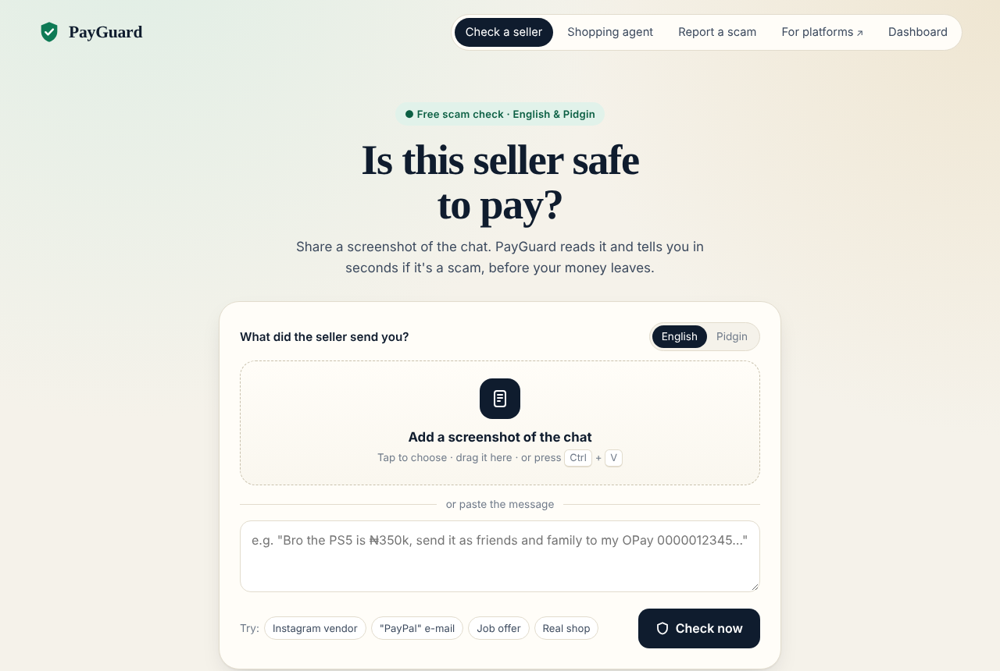
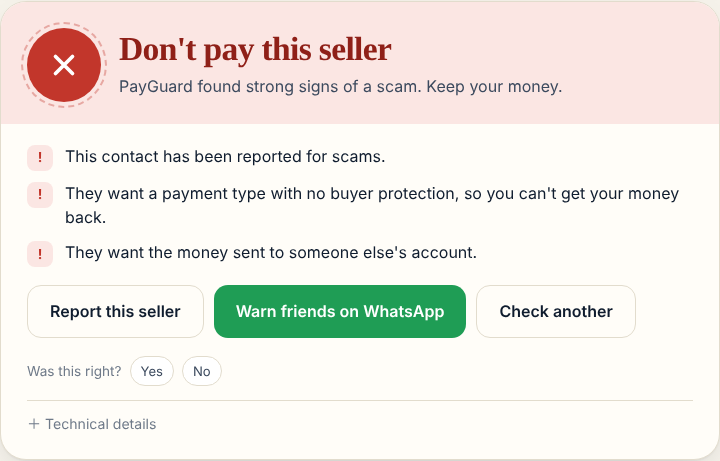
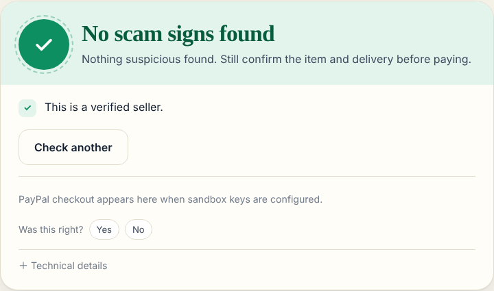
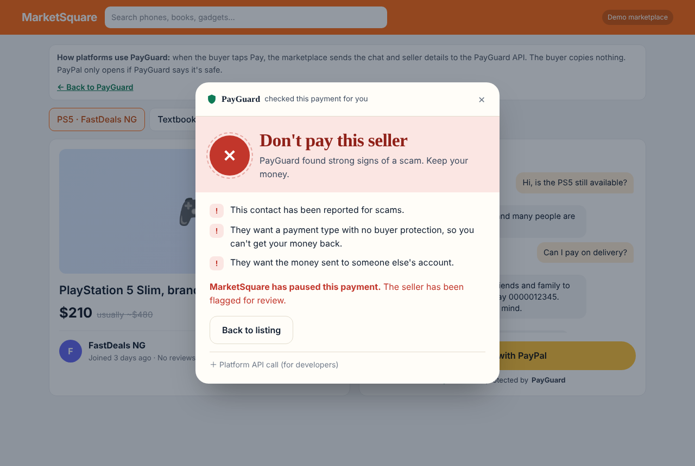
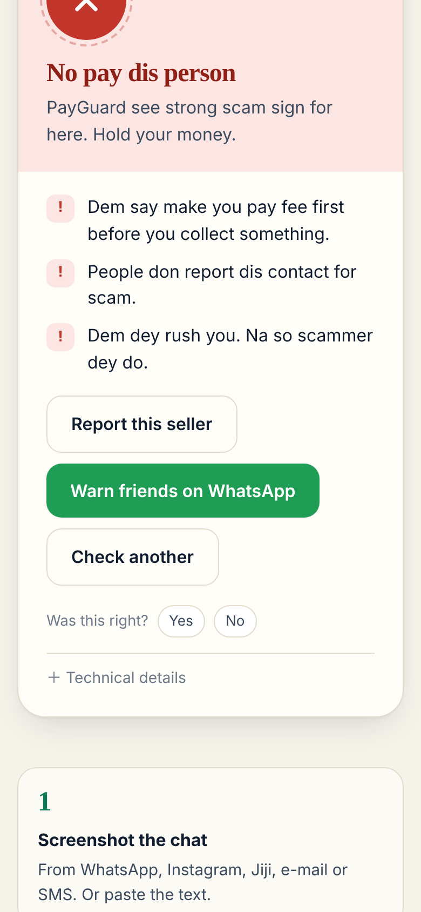
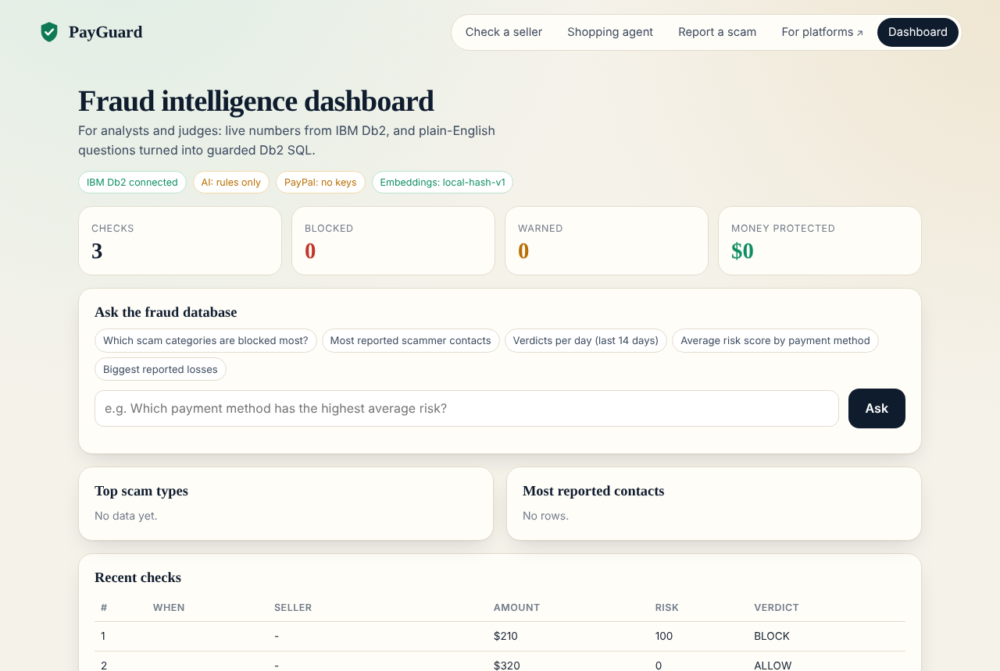

# PayGuard: an AI payment firewall on IBM Db2

> **One-line pitch:** PayGuard checks a payment *before* you send it. It combines rule signals, an IBM Db2 scam knowledge base with vector search, and a Gemini investigator agent. Then it allows, warns or blocks the payment, and only safe payments reach PayPal checkout.



---

## Table of Contents
- [Problem Statement](#problem-statement)
- [Solution Overview](#solution-overview)
- [IBM Db2 Integration](#ibm-db2-integration)
- [AI / LLM Architecture](#ai--llm-architecture)
- [PayPal Integration](#paypal-integration)
- [Tech Stack](#tech-stack)
- [Prerequisites](#prerequisites)
- [Setup & Installation](#setup--installation)
- [Configuration](#configuration)
- [Running the Project](#running-the-project)
- [Testing & Verification](#testing--verification)
- [Screenshots & Demo](#screenshots--demo)
- [Known Limitations & Future Roadmap](#known-limitations--future-roadmap)
- [Team Members & Credits](#team-members--credits)

---

## Problem Statement
- Online buyers in Nigeria and worldwide lose money to the same scam scripts again and again. A seller insists on PayPal "Friends & Family" so there is no buyer protection. A fake "your account is limited" e-mail links to a look-alike login page. A "job" asks for a registration fee. A caller asks for your OTP.
- **Audience:** everyday buyers, students, small online sellers, and the marketplaces and fintechs that serve them.
- **Why existing tools fall short:** fraud checks usually run on the payment provider's side, *after* money moves. Victims rarely know a pattern is a known scam until it's too late. Community warnings are scattered across WhatsApp groups and social media, and nobody can search them.

## Solution Overview
PayGuard is built so the buyer does almost nothing:

1. **Screenshot check (one tap):** screenshot the chat on WhatsApp or Instagram, tap **Share**, then **PayGuard**. The app is installable and registered as an Android **share target**. Gemini vision reads the seller, phone numbers, **bank account numbers**, price and requests, then PayGuard answers 🟢 *No scam signs* / 🟡 *Be careful* / 🔴 *Don't pay*, in **English or Nigerian Pidgin**. On a computer: drag the image in, press Ctrl+V, or paste the text.
2. **Protected checkout for platforms (zero effort):** marketplaces call `POST /api/v1/checkout/verify` when the buyer taps Pay, sending the chat, seller details, account age and listing vs market price. PayPal only opens if PayGuard allows it. A live demo marketplace is at `/market`.
3. **One-tap actions after a verdict:** *Report this seller* (adds to the Db2 blocklist; three reports block a contact automatically) and *Warn friends on WhatsApp*.
4. **AI shopping agent (agentic commerce):** "Buy the PS5 from FastDeals for $210…" → the agent builds the order, screens it, and either refuses or prepares PayPal checkout for your approval.
5. **Fraud intelligence dashboard** for analysts and judges: live KPIs, and plain-English questions turned into guarded, read-only Db2 SQL.

**Safety design:** deterministic rules and Db2 evidence set the score. The AI may **raise** risk or explain it, but never lower a verdict. The server re-reads the verdict from Db2 before creating any PayPal order, so a modified browser cannot bypass a block.

## IBM Db2 Integration
- **Db2 edition and environment:** IBM Db2 Community Edition 12.1.2+ on Docker (`docker-compose.yml`). Db2 on IBM Cloud also works via `DB2_SSL=true`.
- **Connector / driver used:** `ibm_db` / `ibm_db_dbi` (DB-API), with parameter markers throughout.
- **Database schema / data models:**

| Object | Purpose | Db2 features |
|---|---|---|
| `PG_SCAM_PATTERNS` | 25 scam playbooks (global + Nigeria-specific) | `VECTOR(768, FLOAT32)` column, `CHECK` constraint, composite index on `(REGION, CATEGORY)` |
| `SCAM_EXAMPLES` | 105 supplied Nigerian message examples, including safe controls | SHA-256 primary key, label/text/source, BSON metadata, `VECTOR(768, FLOAT32)`; queried through LangChain `DB2VS` |
| `PG_ENTITIES` | bank account numbers, e-mails, phones, domains, wallets with `BLOCKED`/`SUSPECT`/`TRUSTED` status | `UNIQUE (ENTITY_TYPE, ENTITY_VALUE)`, `MERGE` upsert with auto-escalation |
| `PG_REPORTS` | community scam reports | `VECTOR` column, FK with `ON DELETE CASCADE` |
| `PG_SCREENINGS` | every payment screened, its verdict, reasons and PayPal order state | `CLOB` JSON evidence, indexes on `(PAYEE_EMAIL, CREATED_AT)` and `(VERDICT, CREATED_AT)` |
| `PG_V_ENTITY_RISK`, `PG_V_DAILY_VERDICTS` | aggregated views for analytics and lookups | `CREATE OR REPLACE VIEW`, `LEFT JOIN` + `GROUP BY` |

- **Key queries and operations** (see [architecture.md](architecture.md) for the full SQL):
  - **Hybrid vector + relational search:** `VECTOR_DISTANCE(EMBEDDING, VECTOR('<query vector>', 768, FLOAT32), COSINE)` ranked with `WHERE REGION IN ('GLOBAL', ?)` and `FETCH FIRST n ROWS ONLY`.
  - **Community similarity:** a vector search over report narratives joined to entity status.
  - **Atomic upsert with escalation:** `MERGE INTO PG_ENTITIES ... WHEN MATCHED THEN UPDATE SET STATUS = CASE WHEN REPORT_COUNT + 1 >= 3 THEN 'BLOCKED' ...`.
  - **Generated keys:** `SELECT ID FROM FINAL TABLE (INSERT ...)`.
  - **Velocity checks:** `CREATED_AT > CURRENT TIMESTAMP - 24 HOURS` against an index.
  - **Catalog introspection:** `SYSCAT.COLUMNS` supplies the live schema to the text-to-SQL model.
  - **Read-only analytics:** model-written SQL passes a guard (single `SELECT`/`WITH` statement, PayGuard tables only, no `EMBEDDING`, forced `FETCH FIRST`), then runs and is rolled back.

## AI / LLM Architecture
- **Framework:** LangChain runs the existing Gemini investigator through a `RunnableLambda` chain and validates/executes its Db2 functions as `StructuredTool` instances (`src/langchain_db2_tools.py`, `src/agent.py`). IBM `langchain-db2` supplies `DB2VS` for live cosine vector retrieval over `SCAM_EXAMPLES` (`src/db.py`); a LangChain `Embeddings` adapter reuses the existing local/Gemini embedder. Gemini REST remains the model transport. Every production tool calls the real `Db2Repository`.
- **Model provider and model:** Google Gemini `gemini-2.5-flash` for reasoning. Embeddings come from `local-hash-v1` by default (offline feature hashing, 768-d). `gemini-embedding-001` is optional via `EMBED_PROVIDER=gemini`.
- **RAG / tool-calling workflow:**
  1. The risk engine gathers evidence: rules, then a Db2 entity lookup, then Db2 vector search over playbooks and reports, then Db2 velocity.
  2. The investigator agent receives the evidence and may call `lookup_entity`, `search_scam_patterns`, `search_community_reports`, `search_scam_examples` or `payee_history` to dig further.
  3. It returns JSON `{summary, advice, escalate, extra_risk}`. `extra_risk` is clamped to 0-20 and can only increase the score.
  4. **Fallback:** without a Gemini key, the app still works fully with rule-based explanations and quick analytics.

## PayPal Integration
- PayPal **Orders v2 (sandbox)** called from the server, plus PayPal **JS SDK** buttons in the browser.
- `POST /api/paypal/orders` loads the screening from Db2. `BLOCK` returns 403. `REVIEW` requires explicit acknowledgement (otherwise 409). The amount comes from Db2, never from the browser. `custom_id = payguard:<screening>:<verdict>:<score>` links the PayPal order to the audit row.
- `POST /api/paypal/orders/{id}/capture` checks that the order belongs to the screening, captures it, and writes the status back to Db2.

## Tech Stack
- **Backend / core:** Python 3.10+, FastAPI, Uvicorn
- **Database:** IBM Db2 12.1.2+ (VECTOR, MERGE, views, FINAL TABLE, SYSCAT)
- **Frontend / UI:** a single-page HTML/CSS/JS app served by FastAPI (no build step)
- **Libraries and tools:** LangChain (`langchain`, `langchain-core`, `langchain-community`, `langchain-db2==1.0.0`), `ibm_db`, `httpx`, `pydantic`, Docker, PayPal JS SDK, Gemini API, pytest

## Prerequisites
- Docker (for local Db2) **or** a Db2 12.1.2+ instance
- Python ≥ 3.10 and `pip`
- Optional: a Gemini API key (free) and PayPal sandbox app credentials

## Setup & Installation

From the submission repository root, run `cd submissions/payguard` before the commands below. Standalone source: [Josebert2001/payguard](https://github.com/Josebert2001/payguard).

### Windows quick start

Install Python 3.10+ and Docker Desktop, then start Docker Desktop. In PowerShell, from the project folder:

```powershell
Copy-Item .env.example .env
# Edit .env and set DB2_PASSWORD; add optional Gemini and PayPal credentials locally.
docker compose up -d
# Wait for "(*) Setup has completed." in: docker logs -f payguard-db2
.\start.bat
```

`start.bat` creates the Python environment, installs dependencies, ensures Db2 is running, seeds the database if empty, and opens http://localhost:8000. Keep `.env` private.

### Manual setup

```bash
# Run from submissions/payguard (or the standalone PayGuard repository root).
python -m venv .venv
source .venv/bin/activate        # Windows: .venv\Scripts\activate
pip install -r requirements.txt

cp .env.example .env             # then edit DB2_PASSWORD (and optional keys)
docker compose up -d             # Db2: wait for "(*) Setup has completed." (5-10 min first time)
docker logs -f payguard-db2
```

## Configuration
| Variable | Purpose |
|---|---|
| `DB2_HOST`, `DB2_PORT`, `DB2_DATABASE`, `DB2_USER`, `DB2_PASSWORD`, `DB2_SSL` | Db2 connection |
| `GEMINI_API_KEY`, `GEMINI_MODEL` | AI investigator, agent and text-to-SQL (optional) |
| `EMBED_PROVIDER` (`local`/`gemini`), `EMBED_DIM` | embedding backend; changing it rebuilds the vectors on the next seed |
| `PAYPAL_CLIENT_ID`, `PAYPAL_CLIENT_SECRET`, `PAYPAL_BASE_URL` | PayPal sandbox checkout (optional) |
| `REVIEW_THRESHOLD`, `BLOCK_THRESHOLD` | verdict cut-offs |

> **Security:** never commit `.env`. Only `.env.example` (placeholder values) is in Git.

## Running the Project
```bash
python src/seed.py --reset       # creates tables, views and indexes, loads the knowledge base, screens demo history
uvicorn main:app --app-dir src --reload
# open http://localhost:8000
```
- **Try:** buttons give ready-made cases: Instagram vendor, fake "PayPal" e-mail, job fee, real shop.
- **Screenshot demo:** drag `docs/demo/sample-chat.png` (a fictional Pidgin chat) onto the page. This needs `GEMINI_API_KEY`.
- **Platform demo:** open `http://localhost:8000/market` and tap *Buy now with PayPal* on each listing.
- **Phone share sheet:** serve over HTTPS (e.g. a tunnel), open it in Chrome on Android, tap *Install*, then share any screenshot to PayGuard.

## Testing & Verification
```bash
pytest -q        # Original 31 tests plus CSV, LangChain, and safety regression tests: signals, risk fusion, AI agent loop, screenshot flow, platform API, PayPal gating, SQL guard
```
The default tests use an in-memory repository, so CI needs no database; four opt-in integration tests require real Db2. The application itself always uses Db2. To verify against Db2:
```bash
python src/seed.py --reset
curl -s localhost:8000/api/health                       # {"db2": true, ...}
curl -s -X POST localhost:8000/api/screen -H "Content-Type: application/json" \
  -d '{"merchant":"FastDeals NG","payee_email":"fastdeals.ng@mail.example","amount":210,"payment_method":"friends_family","message":"send as friends and family"}'
```

## Screenshots & Demo
- **Demo video:** [Watch PayGuard](https://youtu.be/Xl68sUC8XLY)
- Screenshots of a blocked payment, an allowed payment and the agent:

| Check a seller | Scam verdict | Safe verdict |
|---|---|---|
|  |  |  |

| Platform checkout (`/market`) | Mobile, Pidgin | Dashboard |
|---|---|---|
|  |  |  |

## Known Limitations & Future Roadmap
- **Current limitations:** the seed data is illustrative, and all contacts are fictional `.example` values. Local hashing embeddings capture wording overlap rather than deep meaning. Gemini embeddings are available but their thresholds should be re-tuned on real data.
- **Next steps:** a WhatsApp bot (forward a message or voice note), a browser extension, and **checking at the moment of transfer**: banks and fintechs call PayGuard when a user types a recipient's account number ("Truecaller for account numbers"). Also Db2 vector indexes once approximate search is available, and a reporter reputation score.

## Team Members & Credits
| Name | GitHub Handle | Role / Contribution |
|---|---|---|
| Sunday Robert (Josebert) | [@Josebert2001](https://github.com/Josebert2001) | Design, Db2 integration, AI agent, PayPal checkout |

All scam patterns are written from public consumer-protection advice. All names, e-mails, phones, domains and wallets in the seed data are fictional.

## Nigerian examples and LangChain on Db2

The supplied CSVs are stored in `data/`. `src/seed.py` now also loads `data/handmade_all.csv`, including when the 25 playbooks already exist. To add examples to an existing database without reseeding:

```bash
python src/load_scam_examples.py
```

The loader creates `SCAM_EXAMPLES` and inserts all 105 supplied rows with the same configured embeddings and `VECTOR(dim, FLOAT32)` storage as the playbooks. A deterministic SHA-256 ID and duplicate check make reruns safe. Label, text and source are preserved; BSON metadata lets IBM's `DB2VS` read the labels. The investigator's new `search_scam_examples` tool and the risk engine both retrieve from this real Db2 table. Responses include `matched_examples`; the verdict's technical evidence names the matched label. Safe examples never subtract risk, and AI additions remain clamped to 0?20.

`data/heldout_v1.csv` is read only by evaluation tests, never by the loader or playbook seeder. **Data overlap:** all 15 evaluation texts also occur in the supplied 105-row CSV (90 `hand_reviewed`, 15 `external_heldout`). To preserve the requested 105-row import without inflating evaluation, tests exclude **all 15 texts** from retrieved candidates before top-k selection. This is an overlap-filtered check, not an independent benchmark. With the default local embedder it flags **5/10 scam messages** and allows **5/5 safe messages**; recall remains limited for vague grant/job offers. No rules or thresholds were added to fit those missed messages. A general credential-warning regression prevents ?never share your PIN? from being treated as a credential request, while a separate actual request still triggers.

Run the full suite, including the four live database checks, in PowerShell after configuring `.env` and starting Db2:

```powershell
$env:PAYGUARD_DB2_TEST = "1"
python -m pytest -q -s
```

The integration tests verify idempotent loading, actual `DB2VS` search, LangChain tools querying Db2, verdict evidence, and overlap-filtered evaluation. They use no mocked database and fail if the configured Db2 connection is unavailable. Optional external AI calls remain disabled in tests. Verified locally against the running Db2 **12.1.5** container; the project requires vector support from Db2 12.1.2+.

Integration references: [IBM LangChain Db2 connector](https://github.com/langchain-ai/langchain-ibm/tree/main/libs/langchain-db2), [LangChain StructuredTool](https://reference.langchain.com/python/langchain-core/tools/structured/StructuredTool).

## License

PayGuard is released under the [MIT License](LICENSE). Third-party dependencies retain their respective licenses.
