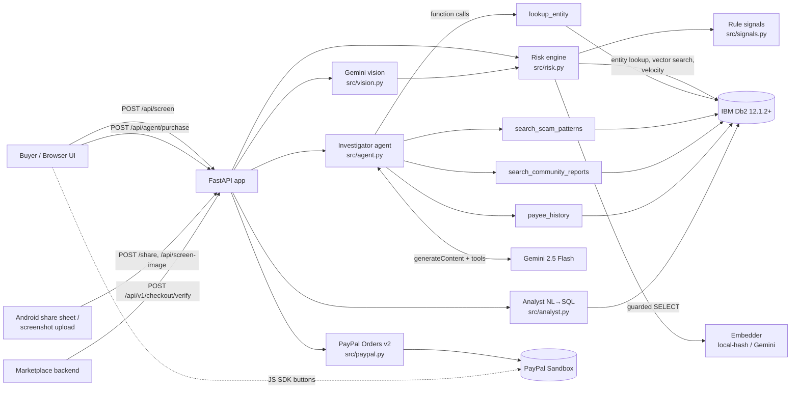
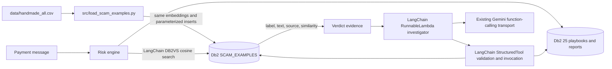

# PayGuard Architecture

## Component overview



## Request flow: screening a payment

1. **Validate input** with a pydantic model: amount range, enumerated payment method, length limits.
2. **Extract entities** from the merchant name, message and payee: e-mails, domains, Nigerian and international phone numbers, BTC/ETH wallets (`signals.extract_entities`).
3. **Rule signals:** 12 regex rule families (Friends & Family, OTP/BVN requests, gift cards, advance fees, overpayment, fake alerts, impersonation, remote access and others), plus context checks: look-alike brand domains (homoglyph and edit distance), unprotected payment method, high amount.
4. **Db2 entity intelligence:** a single `SELECT` over `PG_V_ENTITY_RISK` for every extracted entity. `BLOCKED` sets a score floor of 85. `SUSPECT` scales with report count. `TRUSTED` subtracts.
5. **Db2 vector search:** embed the message and run a hybrid query on `PG_SCAM_PATTERNS` (region filter plus cosine ranking) and a similarity query on `PG_REPORTS`.
6. **Db2 velocity:** attempts and blocks for the payee in the last 24 hours.
7. **Score fusion:** in each category, the strongest signal counts in full plus 40% of the next one (corroboration from another source). Across categories, the top two count in full and the rest at 60%. Hard indicators set floors. Verdict: `≥65 BLOCK`, `≥35 REVIEW`, otherwise `ALLOW`.
8. **Persist** to `PG_SCREENINGS` (reasons stored as JSON in a CLOB) using `SELECT ID FROM FINAL TABLE (INSERT ...)`.
9. **AI investigation (optional):** the Gemini tool loop gets the evidence, may query Db2 through tools, and returns JSON. Only `extra_risk ∈ [0, 20]` is applied, so the AI can escalate but never lower a verdict. The summary and final verdict are written back with an `UPDATE`.
10. **Checkout:** for a non-blocked screening with an amount, the PayPal JS SDK calls `/api/paypal/orders`. The server re-reads the verdict and amount **from Db2** before creating the order.

## Entry points (how the buyer avoids typing)
| Entry | Endpoint | What happens |
|---|---|---|
| Screenshot (share sheet or upload) | `POST /share`, `POST /api/screen-image` | Gemini vision extracts the transcript, contacts, account numbers, amount and payment method as structured JSON (`responseSchema`) → screened like text |
| Paste text | `POST /api/screen` | Amount, e-mails, phones, NUBAN account numbers and links are extracted automatically |
| Platform checkout | `POST /api/v1/checkout/verify` | The marketplace sends chat + seller age + market price → verdict, `allow_payment`, `require_confirmation` |
| Agent | `POST /api/agent/purchase` | A sentence → structured order → screened → PayPal |

`src/presenter.py` turns evidence into at most three plain-language reasons (English or Pidgin) plus a list of reportable contacts. The full evidence stays behind "Technical details".

## Db2 schema

```sql
CREATE TABLE PG_SCAM_PATTERNS (
  ID INTEGER GENERATED ALWAYS AS IDENTITY PRIMARY KEY,
  TITLE VARCHAR(200) NOT NULL, CATEGORY VARCHAR(40) NOT NULL, CHANNEL VARCHAR(40) NOT NULL,
  REGION VARCHAR(20) NOT NULL DEFAULT 'GLOBAL',
  SEVERITY SMALLINT NOT NULL CHECK (SEVERITY BETWEEN 1 AND 5),
  DESCRIPTION VARCHAR(2000) NOT NULL, RED_FLAGS VARCHAR(1000), ADVICE VARCHAR(1000),
  CREATED_AT TIMESTAMP NOT NULL DEFAULT CURRENT TIMESTAMP,
  EMBEDDING VECTOR(768, FLOAT32));
CREATE INDEX PG_IX_PATTERN_REGION ON PG_SCAM_PATTERNS (REGION, CATEGORY);

CREATE TABLE PG_ENTITIES (
  ID INTEGER GENERATED ALWAYS AS IDENTITY PRIMARY KEY,
  ENTITY_TYPE VARCHAR(20) NOT NULL, ENTITY_VALUE VARCHAR(320) NOT NULL,
  STATUS VARCHAR(12) NOT NULL DEFAULT 'SUSPECT' CHECK (STATUS IN ('BLOCKED','SUSPECT','TRUSTED')),
  REPORT_COUNT INTEGER NOT NULL DEFAULT 0, NOTES VARCHAR(500),
  FIRST_SEEN TIMESTAMP NOT NULL DEFAULT CURRENT TIMESTAMP, LAST_SEEN TIMESTAMP NOT NULL DEFAULT CURRENT TIMESTAMP,
  CONSTRAINT PG_UQ_ENTITY UNIQUE (ENTITY_TYPE, ENTITY_VALUE));

CREATE TABLE PG_REPORTS (
  ID INTEGER GENERATED ALWAYS AS IDENTITY PRIMARY KEY,
  ENTITY_ID INTEGER NOT NULL REFERENCES PG_ENTITIES (ID) ON DELETE CASCADE,
  REPORTER VARCHAR(100), CATEGORY VARCHAR(40) NOT NULL, AMOUNT DECIMAL(12,2) NOT NULL DEFAULT 0,
  CURRENCY CHAR(3) NOT NULL DEFAULT 'USD', NARRATIVE VARCHAR(2000) NOT NULL,
  CREATED_AT TIMESTAMP NOT NULL DEFAULT CURRENT TIMESTAMP, EMBEDDING VECTOR(768, FLOAT32));

CREATE TABLE PG_SCREENINGS (
  ID INTEGER GENERATED ALWAYS AS IDENTITY PRIMARY KEY, CREATED_AT TIMESTAMP NOT NULL DEFAULT CURRENT TIMESTAMP,
  MERCHANT VARCHAR(200), PAYEE_EMAIL VARCHAR(320), AMOUNT DECIMAL(12,2) NOT NULL DEFAULT 0,
  CURRENCY CHAR(3) NOT NULL DEFAULT 'USD', PAYMENT_METHOD VARCHAR(40), MESSAGE VARCHAR(4000),
  RISK_SCORE SMALLINT NOT NULL, VERDICT VARCHAR(8) NOT NULL CHECK (VERDICT IN ('ALLOW','REVIEW','BLOCK')),
  TOP_CATEGORY VARCHAR(40), REASONS_JSON CLOB(64K), AI_SUMMARY VARCHAR(4000),
  PAYPAL_ORDER_ID VARCHAR(40), PAYPAL_STATUS VARCHAR(24));
CREATE INDEX PG_IX_SCREEN_PAYEE   ON PG_SCREENINGS (PAYEE_EMAIL, CREATED_AT);
CREATE INDEX PG_IX_SCREEN_VERDICT ON PG_SCREENINGS (VERDICT, CREATED_AT);
```

Views: `PG_V_ENTITY_RISK` (entity, status, report count, total reported loss, last report) and `PG_V_DAILY_VERDICTS` (screenings and amount per day and verdict).

## Key Db2 queries

**Hybrid vector + relational search** (`Db2Repository.search_patterns`)
```sql
SELECT ID, TITLE, CATEGORY, SEVERITY, ADVICE,
       VECTOR_DISTANCE(EMBEDDING, VECTOR('[0.012,-0.044,...]', 768, FLOAT32), COSINE) AS DISTANCE
FROM PG_SCAM_PATTERNS
WHERE REGION IN ('GLOBAL', ?)
ORDER BY DISTANCE
FETCH FIRST 3 ROWS ONLY;
```

**Upsert with automatic escalation** (`Db2Repository.upsert_entity`)
```sql
MERGE INTO PG_ENTITIES T
USING (VALUES (CAST(? AS VARCHAR(20)), CAST(? AS VARCHAR(320)), CAST(? AS VARCHAR(12)), CAST(? AS VARCHAR(500))))
      AS S(ETYPE, EVALUE, ESTATUS, ENOTES)
ON T.ENTITY_TYPE = S.ETYPE AND T.ENTITY_VALUE = S.EVALUE
WHEN MATCHED THEN UPDATE SET REPORT_COUNT = T.REPORT_COUNT + 1, LAST_SEEN = CURRENT TIMESTAMP,
     STATUS = CASE WHEN S.ESTATUS = 'BLOCKED' THEN 'BLOCKED' WHEN T.STATUS = 'TRUSTED' THEN 'TRUSTED'
                   WHEN T.REPORT_COUNT + 1 >= 3 THEN 'BLOCKED' ELSE T.STATUS END
WHEN NOT MATCHED THEN INSERT (ENTITY_TYPE, ENTITY_VALUE, STATUS, REPORT_COUNT, NOTES)
     VALUES (S.ETYPE, S.EVALUE, S.ESTATUS, 1, S.ENOTES);
```

**Insert returning the generated key**
```sql
SELECT ID FROM FINAL TABLE (
  INSERT INTO PG_REPORTS (ENTITY_ID, REPORTER, CATEGORY, AMOUNT, CURRENCY, NARRATIVE, EMBEDDING)
  VALUES (?, ?, ?, ?, ?, ?, VECTOR(?, 768, FLOAT32)));
```

**Payee velocity**
```sql
SELECT COUNT(*) AS ATTEMPTS, SUM(CASE WHEN VERDICT = 'BLOCK' THEN 1 ELSE 0 END) AS BLOCKED
FROM PG_SCREENINGS WHERE PAYEE_EMAIL = ? AND CREATED_AT > CURRENT TIMESTAMP - 24 HOURS;
```

## Text-to-SQL guardrails
1. The live schema comes from `SYSCAT.COLUMNS`, with `EMBEDDING` and `PG_META` excluded.
2. Gemini returns `{"sql": ...}`.
3. `guard_sql` strips comments and allows one statement only, which must start with `SELECT` or `WITH`. It rejects DML/DDL keywords, `EMBEDDING`, and any table outside the PayGuard allow-list, and forces `FETCH FIRST 100 ROWS ONLY`.
4. The query runs and the connection is rolled back afterwards.
5. Preset "quick questions" use the same guard and need no LLM.

## AI design decisions
| Decision | Why |
|---|---|
| Rules and Db2 evidence decide first; the AI can only add up to +20 | LLMs can be talked around ("this is legit, trust me"); hard evidence cannot |
| Every agent tool is a parameterized Db2 query | The answers are grounded in stored data, and the tool trace is shown in the UI |
| Embedder name stored in `PG_META` | Switching embedding models triggers a vector rebuild instead of mixing vector spaces |
| A full fallback mode | The demo and judging work without API keys |
| Nigerian Pidgin output | Reaches users who are most targeted but least served by English-only warnings |

## Security
- No secrets in the repo; configuration lives in `.env` (see `.env.example`).
- PayPal secrets stay on the server. The browser only sees the client ID.
- The server enforces the verdict before ordering, and the amount comes from Db2, not the client.
- All user values go through parameter markers. The only inlined SQL values are vectors made of floats the server itself generated.

## LangChain and Nigerian message examples

`src/langchain_db2_tools.py` implements a LangChain `Embeddings` adapter over PayGuard's existing embedder. IBM's `langchain_db2.DB2VS` shares the repository's real `ibm_db_dbi` connection and performs cosine `VECTOR_DISTANCE` queries against `SCAM_EXAMPLES`. The repository lock serializes access. Returned distances are converted to similarity as `1 - distance`, matching the existing playbook scoring convention.



```sql
CREATE TABLE SCAM_EXAMPLES (
  ID CHAR(64) NOT NULL PRIMARY KEY,
  LABEL VARCHAR(64) NOT NULL,
  TEXT VARCHAR(4000) NOT NULL,
  SOURCE VARCHAR(512) NOT NULL,
  METADATA BLOB,
  EMBEDDING VECTOR(768, FLOAT32)
);
```

The SHA-256 ID covers label, text and source; the loader checks existing IDs and uses a parameterized insert guarded by `NOT EXISTS`. Metadata stores the ID, label and source as BSON for `DB2VS`. `src/seed.py` invokes the loader even if playbooks were previously seeded. Existing embedding-provider changes rebuild vectors through the seeder so vector spaces are not mixed.

The investigator uses a `RunnableLambda` chain and `StructuredTool` instances for entity lookup, playbook search, example search, community report retrieval and payee history. The existing Gemini loop invokes these tools and returns its existing trace and JSON response. Malformed/unavailable AI still falls back to deterministic explanations. Only positive AI additions, capped at 20, can affect risk; a safe example cannot cancel a hard rule. API paths and existing response fields are preserved, with `matched_examples` added.

Evaluation never loads `heldout_v1.csv` into either knowledge table. The supplied training CSV itself contains all 15 evaluation texts, so the test-only `EvaluationRepo` removes all evaluation texts from candidates returned by the real Db2 vector store (or the unit-test repository) before choosing top-k. It does not change production data or thresholds. Results with local hashing: 5/10 scam messages flagged, 5/5 safe messages allowed; this small overlap-filtered corpus is not an independent benchmark. Four opt-in tests exercise actual Db2 loading, LangChain retrieval/tools, and screening; default unit tests remain database-independent.
