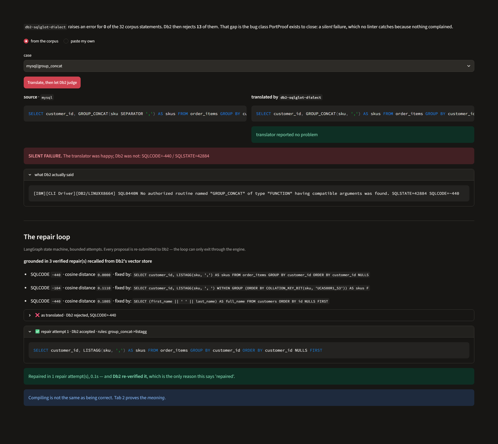
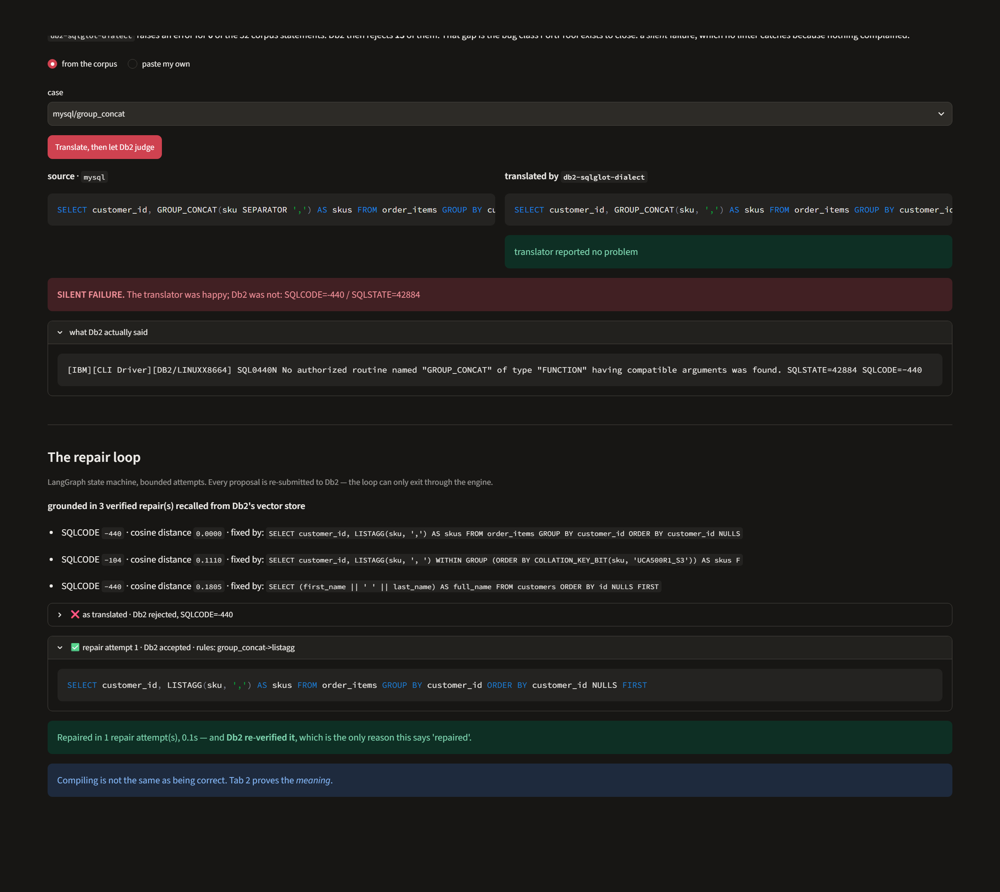
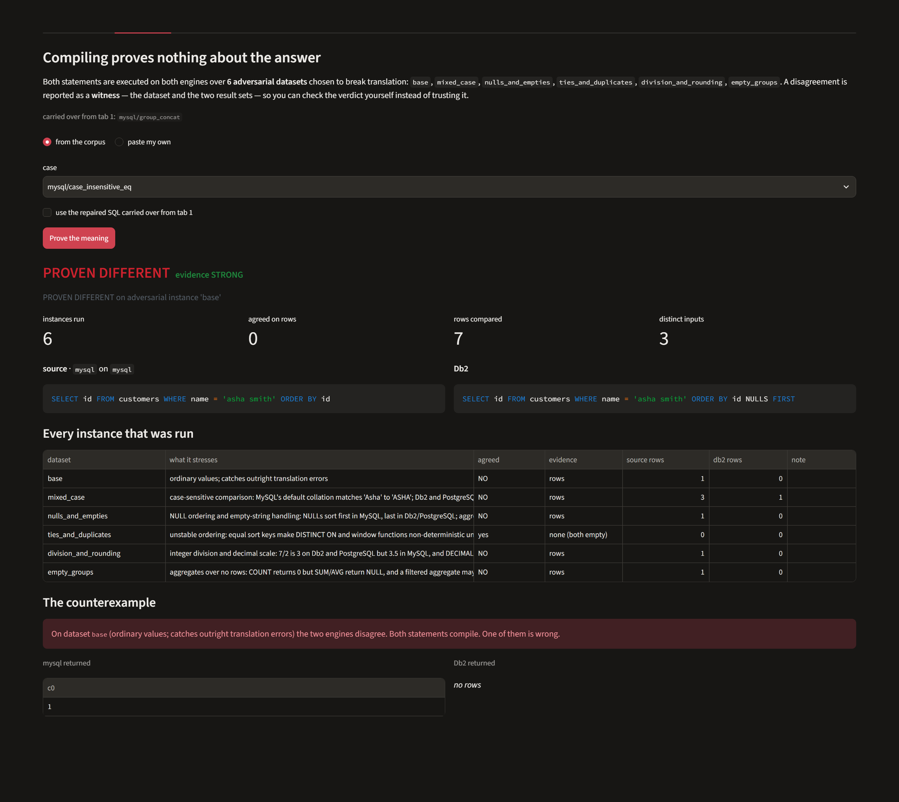
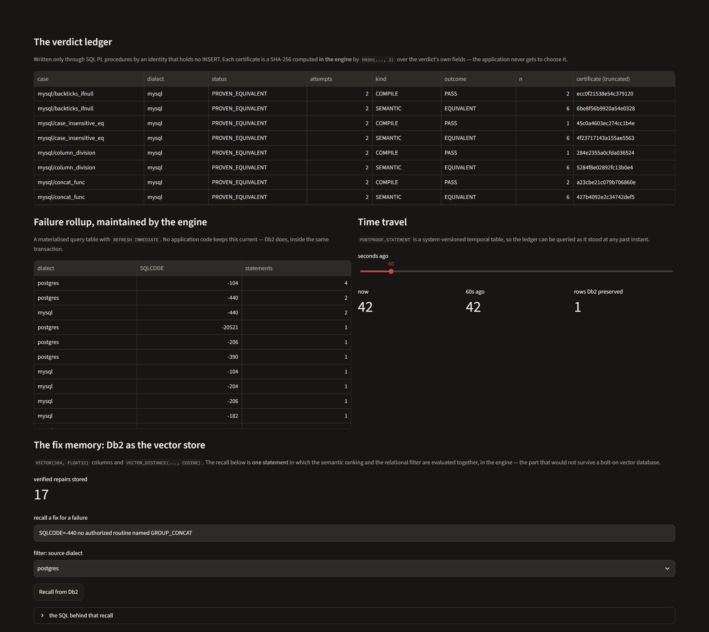
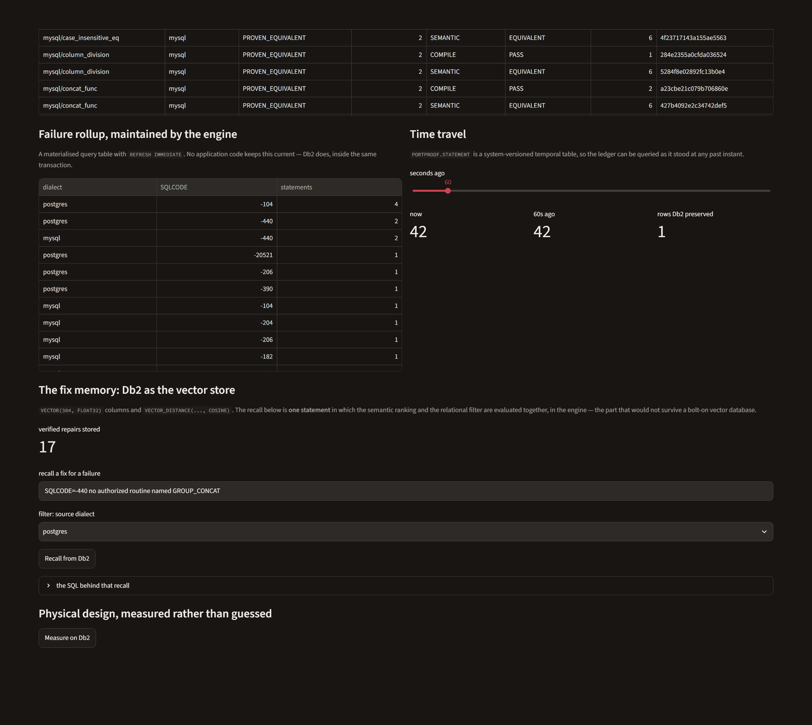
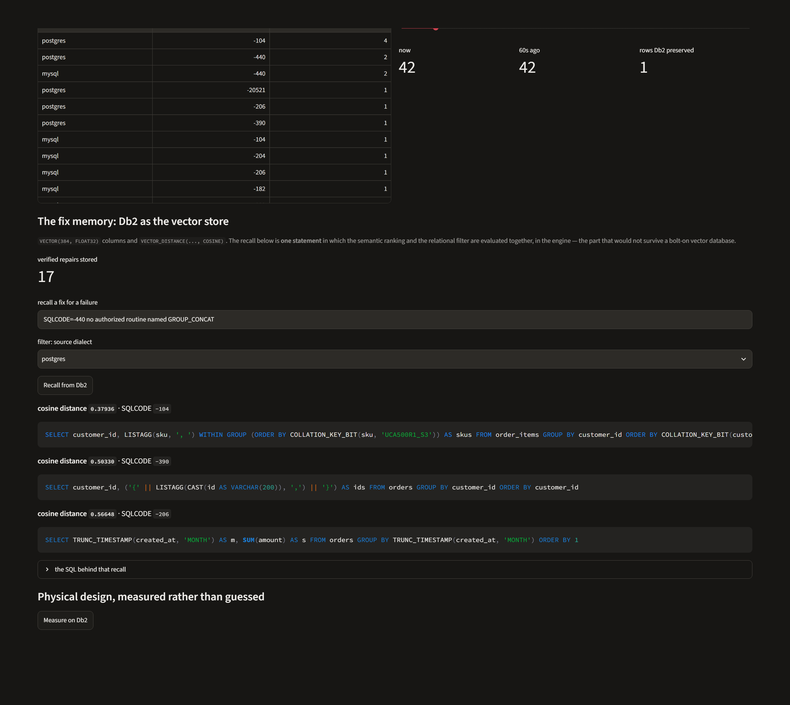
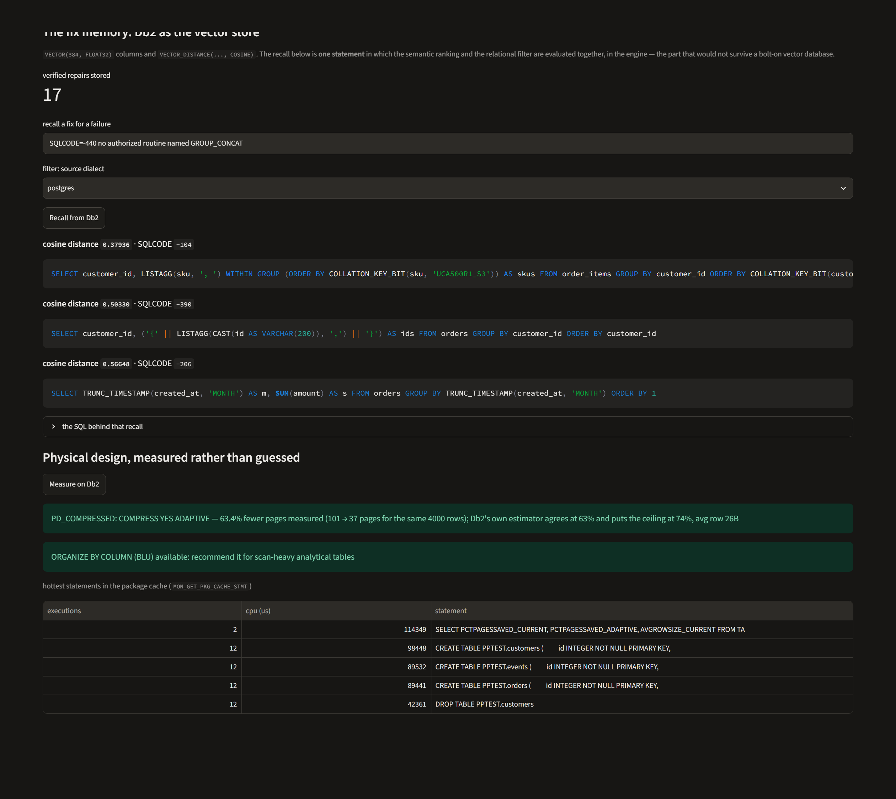

# PortProof

> **One line pitch:** PortProof translates PostgreSQL and MySQL into Db2 and then makes Db2 itself prove the result, first that it compiles and then that it returns the same answers, so a migration is finished when the engine says so rather than when a tool stops complaining.

**AI proposes. Db2 proves.**

---

## Table of Contents
- [Problem Statement](#problem-statement)
- [Solution Overview](#solution-overview)
- [What the Last Run Measured](#what-the-last-run-measured)
- [IBM Db2 Integration](#ibm-db2-integration)
- [AI and LLM Architecture](#ai-and-llm-architecture)
- [Tech Stack](#tech-stack)
- [Prerequisites](#prerequisites)
- [Setup and Installation](#setup-and-installation)
- [Configuration](#configuration)
- [Running the Project](#running-the-project)
- [Testing and Verification](#testing-and-verification)
- [Screenshots and Demo](#screenshots-and-demo)
- [Security](#security)
- [Findings About Db2 and About the Translator](#findings-about-db2-and-about-the-translator)
- [Known Limitations and Future Roadmap](#known-limitations-and-future-roadmap)
- [Team Members and Credits](#team-members-and-credits)

---

## Problem Statement

Moving an application from PostgreSQL or MySQL onto Db2 means rewriting its SQL, and the tooling that does the rewriting is confident in a way it has not earned.

Run the 38 real world statements in `src/corpus.py` through IBM's own `db2-sqlglot-dialect` and it reports success on every single one. Hand those outputs to a real Db2 and 14 of them are rejected outright. The translator was not lying, exactly. It simply never asked the database.

That is the cheap failure. The expensive one is the statement that compiles on Db2, runs without an error, and quietly returns a different answer than it did before. Nobody finds those at build time. They are found weeks later, by an accountant, in a report that does not reconcile.

The people who hit this are the ones doing the work: a database administrator or an application developer with a few thousand statements, a deadline, and no way to tell the two categories apart. Existing tooling is insufficient in a specific and fixable way. A translator checks syntax against its own grammar, a linter checks style, and a test suite checks the application. None of them ask the target engine whether the translated statement is valid, and none of them run the old statement and the new statement side by side to see whether the rows still match.

PortProof is built around the view that the only authority on Db2 is Db2.

---

## Solution Overview

Every statement goes through five stages, and no stage is allowed to accept its own work.

**1. Translate.** IBM's `db2-sqlglot-dialect` does the rewriting. PortProof does not compete with it, it verifies it.

**2. Prove it compiles.** The candidate goes to Db2 as a `PREPARE`. That parses it, resolves every name against the live catalog and type checks it, without executing anything. Whatever Db2 says is the verdict, SQLCODE included. A statement the translator called a success and Db2 rejects is recorded as a **silent failure**, because that is what it is.

**3. Repair, if needed.** A bounded LangGraph state machine rewrites the statement and sends it straight back to Db2. The model's output is never trusted: it is validated as a single read only query before it goes near the connection, and a repair Db2 rejects is discarded like any other failed candidate. The prompt is grounded in a vector fix memory of repairs Db2 has already accepted, stored in Db2 itself.

**4. Prove the meaning.** This is the part that matters. The original statement runs on a real PostgreSQL or a real MySQL, the translated statement runs on Db2, both over six adversarial datasets, and the results are compared row by row and column by column. Each dataset provokes one documented difference between the engines: case sensitive collation, NULL ordering and three valued logic, integer and decimal division, unstable ties, aggregates over no rows.

**5. Repair the meaning, if it can.** A statement that compiles and still returns wrong rows used to be a dead end. Now five measured rewrite rules are tried against it, and every candidate is re run through the same differential proof that caught the divergence. A rewrite is reported only because that proof now agrees.

Everything is written to a ledger inside Db2 through SQL PL procedures, by an identity that holds no `INSERT` on any table, with a SHA-256 certificate the engine computes over the evidence.

### The verdict is deliberately hard to earn

Proving two SQL programs equivalent is undecidable in general, so PortProof never claims equivalence outright. It reports one of five things, and the four that are not `EQUIVALENT` all exist to stop a stronger claim being made.

| Verdict | What it means |
|---|---|
| `EQUIVALENT` | The engines agreed, on enough instances, having actually compared rows. Carries an evidence strength of `WEAK`, `MODERATE` or `STRONG`. |
| `DIFFERENT` | A counterexample exists. The witness rows are stored. One of the two statements is wrong. |
| `UNSTABLE` | The engines differ, and the source engine differs from **itself** when the same rows are inserted in another order. The `ORDER BY` has ties, so no engine owes you that order and Db2 is not at fault. |
| `VACUOUS` | The engines agreed and both returned nothing. An empty result equals an empty result for any two statements that happen to select nothing, so this proves nothing. |
| `INCONCLUSIVE` | PortProof declined to rule, and says why. |

Three guards sit in front of that table, and each one is there because PortProof once got the answer wrong without it.

**A source engine may only judge its own dialect.** PortProof used to emulate MySQL with DuckDB in PostgreSQL mode. MySQL's default collation is case insensitive and PostgreSQL's is not, so for `WHERE name = 'asha smith'` real MySQL returns rows, Db2 returns none, and DuckDB also returned none. Two empty results matched, and a genuine divergence was certified `EQUIVALENT`. There is now a real MySQL, and where one is not reachable the MySQL statements come back `INCONCLUSIVE` rather than being judged by a substitute.

**A stand in engine must declare where it stands in badly.** The embedded DuckDB is still the zero setup default for PostgreSQL, and it now names the constructs it gets wrong. DuckDB returns 3.5 for `7 / 2`; PostgreSQL and Db2 both return 3. Judging that through DuckDB reported `PROVEN DIFFERENT` against Db2 when PostgreSQL and Db2 actually agree, which is a false accusation and the mirror image of the false `EQUIVALENT` above.

**Agreement on nothing is not agreement.** `[] == []` used to count as supporting evidence, and on the `empty_groups` dataset most statements return nothing on both sides. That is now a `VACUOUS` verdict, and the strength score counts only instances that returned rows, over genuinely distinct inputs.

---

## What the Last Run Measured

Measured on Db2 Community Edition 12.1.5.0, against a real PostgreSQL 17 and a real MySQL 8.4, over the 38 statement corpus and six adversarial datasets. Reproduce it with `python -m src.main --physical`.

```
statements migrated      : 38
translator reported errors: 0
SILENT failures (clean translate, rejected by Db2): 14
repaired and re-verified : 14
still failing to compile : 0
proven equivalent        : 34 (mean 5.0 of 6 adversarial datasets returned rows)
  of those, evidence STRONG: 28
semantic divergences found: 7 (compiled on Db2, wrong rows)
  of those, repaired and re-proved: 6
PROVEN DIFFERENT         : 1
order not determined by the SQL: 2
vacuous (agreed on nothing): 0
inconclusive             : 1
```

**Fourteen silent failures out of 38.** Every one translated without complaint. Db2's own SQLCODEs were the only thing that caught them: `-104` unexpected token, `-204` undefined name, `-206` column not in scope, `-390` function not valid in this context, `-440` no authorized routine found, `-182` invalid datetime arithmetic, `-20521` invalid identifier. All 14 were repaired and re verified by Db2.

**Seven statements compiled on Db2 and returned the wrong rows.** This is the category nothing else in the toolchain can see. Six were repaired and re proved against the source engine. The one that remains is a genuine finding rather than a failure: PostgreSQL numeric division and Db2 DECIMAL division carry different trailing digits, and the report says so.

**Two statements were reported as having no determined order rather than as a Db2 bug.** Their `ORDER BY` has ties, which PortProof established by asking the source engine the same question twice, over the same rows inserted in a different order, and getting two different answers.

---

## IBM Db2 Integration

**Db2 edition and environment:** Db2 Community Edition 12.1.5.0 in Docker. Local, free, no account and no API key.

**Connector and driver:** `ibm_db` and `ibm_db_dbi` throughout, plus IBM's official `langchain-db2` (`DB2VS`) for the vector fix memory.

### Db2 is not a store here, it is the authority

Db2 decides three things an application layer could not decide for it.

**It decides whether the SQL is valid.** `PREPARE` is the compile oracle. One detail matters more than it looks: the connection string sets `DeferredPrepare=0`. With the Db2 CLI default, `PREPARE` is held back on the client until execution, so `ibm_db.prepare()` reports success for SQL the server would reject. Measured on 12.1.5. The whole verdict rests on `PREPARE` being a real server side compile, so deferred prepare is switched off in `src/config.py`.

**It computes the certificates.** `RECORD_VERDICT` is a SQL PL procedure that computes `HASH(..., 2)`, a SHA-256, over the verdict's own fields inside the engine. The application never gets to choose the certificate, and what is hashed is the evidence rather than the conclusion: instances that returned rows, rows compared, distinct inputs, strength and the per instance breakdown. Before that, a vacuous proof and a substantive one hashed identically.

**It decides who gives up.** `ESCALATE_STALLED` is a cursor loop with an explicit `CONTINUE HANDLER FOR NOT FOUND` that marks every statement which burned its repair budget without a proof as `ESCALATED`, writing the reason into the row. It runs as the least privilege identity, which cannot `UPDATE` the ledger directly. "The automation gave up on these statements" is the one output of an automated migration that the automation must not be able to quietly rewrite.

### Schema and data model

`sql/01_schema.sql`, `sql/02_procedures.sql`, `sql/03_grants.sql`, `sql/04_wlm_leash.sql`.

| Object | Why it is that kind of object |
|---|---|
| `PORTPROOF.STATEMENT` | One row per statement, system versioned with `PERIOD SYSTEM_TIME` into `STATEMENT_HIST`, so the ledger can be read as it stood at any past moment with `FOR SYSTEM_TIME AS OF`. A migration record that can be edited without trace is not a record. |
| `PORTPROOF.VERDICT` | One row per proof, with the engine computed certificate. `CHECK` constraints enumerate the legal outcomes, which is how `VACUOUS` and `UNSTABLE` are stopped from being folded into `EQUIVALENT` or `DIFFERENT` at the storage layer rather than by convention. |
| `PORTPROOF.FIX_MEMORY` | Created by `langchain-db2` `DB2VS`. `EMBEDDING VECTOR(384, FLOAT32)` plus `TEXT CLOB` and `METADATA BLOB`, placed in a 32K page tablespace so it can carry a vector index. |
| `PORTPROOF.MQT_FAILURE_BY_CODE` | A materialized query table, `REFRESH IMMEDIATE MAINTAINED BY SYSTEM`. The failure rollup by dialect and SQLCODE is maintained by the engine on write, not recomputed by the application on read. |
| `IX_STMT_CASEFOLD` | An expression based index on `UPPER(CASE_NAME)`, so case insensitive lookups are indexed rather than scanned. |
| `IX_FIX_MEMORY_VEC` | `CREATE VECTOR INDEX ... WITH DISTANCE COSINE`, so recall can be served by `FETCH APPROX FIRST`. |
| WLM service class, workload, thresholds | `SQLROWSRETURNED` and `ESTIMATEDSQLCOST` thresholds on a workload matched by `CURRENT CLIENT_APPLNAME`. The engine stops the prover's own queries if one runs away. |
| Two identities | `PPOWN` owns the schema and is deliberately not `DBADM`. `PPAPP` is what the application runs as, holding `SELECT` on the ledger and `EXECUTE` on three procedures. It cannot `INSERT`, `UPDATE` or `DELETE` any table directly. |

### Key queries and operations

The hybrid recall in `src/fixmemory.py` is the one that would not survive being moved to a bolt on vector store, because the semantic ranking and the structured filter are evaluated together, in the engine, with every value bound:

```sql
SELECT JSON_VALUE(METADATA, '$.fixed_sql' RETURNING VARCHAR(4000)),
       VECTOR_DISTANCE(EMBEDDING, VECTOR(?, 384, FLOAT32), COSINE) AS DIST
  FROM FIX_MEMORY
 WHERE JSON_VALUE(METADATA, '$.dialect' RETURNING VARCHAR(16)) = ?
 ORDER BY DIST
 FETCH APPROX FIRST 3 ROWS ONLY
```

The ledger upsert in `sql/02_procedures.sql` is a real `MERGE`. It used to be a `SELECT` followed by an `IF` and an `INSERT` or an `ELSE` and an `UPDATE`, which is a read then write race: two concurrent runs of the same case both read NULL, both insert, and the second fails on the unique constraint instead of updating.

Physical design advice in `src/physical.py` is measured by the engine and recorded as a verdict of kind `PHYSICAL`, so the number is reproducible rather than asserted. On the last run `ADMIN_GET_TAB_COMPRESS_INFO` reported 63.4 percent fewer pages for the same 4000 rows, with Db2's own estimator agreeing at 63 percent. Where the grants for those routines are absent, the advice degrades to "not measurable (SQLCODE=-551)" instead of inventing a figure.

---

## AI and LLM Architecture

**Framework:** LangChain and LangGraph, with IBM's `langchain-db2` for the vector store.

**Model provider:** the default is `LLM_PROVIDER=mock`, which is not a language model at all. It is a deterministic rewrite engine of fifteen rules, each derived from a real SQLCODE observed on a real Db2, so the whole project including every proof runs offline with no key and the tests are reproducible. Setting `LLM_PROVIDER=http` swaps in any OpenAI compatible endpoint (Groq, the Gemini compatibility layer, watsonx, a local server) through the same LangChain chain. The pipeline does not know or care which one answered, because both are judged the same way.

**Embeddings:** `sentence-transformers/all-MiniLM-L6-v2`, local, CPU, 384 dimensions, matching the Db2 `VECTOR(384, FLOAT32)` column exactly.

### The compile repair loop is a state machine, not an open ended agent

```
translate -> PREPARE -> (rejected) -> recall from Db2 -> rewrite -> PREPARE -> ...
```

It terminates on success or after `MAX_REPAIR_ATTEMPTS`, so it cannot spin, and every transition is recorded with the rules that fired. The retrieval augmented part is the `recall` node: the failing SQL and Db2's error message are embedded and used to pull back repairs Db2 has already accepted for similar failures, which enter the prompt as precedent.

Two things keep this honest. The loop only learns from a repair that Db2 accepted **and** that then proved equivalent, so a fix which compiles but changes the answer is never remembered. And the fix memory de duplicates on write with a Db2 predicate over the stored JSON, because without it every run re stored the same repairs and recall returned the same fix three times at an identical distance, which looks like three corroborating precedents while being one.

### The semantic repair loop is the novel one

Db2 tells you when it rejects a statement. Nothing tells you when a statement is accepted and wrong, so this loop has to build its own signal.

```
prove meaning -> DIFFERENT -> rewrite -> PREPARE -> prove meaning again
```

Five rules, in `src/semantic_repair.py`, each a divergence measured on this Db2 against this source engine:

| Rule | The divergence it closes |
|---|---|
| `mysql-case-insensitive-collation` | MySQL's `utf8mb4_0900_ai_ci` makes string equality case insensitive. `COLLATION_KEY_BIT(x, 'UCA500R1_S1')` on both sides reproduces it exactly on Db2. |
| `mysql-decimal-division` | MySQL's `/` is exact decimal division, rounded to the numerator's scale plus four. The translator emits `CAST(amount AS DOUBLE) / ...`, which is binary floating point, and Db2's own decimal `/` truncates at a wider scale. |
| `postgres-array-text-form` | PostgreSQL's `array_agg` yields an array whose text form is `{10,11}`. Db2 has no array in a result column, so the compile repair turns it into `LISTAGG`, which yields `10,11`. Something always parses that column. |
| `postgres-linguistic-collation-order` | PostgreSQL's default collation sorts linguistically (`a1` then `A1` then `b2`); Db2 sorts by code point (`A1` then `B2` then `a1`). `COLLATION_KEY_BIT(k, 'UCA500R1_S3')` gives Db2 PostgreSQL's order. |
| `strftime->db2-format-model` | The translator converts the date format string the wrong way round, producing `'%Y-%m'` where Db2 wants `'YYYY-MM'`. `PREPARE` accepts it because a literal's contents are not validated at compile time. It fails on the first fetch. |

Three properties make this safe to automate, and they are the whole argument:

1. A candidate is never trusted. It goes back through `PREPARE` and then through the entire differential proof.
2. The acceptance test is the test that found the bug. A rewrite is accepted only if the counterexample now agrees and the proof is not vacuous, so a rewrite that made both engines return nothing cannot pass.
3. The rules are dialect scoped. A rule that fixes case sensitivity must never fire on a PostgreSQL statement, because that would introduce the exact class of bug the file exists to remove. A test asserts it.

A rewrite is also accepted when what remains is not a difference anybody can fix. `postgres/limit_offset` is that case: the engines part company on mixed case names, which the collation rewrite settles, and also on three rows whose sort key is literally the same string, which no rewrite can settle because the statement never said which comes first. Accepting the correct fix and naming the residue is more use than discarding the fix.

---

## Tech Stack

- **Core:** Python 3.12
- **Database:** IBM Db2 Community Edition 12.1.5.0 (Docker)
- **AI framework:** LangChain 1.4.9, LangGraph 1.2.20, `langchain-db2` 1.0.0
- **Translation:** `sqlglot` 30.30.0 with IBM's `db2-sqlglot-dialect` 1.1.0
- **Embeddings:** `sentence-transformers` 6.2.0, `all-MiniLM-L6-v2`
- **Source engines:** PostgreSQL 17 and MySQL 8.4 in Docker, with DuckDB 2.0.0 embedded as a declared stand in
- **UI:** Streamlit 1.67.0
- **Testing:** pytest 9.2.0

Every version in `requirements.txt` is pinned to what the project was built and measured against.

---

## Prerequisites

- Docker, for the Db2 container and optionally for PostgreSQL and MySQL
- Python 3.10 or newer (built and tested on 3.12)
- `pip`
- No API key. No cloud account. No GPU.

---

## Setup and Installation

```bash
# 1. Go to the submission directory
cd submissions/portproof

# 2. Install dependencies
python -m venv .venv
source .venv/bin/activate          # Windows: .venv\Scripts\activate
pip install -r requirements.txt

# 3. Start Db2 Community Edition
docker run -d --name db2spike --privileged=true -p 50000:50000 \
  -e LICENSE=accept -e DB2INST1_PASSWORD="$(openssl rand -base64 18)" \
  -e DBNAME=testdb icr.io/db2_community/db2:latest
# Give it a couple of minutes to create the database.

# 4. Create PortProof's two Db2 identities and the 32K tablespace.
#    This generates two strong passwords and prints them once.
bash scripts/create_db2_users.sh db2spike testdb

# 5. Optional but recommended: real source engines.
#    Without these, PostgreSQL falls back to the embedded DuckDB stand in and
#    the MySQL statements come back INCONCLUSIVE rather than being guessed at.
docker run -d --name pppg -p 5433:5432 \
  -e POSTGRES_PASSWORD="$(openssl rand -base64 18)" \
  -e POSTGRES_DB=pptest postgres:17

docker run -d --name ppmysql -p 3307:3306 \
  -e MYSQL_ROOT_PASSWORD="$(openssl rand -base64 18)" \
  -e MYSQL_DATABASE=pptest mysql:8.4

# 6. Build the schema, procedures, grants, MQT, vector store and WLM leash
python -m src.setup_db

# 7. Optional: the approximate vector index over the fix memory.
#    Separate because building it implicitly creates a helper table in SYSIBM,
#    which PortProof's deliberately-not-DBADM owner cannot write to.
bash scripts/create_vector_index.sh db2spike testdb
```

---

## Configuration

```bash
cp .env.example .env
```

Then fill in the passwords `scripts/create_db2_users.sh` printed, plus the two source engine passwords if you started them. Every setting is documented in `.env.example`, including why `DB2_SCHEMA` is reported but not honoured.

> **Security warning:** never commit `.env`. It is gitignored, and during development it was kept outside the repository entirely.

---

## Running the Project

```bash
# The whole corpus: translated, compile proved, repaired, meaning proved
python -m src.main

# One dialect, or a subset
python -m src.main --dialect mysql
python -m src.main --limit 5

# Compile proof only, which is fast
python -m src.main --no-prove

# Measured physical design advice, recorded to the ledger
python -m src.main --physical

# Read the Db2 ledger back, with the MQT rollup and a time travel query
python -m src.main --ledger

# The three tab UI
streamlit run src/app.py
```

---

## Testing and Verification

```bash
pytest -q
```

The suite has four parts and does not mock the database.

- `tests/test_unit.py`, pure functions: value canonicalisation, the rewrite rules, the read only guard, the translator.
- `tests/test_soundness.py`, the things that decide whether a verdict can be believed. Every test here exists because PortProof once got that answer wrong, and the docstrings say which answer.
- `tests/test_integration.py`, against a live Db2, a live PostgreSQL and a live MySQL. Marked `db2` and skipped automatically when the engines are unreachable, so the suite is still green on a laptop with nothing running.
- `tests/test_ui.py`, the Streamlit app driven headlessly through `AppTest`, so the UI is covered by the same command.

The regressions pinned by name, because each one would have invalidated the results:

| Pinned regression | What it was |
|---|---|
| `DeferredPrepare=0` | Without it, `PREPARE` reported success for SQL the server rejects, so the compile oracle was measuring the client. |
| `Decimal.normalize()` | It returns `5E+1` for `50.00`, which produced four false `PROVEN DIFFERENT` verdicts out of a formatting difference. |
| `ensure_fixture_schema` sets `CURRENT SCHEMA` | It used to be set as a side effect of constructing the target, so any caller that compiled first got `-204` on perfectly good SQL. A false silent failure, which is the one mistake this project cannot afford. |
| MQT predicate `LAST_SQLCODE < 0` | It was `IS NOT NULL`, which also matches zero, so successes were counted as failures. |
| `PCTPAGESSAVED_CURRENT` | The column is not called `PCTPAGESSAVED`, and `ADMIN_GET_TAB_COMPRESS_INFO_V10` is a specific name, so the grant needs `ON SPECIFIC FUNCTION`. |
| `SQL_ATTR_INFO_APPLNAME` | The WLM leash was armed with `SQL_ATTR_INFO_PROGRAMNAME`, which populates a different field. `CURRENT CLIENT_APPLNAME` stayed empty, every connection matched the default workload, and the threshold silently never fired. It is now verified to fire: `SQL4712N ... threshold "PP_MAX_ROWS" has been exceeded`. |
| Fetch time errors are wrapped | A WLM threshold stops the activity during the fetch, not at prepare or execute, so `fetch_all` let the engine's own safety control escape as a bare exception. |
| Only an outer `ORDER BY` asserts order | The old check matched the bare words, so `OVER (ORDER BY ...)` made PortProof compare a window function's ties positionally and report engine dependent order as a semantic difference. |
| Adversarial datasets are actually distinct | The variants shared row lists by reference, so two of the four tables were byte identical across five of the six datasets. "Equivalent on six datasets" was one test counted six times. |

---

## Screenshots and Demo

All seven are in `docs/screenshots/`, captured from the running Streamlit app.

### 1. A silent failure, caught by the engine



Two panels, side by side, and the contrast between them is the whole project. On the left, what IBM's translator produced, with no error reported. On the right, what Db2 said about it. The badge reads SILENT FAILURE: the tool was happy, the database was not, and nothing except asking the database would have told you.

### 2. The repair loop, with every attempt on show



Attempt 0 is labelled "as translated" and carries no rules, because no rule can be responsible for the translator's own output. Each later row shows the candidate, the rules that fired, the SQLCODE Db2 answered with, and how many verified precedents were recalled from the Db2 fix memory to ground the rewrite. The loop is auditable rather than a black box, and it is bounded, so it cannot spin.

### 3. A counterexample, and the evidence behind the verdict



`mysql/case_insensitive_eq` against a real MySQL. Both statements compile, both run, and MySQL returns a row where Db2 returns none, because MySQL's default collation is case insensitive. This is the exact statement that an earlier version of PortProof certified as equivalent, when DuckDB stood in for MySQL and two empty results matched.

The tiles under the verdict are the evidence rather than the conclusion: instances run, how many of those agreed on actual rows, total rows compared, and how many genuinely distinct inputs they represent. The table below lists every adversarial dataset with what it stresses and whether it agreed, and the `ties_and_duplicates` row shows the vacuity detector working: both engines returned nothing there, so its evidence column reads "none (both empty)" instead of counting as a pass.

### 4. The ledger, with certificates the application cannot forge



One row per statement and per verdict, written only through SQL PL procedures by an identity that holds no `INSERT`. Each certificate is a SHA-256 computed inside the engine by `HASH(..., 2)` over the verdict's own fields, so the application cannot choose or backdate one. The header strip names both identities: `PPAPP` at least privilege, `PPOWN` for DDL only.

### 5. The MQT rollup and time travel



The failure count by dialect and SQLCODE is a materialized query table with `REFRESH IMMEDIATE MAINTAINED BY SYSTEM`, so Db2 maintains it on write rather than the application recomputing it on read. Below it, the same ledger read as it stood one second ago through `FOR SYSTEM_TIME AS OF`, with the number of rows the engine has preserved in the history table.

### 6. Vector recall of verified repairs, inside Db2



The failing SQL and Db2's error message are embedded locally, then matched against past repairs with `VECTOR_DISTANCE(..., COSINE)`, with the dialect filter applied in the same statement rather than after the top k. Distances are shown, so the ranking is inspectable rather than asserted. This is the Db2 native form of the same recall that `DB2VS` performs through LangChain.

### 7. Physical design advice, measured rather than guessed



63.4 percent fewer pages, measured by `ADMIN_GET_TAB_COMPRESS_INFO`, with Db2's own estimator agreeing at 63 percent and putting the ceiling at 74. Underneath, the hottest statements in the package cache from `MON_GET_PKG_CACHE_STMT`, which are real executions rather than a prediction. Where the grants for those routines are missing, this panel says the number is not measurable instead of inventing one.

---

## Security

The rubric asks for this explicitly, and the threat model here is unusual enough to state plainly: PortProof's job is to hand arbitrary SQL to a database. It cannot parameterise the statement under test, because that statement **is** the input.

- **No secrets in the repository.** Credentials come from `.env`, which is gitignored. `.env.example` holds placeholders only. `scripts/create_db2_users.sh` has no default passwords: it reads them from the environment or generates two strong ones from `/dev/urandom` and prints them once. An earlier version of that script shipped with defaults that were the live development passwords. They were removed and rotated.
- **Every value is bound.** No SQL text in PortProof is built by string interpolation. The statement under test is treated as data, and every value stored about it is a parameter marker.
- **The compile oracle never executes.** `PREPARE` parses, resolves and type checks. A hostile statement does not run there.
- **Model output is validated before use.** A repair proposal must be a single read only query (`SELECT`, `WITH` or `VALUES`, no second statement, no DDL or DML keyword) before it reaches the connection. `PREPARE` alone is not a sufficient guard, because `DROP TABLE orders` prepares perfectly well, and a repair prompt carries attacker influenced text straight into a generative model. The default rule engine cannot produce DDL, which is exactly why this is checked rather than assumed: the default is safe and the configurable path is not.
- **Least privilege, enforced by the engine.** Two identities. `PPOWN` owns the schema and is not `DBADM`. `PPAPP` runs the application and can only `SELECT` the ledger and `EXECUTE` three procedures.
- **Blast radius.** The differential prover runs against the disposable `PPTEST` schema, never the ledger.
- **A leash in the engine.** A WLM workload matched on `CURRENT CLIENT_APPLNAME` carries `SQLROWSRETURNED` and `ESTIMATEDSQLCOST` thresholds, so Db2 stops a runaway prover query itself rather than trusting the application to behave.

---

## Findings About Db2 and About the Translator

Measured on Community Edition 12.1.5.0 during this build. Recorded here because they are the reusable part.

**IBM's `db2-sqlglot-dialect` converts a date format string the wrong way round.** `to_char(created_at, 'YYYY-MM')` becomes `VARCHAR_FORMAT(created_at, '%Y-%m')`, which is Db2's format model rewritten into strftime rather than the reverse. `PREPARE` accepts it, because the contents of a string literal are not validated at compile time. It fails on the first fetch. A compile oracle alone passes this statement straight through to production.

**It renders MySQL's decimal division as binary floating point.** `amount / quantity` becomes `CAST(amount AS DOUBLE) / NULLIF(quantity, 0)`. MySQL's `/` is exact decimal arithmetic. For `0.01 / 7` the translation returns `0.0014285714285714286` where MySQL returns `0.001429`. A money column silently becomes a float.

**Db2 accepts `NULLS FIRST` in a top level `ORDER BY` and rejects it inside `WITHIN GROUP`.** `SQL0109N`, clause not supported in the context where it is used. So this is not a rule about the keyword, it is a rule about where the keyword appears, and a blanket strip would change the meaning of the ordering it is legal in. Removing it inside an ordered set aggregate is meaning preserving, because aggregates ignore NULLs and there are none left for the clause to place.

**A 384 dimension vector column cannot be indexed in a 4K page tablespace.** `CREATE VECTOR INDEX ... WITH DISTANCE COSINE` on `VECTOR(384, FLOAT32)` in `USERSPACE1` fails with `SQL0614N`, the combined length of the specified columns is too long. 4K pages cap an index key at 1024 bytes and 384 FLOAT32 values are 1536. The same statement succeeds in a 32K page tablespace, where the cap is 8192, and `SYSCAT.INDEXES.INDEXTYPE` then reads `VANN`.

**And even there, the schema owner cannot build it.** In the 32K tablespace the statement fails for `PPOWN` with `SQL0551N`: *Authorization ID "PPOWN". Operation: "CREATE TABLE". Object: "SYSIBM.AGT..."*. Building the index implicitly creates a helper table in `SYSIBM`, which an owner that is deliberately not `DBADM` cannot write to. Granting that for one index would undo the privilege split, so the index is built once by the instance owner in `scripts/create_vector_index.sh`.

**Db2 accepts `FETCH APPROX FIRST` with no vector index present, and answers exactly.** So "the statement ran" is not evidence that an index served it. The code checks `SYSCAT.INDEXES` rather than inferring it from a successful parse.

**`COLLATION_KEY_BIT` works in a predicate and is rejected as an index key expression**, `SQL0356N` reason 23, which is why the case insensitive case name index is on `UPPER(CASE_NAME)` instead.

**`ADMIN_GET_TAB_COMPRESS_INFO` has no `PCTPAGESSAVED` column.** The real names are `PCTPAGESSAVED_CURRENT` and `PCTPAGESSAVED_ADAPTIVE`, and `ADMIN_GET_TAB_COMPRESS_INFO_V10` is a specific name, so an unqualified `GRANT EXECUTE` fails with `SQL0476N` and needs `ON SPECIFIC FUNCTION`.

**Only `SQL_ATTR_INFO_APPLNAME` feeds `CURRENT CLIENT_APPLNAME`.** `SQL_ATTR_INFO_PROGRAMNAME` populates a different monitor element. Setting the wrong one leaves the special register empty, every connection matches the default workload, and a WLM threshold that is correct in every other respect silently never fires.

---

## Known Limitations and Future Roadmap

Stated plainly, because a prover that oversells itself is the thing this project argues against.

**Current limitations**

- **Equivalence is bounded, not proven.** Six adversarial datasets are evidence, not a proof over all inputs. That is why every `EQUIVALENT` carries a strength score and why the ledger stores per instance evidence rather than a verdict alone. A statement whose bug needs a seventh dataset will pass.
- **One statement at a time.** Stored procedures, triggers, multi statement transactions and cursor logic are out of scope. The unit of proof is a single read only query.
- **The corpus is 38 statements, not a customer schema.** Adversarial by design rather than representative by volume.
- **`DB2_SCHEMA` is reported and not honoured.** The schema name is baked into the DDL, the procedure names and the grants. PortProof warns when the variable disagrees instead of pretending it moves anything.
- **The default repair engine is rules, not a model.** A deliberate trade for offline reproducibility. The `http` provider exists and goes through the same validation, but the measured numbers above are from the rule engine.
- **One divergence remains unrepaired**, and the report says which and why: PostgreSQL numeric division and Db2 DECIMAL division carry different trailing digits. That is a finding, not a bug to patch over.
- **Federation was not attempted.** A Db2 federated wrapper to PostgreSQL and MySQL would let the differential proof run inside a single engine. `FEDERATED=YES` was verified on this instance; the wrapper was not.

**Next steps**

- A cost regression gate: compare `EXPLAIN` estimates before and after a repair, so a rewrite that is correct and catastrophically slow is caught too.
- Counterexample minimisation: shrink a failing dataset to the smallest rows that still disagree, which turns a verdict into a bug report.
- Federated differential execution, so the source engine and Db2 are compared in one statement.
- Widen the corpus from a public benchmark such as BIRD Mini-Dev, to report the same measurements at a larger scale.

---

## Team Members and Credits

| Name | GitHub handle | Role and contribution |
|---|---|---|
| Vishnu | [@ZENODIUM](https://github.com/ZENODIUM) | Solo entry. Db2 schema and SQL PL, the compile oracle, the differential prover and its soundness guards, the LangGraph compile repair loop, the semantic repair loop, the Db2 vector fix memory, the Streamlit UI, and the test suite. |

Built on IBM's `db2-sqlglot-dialect` and IBM's `langchain-db2`. The translator is the subject of the measurements here rather than a competitor: PortProof exists to tell you which of its outputs you can trust.
