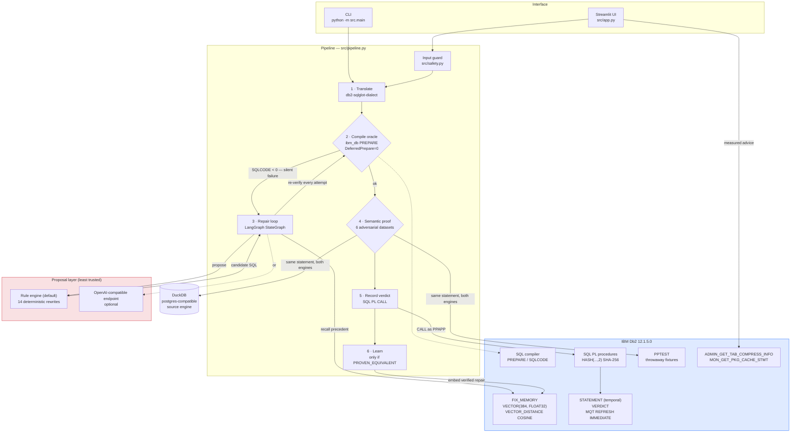

# System Architecture

## Overview

PortProof has one architectural rule, and everything else follows from it:

> **The language model may only propose. Db2 decides.**

The system is a pipeline whose every stage ends in a Db2 verdict. There is no
code path that marks a statement migrated without the engine having said so —
first through `PREPARE` (does it compile?), then through differential execution
(does it mean the same thing?). The LLM sits inside a bounded loop whose only
exits are "Db2 accepted it" and "attempt budget exhausted".

This inverts the usual LLM-tool arrangement. Normally the model is the authority
and the database is storage. Here the database is the authority and the model is
an untrusted string generator.

---

## Architecture Diagram



The red block is the only untrusted component, and it has no edge that reaches
Db2 without passing back through the compile oracle.

---

## Component Breakdown

### 1. Interface layer
- **`src/app.py`** — Streamlit, three tabs matching the three claims:
  *Translate & Prove*, *Semantic Proof*, *Ledger & Engine*. Pasted SQL goes
  through `src/safety.py` before anything else touches it.
- **`src/main.py`** — the CLI used to produce every number in `README.md`.

### 2. Translation
- **`src/translate.py`** wraps IBM's `db2-sqlglot-dialect` with
  `ErrorLevel.RAISE`, so a translator that *does* complain is distinguished from
  one that silently emits invalid SQL. On this corpus it never complains, which
  is the project's premise and is asserted as a test.

### 3. The compile oracle — `src/db.py::compile_check`
- Calls `ibm_db.prepare()` and **never executes**. Returns `CompileResult(ok,
  sqlcode, sqlstate, message)` with the SQLCODE parsed out of the diagnostic.
- Depends on `DeferredPrepare=0` in the DSN. With the CLI default, `PREPARE` is
  held on the client until execution and this function reports success for SQL
  the server would reject — which would make every verdict in the system
  meaningless. Asserted by `test_prepare_is_a_real_server_side_compile`.
- Name resolution is established by `ensure_fixture_schema()`, which sets
  `CURRENT SCHEMA` in the same call that guarantees the tables exist, so
  unqualified corpus SQL (`FROM orders`) resolves the way the application would
  write it.

### 4. The repair loop — `src/repair.py`
A LangGraph `StateGraph`:

```
          ┌──────────────────────────────────┐
          ▼                                  │
      [ prove ] ──ok──▶ END                  │
          │                                  │
       not ok                                │
          ▼                                  │
      [ recall ]  ◀── Db2 VECTOR_DISTANCE    │
          ▼                                  │
      [ repair ]  ◀── rule engine or LLM     │
          └──────────────────────────────────┘
                 (bounded attempt budget)
```

- `recall` grounds the prompt in past repairs **Db2 has already verified**.
- `repair` produces a candidate; `clean_sql` strips prose and code fences.
- `prove` re-submits it to Db2. The router exits only on `ok` or on exhausting
  the budget. Attempt 0 is the translator's own output, before any repair ran.

### 5. The semantic prover — `src/counterexample.py`
- `SourceEngine` is a Protocol; `DuckDbSource` is the PostgreSQL-compatible
  implementation and `Db2Target` is the Db2 side, both loading the *same* six
  `Variant` datasets from `src/corpus.py`.
- `canon_value` / `canon_rows` canonicalise before comparing. This is where
  correctness actually lives: `ibm_db` returns a `DECIMAL` as the string
  `'50.00'` while DuckDB returns `Decimal('50.00')`, and `Decimal.normalize()`
  renders that as `5E+1`. Both artefacts produced **false** PROVEN DIFFERENT
  verdicts during development; both are now fixed and pinned by tests.
- Ordered comparison only when the statement has `ORDER BY`; otherwise rows are
  compared as a multiset and the verdict carries a note saying so.
- A disagreement is returned as an `InstanceResult` **witness** — dataset name,
  what it stresses, and both result sets — so the verdict can be checked.

### 6. The ledger — `sql/01_schema.sql`, `sql/02_procedures.sql`
- Writes go only through SQL PL procedures called by `PPAPP`, which holds no
  `INSERT` on any table.
- `RECORD_VERDICT` computes the certificate **inside the engine**:
  `LOWER(HEX(HASH(... , 2)))` over the verdict's own fields plus
  `CURRENT TIMESTAMP`. The application cannot choose it.

---

## Data Flow

1. **Input.** A corpus statement, or SQL pasted into the UI and passed through
   `check_read_only` (single statement, read-only, comments and literals
   stripped before checking).
2. **Translate.** IBM's dialect emits Db2 SQL, usually without complaint.
3. **Compile.** Db2 `PREPARE`. A failure here on cleanly-translated SQL is what
   PortProof calls a *silent failure*: 13 of 32 on this corpus.
4. **Recall.** The failure text and SQLCODE are embedded locally and matched
   against `FIX_MEMORY` with `VECTOR_DISTANCE(..., COSINE)`, filtered by source
   dialect with `JSON_VALUE` — one statement, both halves evaluated in Db2.
5. **Repair and re-prove.** Bounded, and every attempt goes back to the engine.
6. **Execute both.** Source statement on DuckDB, Db2 statement on Db2, over six
   adversarial datasets; canonicalise; compare.
7. **Record.** `CALL PORTPROOF.RECORD_TRANSLATION` then
   `CALL PORTPROOF.RECORD_VERDICT` as `PPAPP`. The MQT refreshes itself in the
   same transaction; the temporal table preserves the previous row.
8. **Learn.** Only a repair that compiled *and* proved equivalent is embedded
   back into `FIX_MEMORY`.

---

## IBM Db2 Schema & Storage Design

The full, runnable DDL is `sql/01_schema.sql`; this is that file, abridged only
by its `DROP` statements.

```sql
-- The migration unit. System-versioned: every change to a statement's state is
-- kept by the engine, so the whole migration is replayable with
-- FOR SYSTEM_TIME AS OF.
CREATE TABLE PORTPROOF.STATEMENT (
  STMT_ID       INTEGER       NOT NULL GENERATED ALWAYS AS IDENTITY,
  CASE_NAME     VARCHAR(80)   NOT NULL,
  SRC_DIALECT   VARCHAR(16)   NOT NULL,
  SRC_SQL       VARCHAR(4000) NOT NULL,
  DB2_SQL       VARCHAR(4000),
  STATUS        VARCHAR(24)   NOT NULL,
  ATTEMPTS      SMALLINT      NOT NULL DEFAULT 0,
  LAST_SQLCODE  INTEGER,
  LAST_ERROR    VARCHAR(1200),
  META          VARCHAR(2000),
  SYS_START     TIMESTAMP(12) NOT NULL GENERATED ALWAYS AS ROW BEGIN,
  SYS_END       TIMESTAMP(12) NOT NULL GENERATED ALWAYS AS ROW END,
  TRANS_ID      TIMESTAMP(12) GENERATED ALWAYS AS TRANSACTION START ID,
  PERIOD SYSTEM_TIME (SYS_START, SYS_END),
  CONSTRAINT PK_STATEMENT PRIMARY KEY (STMT_ID),
  CONSTRAINT UQ_STATEMENT_CASE UNIQUE (CASE_NAME),
  CONSTRAINT CK_ST_DIALECT CHECK (SRC_DIALECT IN ('postgres', 'mysql')),
  CONSTRAINT CK_ST_ATTEMPTS CHECK (ATTEMPTS BETWEEN 0 AND 10),
  CONSTRAINT CK_ST_STATUS CHECK (STATUS IN (
    'TRANSLATE_FAIL', 'COMPILE_FAIL', 'COMPILES', 'REPAIRED',
    'PROVEN_EQUIVALENT', 'PROVEN_DIFFERENT', 'ESCALATED'))
);

CREATE TABLE PORTPROOF.STATEMENT_HIST LIKE PORTPROOF.STATEMENT;

ALTER TABLE PORTPROOF.STATEMENT
  ADD VERSIONING USE HISTORY TABLE PORTPROOF.STATEMENT_HIST;

-- Proof records. One row per verdict Db2 itself produced.
CREATE TABLE PORTPROOF.VERDICT (
  VERDICT_ID  INTEGER       NOT NULL GENERATED ALWAYS AS IDENTITY,
  STMT_ID     INTEGER       NOT NULL,
  KIND        VARCHAR(16)   NOT NULL,
  OUTCOME     VARCHAR(24)   NOT NULL,
  INSTANCES   SMALLINT      NOT NULL DEFAULT 0,
  DETAIL      VARCHAR(8000),
  CERT_SHA    VARCHAR(64),          -- HASH(..., 2), computed by Db2
  CREATED_AT  TIMESTAMP     NOT NULL DEFAULT CURRENT TIMESTAMP,
  CONSTRAINT PK_VERDICT PRIMARY KEY (VERDICT_ID),
  CONSTRAINT FK_VERDICT_STMT FOREIGN KEY (STMT_ID)
    REFERENCES PORTPROOF.STATEMENT (STMT_ID) ON DELETE CASCADE,
  CONSTRAINT CK_VD_KIND CHECK (KIND IN ('COMPILE', 'SEMANTIC', 'PHYSICAL')),
  CONSTRAINT CK_VD_OUTCOME CHECK (OUTCOME IN (
    'PASS', 'FAIL', 'EQUIVALENT', 'DIFFERENT', 'INCONCLUSIVE', 'ADVICE')),
  CONSTRAINT CK_VD_INSTANCES CHECK (INSTANCES >= 0)
);

CREATE INDEX PORTPROOF.IX_VERDICT_STMT ON PORTPROOF.VERDICT (STMT_ID, KIND);

-- Failure rollup, maintained by the engine on every insert.
-- Note: "LAST_SQLCODE IS NOT NULL" would also match 0, i.e. a *successful*
-- compile, so the failure rollup would have counted successes as failures.
CREATE TABLE PORTPROOF.MQT_FAILURE_BY_CODE AS (
  SELECT SRC_DIALECT, LAST_SQLCODE, COUNT(*) AS N
  FROM PORTPROOF.STATEMENT
  WHERE LAST_SQLCODE < 0
  GROUP BY SRC_DIALECT, LAST_SQLCODE
) DATA INITIALLY DEFERRED REFRESH IMMEDIATE MAINTAINED BY SYSTEM;

-- Expression-based index, so case-insensitive case-name lookups are indexed.
-- Note (measured on CE 12.1.5): COLLATION_KEY_BIT works in a *predicate* but is
-- rejected as an index key expression (SQL0356N reason 23), so the indexable
-- form is UPPER(). PortProof emits the collation-key form for comparison
-- semantics and this form when an index is needed.
CREATE INDEX PORTPROOF.IX_STMT_CASEFOLD
  ON PORTPROOF.STATEMENT (UPPER(CASE_NAME));

-- The fix memory, created by langchain-db2's DB2VS.
--   ID CHARACTER(16), TEXT CLOB, METADATA BLOB, EMBEDDING VECTOR(384)
-- Hybrid recall: semantic ranking and relational filter in one statement.
SELECT JSON_VALUE(METADATA, '$.fixed_sql' RETURNING VARCHAR(4000)),
       VECTOR_DISTANCE(EMBEDDING, VECTOR(?, 384, FLOAT32), COSINE) AS DIST
  FROM FIX_MEMORY
 WHERE JSON_VALUE(METADATA, '$.dialect' RETURNING VARCHAR(16)) = ?
 ORDER BY DIST
 FETCH FIRST 3 ROWS ONLY;
```

---

## Security & Secrets Management

- Credentials are read at runtime from environment variables
  (`src/config.py`). Only `.env.example` is committed, with placeholders.
- **Two identities, separated by Db2 itself**, not by application convention:

  | | `PPOWN` | `PPAPP` |
  |---|---|---|
  | purpose | owns the schema | what the app runs as |
  | authorities | `CONNECT`, `CREATETAB`, `IMPLICIT_SCHEMA`, `WLMADM` | `CONNECT` |
  | ledger tables | owner | `SELECT` only |
  | procedures | owner | `EXECUTE` on three |
  | writes | via DDL | **none** — `INSERT` raises `-551` |
  | DBADM | **no** | **no** |

- Every stored value is bound as a parameter marker. The one thing that cannot
  be — the statement under test — is validated by `src/safety.py` and then only
  ever `PREPARE`d.
- Semantic proofs execute in the disposable `PPTEST` schema.
- A WLM service class, workload and thresholds (`sql/04_wlm_leash.sql`) cap what
  the prover's own queries may consume.
- `GRANT EXECUTE` on the two monitoring routines is scoped to exactly those two
  specific signatures rather than granting DBADM, which is what most
  documentation suggests.
