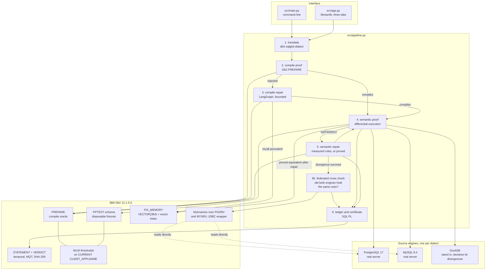

# System Architecture

## Overview

PortProof has one architectural rule, and everything else follows from it:

> **The model may only propose. Db2 decides.**

The system is a pipeline where every stage ends in a Db2 verdict. There is no
code path that marks a statement migrated without the engine having said so,
first through `PREPARE` (does it compile?) and then through differential
execution (does it mean the same thing?). The repair loops sit inside bounded
state machines whose only exits are "Db2 accepted it" and "the attempt budget
is spent".

This inverts the usual arrangement between a model and a tool. Normally the
model is the authority and the database is storage. Here the database is the
authority and the model is an untrusted string generator.

---

## Architecture Diagram



---

## The five stages, and what each one is not allowed to do

### 1. Translate, `src/translate.py`

Wraps IBM's `db2-sqlglot-dialect`. It records whether the translator raised, and
nothing else. It is not allowed to judge its own output, which is the point of
the next stage.

### 2. Compile proof, `src/db.py`

`compile_check()` sends the candidate to Db2 as a `PREPARE`. Db2 parses it,
resolves every name against the live catalog, and type checks it, without
executing anything. The returned `CompileResult` carries Db2's own SQLCODE and
SQLSTATE.

`DeferredPrepare=0` in the connection string is load bearing. With the Db2 CLI
default, `PREPARE` is held back on the client until execution, so
`ibm_db.prepare()` reports success for SQL the server would reject. Measured on
12.1.5. Without that flag the compile oracle is measuring the client library.

A statement that translated cleanly and is rejected here is a **silent failure**.
Fourteen of the 38 corpus statements are.

### 3. Compile repair, `src/repair.py` and `src/llm.py`

A LangGraph state machine:

```
prove -> (ok) -> END
prove -> (fail) -> recall -> repair -> prove -> ...
```

It exits on success or at `MAX_REPAIR_ATTEMPTS`. Every transition is recorded
with the rules that fired and how many precedents were recalled.

Two guards on the proposal, before it reaches the connection:

- `src/safety.py` requires a single read only query. `PREPARE` alone is not
  sufficient, because `DROP TABLE orders` prepares perfectly well, and the
  prompt carries attacker influenced text (the source SQL, and Db2's error
  message) into a generative model.
- Db2's `PREPARE` is the acceptance test. A repair Db2 rejects is discarded.

The default repair engine is `RuleRepairLLM`, fifteen deterministic rewrites
each derived from a real SQLCODE on a real Db2, exposed through the LangChain
`LLM` interface so the pipeline cannot tell it from a model. `LLM_PROVIDER=http`
substitutes any OpenAI compatible endpoint through the same chain and the same
guards.

### 4. Semantic proof, `src/counterexample.py`

The original statement runs on the source engine, the translated statement runs
on Db2, both over the six adversarial datasets in `src/corpus.py`, and the
results are compared.

What is compared, and why each part is needed:

- **Values, canonicalised.** `Decimal('50.00')` and `50.0` are the same datum in
  different clothes. `canon_value` folds driver artefacts out so they cannot
  become verdicts. It once used `Decimal.normalize()`, which returns `5E+1` for
  `50.00`, and that alone produced four false `PROVEN DIFFERENT` results.
- **Column arity and names.** Without arity, a two column result and a seven
  column result compare equal whenever both return no rows. Generated names for
  unaliased expressions are excluded, because engines spell those differently
  and comparing them would measure the drivers.
- **Row order, only when the statement asked for it.** `has_outer_order_by`
  tracks parenthesis depth after stripping comments and literals, so
  `OVER (ORDER BY ...)`, a subquery's ordering and an ordered set aggregate's
  ordering are all correctly treated as saying nothing about the result's order.
  Matching the bare words made PortProof report engine dependent tie order as a
  semantic difference.

Three refusals, each one a bug PortProof used to have:

| Guard | The wrong answer it prevents |
|---|---|
| Dialect guard | A PostgreSQL compatible engine judging MySQL SQL. Both returned nothing for a case insensitive comparison, nothing matched nothing, and a real divergence was certified `EQUIVALENT`. |
| Declared divergences | DuckDB answering for PostgreSQL where it is known to differ. DuckDB says `7 / 2` is 3.5; PostgreSQL and Db2 both say 3, so the verdict was a false `PROVEN DIFFERENT`. |
| Vacuity and strength | `[] == []` counting as evidence. Now a `VACUOUS` outcome, and `EQUIVALENT` carries a strength computed from instances that returned rows over genuinely distinct inputs. |

And one probe, which is the novel piece. Before reporting `PROVEN DIFFERENT` on
an ordered statement, the same statement is re run on the same engine against
the same rows inserted in the opposite order. A table is a set; no correct query
can notice. If the engine returns something else, the `ORDER BY` has ties, the
result was never determined by the SQL, and Db2 disagreeing is not a migration
bug. That distinction cannot be made by reading the SQL, because `ORDER BY name`
is unstable or not depending entirely on the data, so the engine is asked rather
than the parser.

### 5. Semantic repair, `src/semantic_repair.py`

Db2 volunteers a signal when it rejects a statement. Nothing volunteers one when
a statement is accepted and wrong, so this loop builds its own: the acceptance
test is the differential proof that found the divergence.

```
DIFFERENT -> rewrite (dialect scoped rule) -> PREPARE -> prove again
```

A candidate is accepted only when the proof comes back `EQUIVALENT` with a
strength above `NONE`, or when every remaining disagreement is order unstable,
which means the rewrite fixed everything the statement's own SQL determines.
The rules are scoped to one dialect each, because a rule that fixes case
sensitivity firing on a PostgreSQL statement would introduce the exact class of
bug this file exists to remove.

### 5b. Federated cross check, `src/federation.py`

A divergence that survives repair raises a question the Python side cannot
answer. The prover has seen two answers and nothing else. If those answers
differ, the cause is either the query meaning something different, which is the
bug PortProof hunts, or the fixture loader having put slightly different data
into the two engines, which is a bug in the harness and not evidence about the
translation at all. A `TIMESTAMP` that lost its fractional seconds on the way
into Db2 produces exactly the same visible symptom as a mistranslated
`GROUP BY`.

Db2 federation settles it. With a `JDBC` wrapper, a `POSTGRESQL` server, a
`MYSQL` server and a nickname per table, one Db2 statement reads both copies of
the data and computes the symmetric difference:

```sql
WITH SRC AS (SELECT CAST("id" AS INTEGER) AS ID, ... FROM DB2INST1.PG_ORDERS),
     TGT AS (SELECT ID, ... FROM PPTEST.ORDERS),
     ONLY_SRC AS (SELECT * FROM SRC EXCEPT ALL SELECT * FROM TGT),
     ONLY_TGT AS (SELECT * FROM TGT EXCEPT ALL SELECT * FROM SRC)
SELECT (SELECT COUNT(*) FROM ONLY_SRC), (SELECT COUNT(*) FROM ONLY_TGT)
  FROM SYSIBM.SYSDUMMY1
```

`EXCEPT ALL` rather than `EXCEPT`, so a duplicated row on one side counts as a
difference instead of being hidden by set semantics. The remote column is cast
to the *local* column's type, because Db2 gives a nickname whatever type its own
mapping produces and `EXCEPT ALL` refuses mismatched types with SQL0415N. Where
no cast exists, which happens for a MySQL `BOOLEAN` arriving as BINARY, the
column is left out and named in the output, because a partial check that reads
as complete is worse than none.

Three properties keep this honest. It only runs when a divergence survived, so
it costs nothing on the happy path. It returns `UNAVAILABLE` rather than
anything resembling a pass when no nickname exists, which is the state of any
checkout that has not run `scripts/create_federation.sh`. And the Db2 identities
are mapped to remote accounts holding `SELECT` and nothing else, minted by the
setup script with a password it never writes to disk, because a user mapping
stores a remote credential inside the Db2 catalogue.

### 6. Ledger and certificate, `sql/02_procedures.sql`

The runtime identity holds no `INSERT` on any table. It can only `CALL`:

- `RECORD_TRANSLATION`, a `MERGE` upsert keyed on the case name. It was a
  `SELECT` then `IF`/`INSERT` or `ELSE`/`UPDATE`, which is a read then write
  race: two concurrent runs of the same case both read NULL, both insert, and
  the second fails on the unique constraint instead of updating.
- `RECORD_VERDICT`, which computes `HASH(..., 2)`, a SHA-256, over the verdict's
  own fields inside the engine. What is hashed is the evidence, not the
  conclusion. Before that, a vacuous proof and a substantive one hashed
  identically, so the certificate attested to a claim rather than to its
  grounds.
- `ESCALATE_STALLED`, a cursor loop with an explicit
  `CONTINUE HANDLER FOR NOT FOUND` that marks statements which spent their
  budget without a proof, and writes the reason into the row.

---

## Module map

| File | Responsibility |
|---|---|
| `src/config.py` | Environment only. No secret is hard coded. Builds the DSN with `DeferredPrepare=0`. |
| `src/db.py` | Db2 access. Every value bound. `compile_check` is the oracle; `fetch_described` also returns column names and wraps fetch time errors so a WLM threshold arrives as a `Db2Error` with its SQLCODE. |
| `src/translate.py` | IBM's translator, and whether it raised. |
| `src/safety.py` | The read only guard applied to anything a human or a model supplies. |
| `src/corpus.py` | The 38 statements, the shared fixture DDL, and the six adversarial datasets. `Variant.shuffled()` feeds the stability probe. |
| `src/counterexample.py` | The source engines, the canonicalisation, the verdict and its strength. |
| `src/semantic_repair.py` | The five measured rewrite rules and the loop that re proves them. |
| `src/federation.py` | The federated cross check: nicknames, the cast reconciliation, and Db2's own symmetric difference over the two copies of the data. |
| `src/repair.py` | The LangGraph compile repair state machine. |
| `src/llm.py` | `RuleRepairLLM` (the default) and `HttpRepairLLM`, both as LangChain models. |
| `src/embeddings.py` | Local sentence transformer embeddings, plus a deterministic fallback for tests. |
| `src/fixmemory.py` | Db2 as the vector store, through `langchain-db2` `DB2VS`, with the Db2 native hybrid recall and the vector index. |
| `src/physical.py` | Compression, columnar and package cache measurements, taken from the engine. |
| `src/pipeline.py` | Wires all of it together and writes the ledger. |
| `src/setup_db.py` | Idempotent installer for the schema, procedures, grants, MQT, vector store and WLM leash. |
| `src/main.py` | The command line. |
| `src/app.py` | The Streamlit UI. |

---

## Why Db2 and not a generic database

Every one of these is doing work that would otherwise have to be re implemented
less reliably in Python.

| Db2 capability | What it replaces |
|---|---|
| `PREPARE` with `DeferredPrepare=0` | A SQL parser and type checker for Db2's own dialect, maintained by us, always slightly wrong. |
| `HASH(..., 2)` in SQL PL | An application computed certificate, which the application could choose. |
| `PERIOD SYSTEM_TIME` and `FOR SYSTEM_TIME AS OF` | An audit table and triggers, and a trust assumption that nobody edited the ledger. |
| MQT `REFRESH IMMEDIATE` | A rollup query recomputed on every read, or a cache that goes stale. |
| `VECTOR` plus `VECTOR_DISTANCE` plus `CREATE VECTOR INDEX` | A separate vector service, and a second consistency problem. |
| Vector and relational filter in one statement | Top k retrieval followed by a filter, which loses recall exactly when the filter is selective. |
| `COLLATION_KEY_BIT` at UCA strength 1 and 3 | Re implementing MySQL and PostgreSQL collation in application code. |
| WLM thresholds | A timeout in the client, which cannot stop work already running in the engine. |
| `GRANT` and `CHECK` constraints | Privilege and validity as application conventions rather than as engine rules. |
| `ADMIN_GET_TAB_COMPRESS_INFO`, `MON_GET_PKG_CACHE_STMT` | Guessed physical design advice. |
| Federation: JDBC wrapper, nicknames, `EXCEPT ALL` across engines | Two result sets compared in Python, which can tell you the answers differ but never whether the inputs did. |

---

## Data flow for one statement

```
corpus statement (PostgreSQL or MySQL)
   |
   v  db2-sqlglot-dialect
candidate Db2 SQL
   |
   v  Db2 PREPARE                      <-- silent failures are caught here
compiles? ---- no ----> safety check -> recall from FIX_MEMORY -> rewrite -> back to PREPARE
   | yes                                   (bounded, at most MAX_REPAIR_ATTEMPTS)
   v
load six adversarial datasets into the source engine and into PPTEST
   |
   v  run both, compare values, columns and (where asserted) order
agree? ---- no ----> stability probe -> semantic rule -> PREPARE -> prove again
   | yes                                   (accepted only if the proof agrees)
   v
EQUIVALENT with a strength, or DIFFERENT with a witness,
or UNSTABLE, or VACUOUS, or INCONCLUSIVE with a reason
   |
   v  CALL RECORD_TRANSLATION, CALL RECORD_VERDICT
ledger row + SHA-256 certificate over the evidence
   |
   v  only if repaired AND proved equivalent
embedded into FIX_MEMORY for the next run
```
