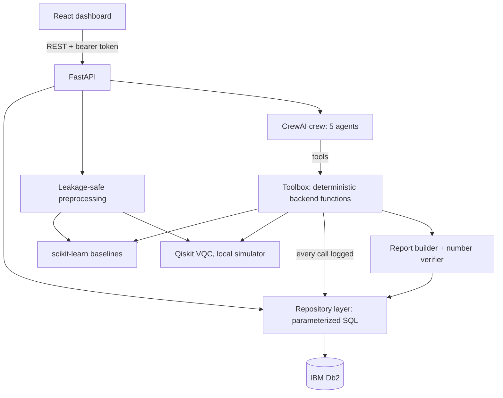

# QuantumMedX architecture

QuantumMedX lets a researcher upload a healthcare CSV, run classical and quantum classifiers on identical splits, and have five CrewAI agents audit the data, run the experiments and write a report. IBM Db2 is the system of record for everything the workflow produces.

## Components
| Component | Responsibility | Where |
|---|---|---|
| React frontend | Auth, datasets, experiments, agent timeline, reports | `frontend/src` |
| FastAPI app | Routes, validation, auth, ownership checks, background jobs | `backend/app/main.py` |
| Db2 layer | Pool, transactions, health check | `backend/app/database/db2.py` |
| Repository | All SQL, one place | `backend/app/repositories/db2_repo.py` |
| ML core | Analysis, preprocessing, classical models, metrics, VQC | `backend/app/ml` |
| Agents | Toolbox (logged tools), CrewAI crew, pipeline, report, verifier | `backend/app/agents` |

## Data flow for an agent run
1. `POST /api/agents/run` checks ownership, creates an `AGENT_RUNS` row and starts a background job.
2. Each agent calls one Toolbox method. The Toolbox runs deterministic code (data audit, correlations, model training) and writes an `AGENT_ACTIVITIES` row for every call.
3. Classical and quantum experiments are saved to `EXPERIMENTS` and `MODEL_RESULTS`.
4. The research agent reads results back from Db2 and writes a short comparison.
5. The report builder assembles tables from Db2, appends the narrative with its source label (CrewAI model or backend template) and checks each number in the narrative against stored values. Unmatched numbers set the report status to `NEEDS_REVIEW` and are listed in the report.
6. The report is saved to `RESEARCH_REPORTS` and the run is marked completed or failed.

If an LLM agent skips a step, the pipeline runs that step itself (also logged), so every report is complete.

## Db2 integration
Ten tables with identity keys, foreign keys, check constraints and indexes (`database/schema/001_schema.sql`). Writes that span tables (dataset plus metadata, experiment plus results) run in one transaction. The health endpoint performs a real query and returns HTTP 503 when Db2 is not configured or reachable.

## Security boundaries
- Passwords hashed with PBKDF2; tokens are signed and expire; failed logins are rate limited.
- Every dataset, run and report is checked against its owner; other users receive 404.
- Uploads: extension, size and parse checks; files stored under random names; deletion refuses paths outside the storage folder.
- Only aggregate statistics reach an LLM. Raw rows never do.
- Secrets live in `.env` (git-ignored); `.env.example` has placeholders only.

## What is and is not verified
See `docs/TESTING.md`.
