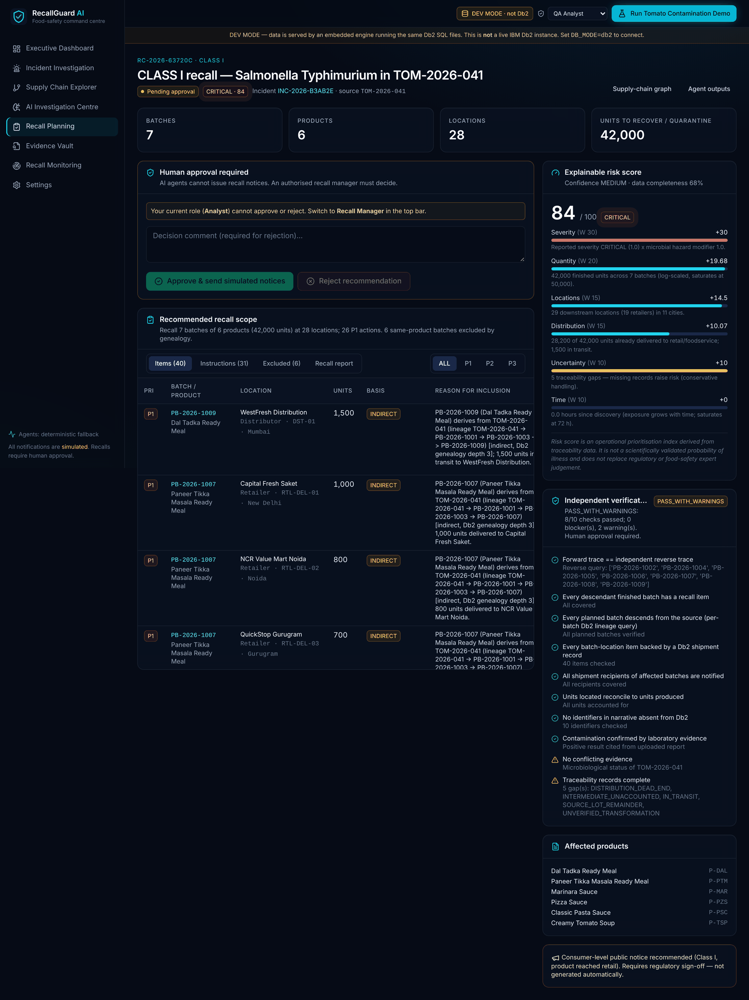
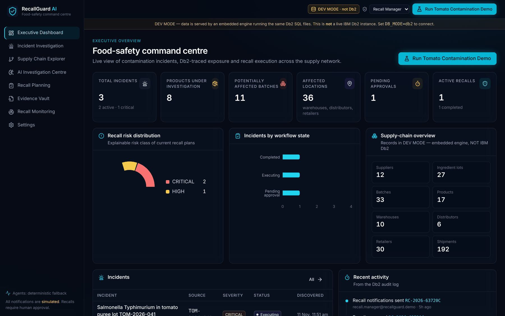
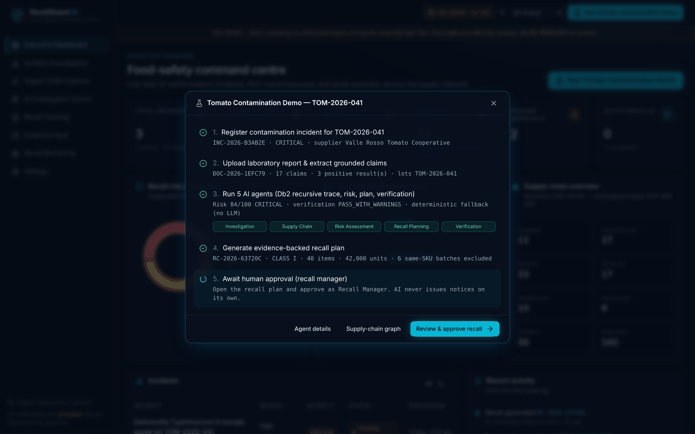
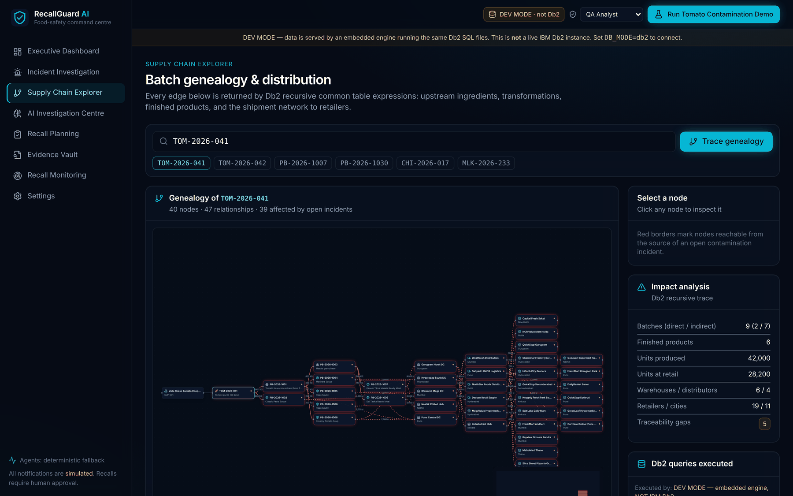
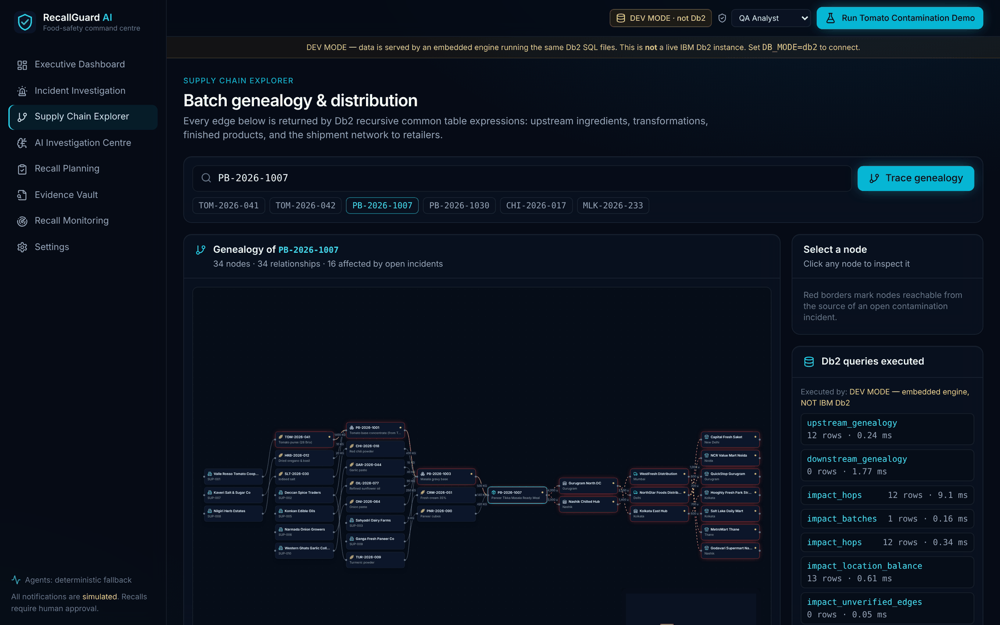
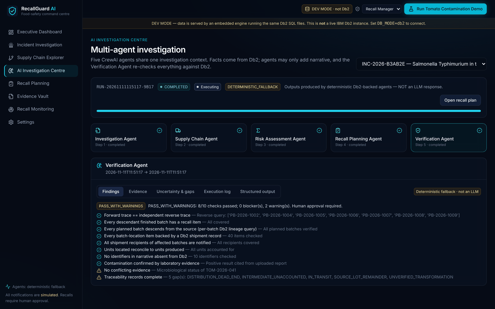
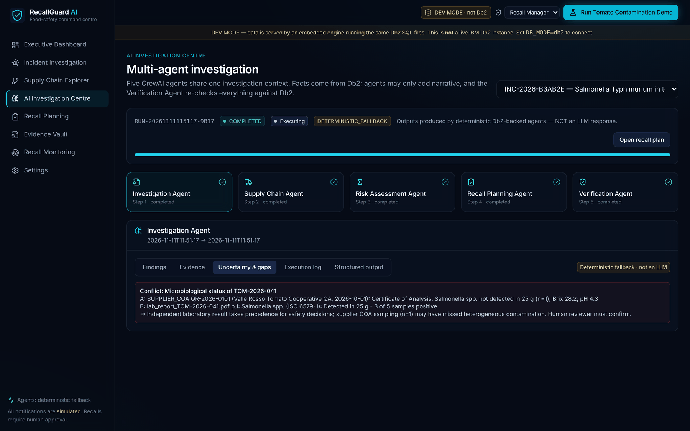
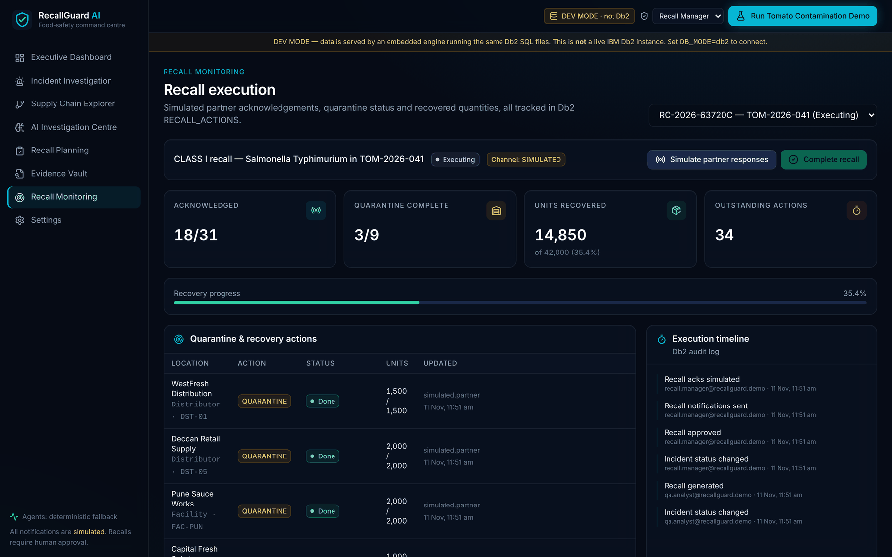
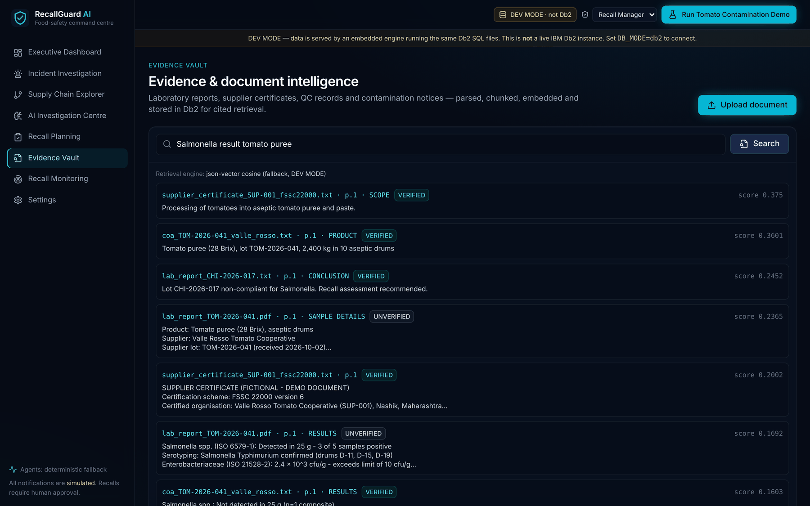

# RecallGuard AI — IBM Db2 Powered Intelligent Food Recall Platform

> **One-Line Pitch:** When a lab finds contamination in one ingredient lot, RecallGuard AI uses IBM Db2 recursive SQL to trace it through every production batch, warehouse, distributor and retailer. Five CrewAI agents then turn that trace into a verified, evidence-backed, *targeted* recall plan that a human recall manager approves.

> *Don't just detect contamination. Identify exactly what needs to be recalled, where, why, and what evidence supports the decision.*



---

## Table of Contents
- [Problem Statement](#problem-statement)
- [Solution Overview](#solution-overview)
- [IBM Db2 Integration](#ibm-db2-integration)
- [AI / LLM Architecture (if applicable)](#ai--llm-architecture-if-applicable)
- [Tech Stack](#tech-stack)
- [Prerequisites](#prerequisites)
- [Setup & Installation](#setup--installation)
- [Configuration](#configuration)
- [Running the Project](#running-the-project)
- [Testing & Verification](#testing--verification)
- [Screenshots & Demo](#screenshots--demo)
- [Known Limitations & Future Roadmap](#known-limitations--future-roadmap)
- [Team Members & Credits](#team-members--credits)

---

## Problem Statement
- **The problem.** One contaminated ingredient lot can flow into dozens of production batches across several plants. From there it reaches hundreds of stores through warehouses and distributors. When a lab reports contamination, the company must answer within hours: *which exact batches, at which exact locations, and why?*
- **Target users.** Food-manufacturer QA and recall teams, supply-chain managers, and the food-safety regulators who audit their decisions.
- **Why existing tooling falls short.** Traceability usually lives in disconnected ERP exports, spreadsheets and e-mails. That leads to:
  - **slow recalls**, while consumers keep buying affected product;
  - **incomplete recalls**, because indirect paths (ingredient → intermediate → ready meal) are missed;
  - **over-broad recalls**, because whole SKUs are destroyed when nobody can prove which batches are clean;
  - **weak audit trails**, because no one can show why each item was included.

---

## Solution Overview
RecallGuard AI is a database-driven food-safety command centre. Its workflow:

| Step | What happens | Where |
|---|---|---|
| 1. Register | The incident is recorded against a lot or batch that must exist in Db2 (no orphans) | `CONTAMINATION_INCIDENTS` |
| 2. Ground | The lab report is parsed. Every claim is stored with its document, page and section | `EVIDENCE_DOCUMENTS`, `EVIDENCE_CHUNKS` |
| 3. Trace | **Db2 recursive CTEs** walk ingredient → intermediate → finished batch → shipment → warehouse → distributor → retailer | `db/queries/traceability.sql` |
| 4. Assess | An explainable 0–100 risk score is built from 6 weighted factors. Missing records *raise* risk | `app/services/risk.py` |
| 5. Plan | A batch-by-location recall plan with priority, quantity, reason and evidence references | `RECALL_CAMPAIGNS`, `RECALL_AFFECTED_ITEMS` |
| 6. Verify | An independent agent re-checks the plan using *different* Db2 queries | `verify_*` queries |
| 7. Approve | Only a Recall Manager can approve or reject. AI never issues notices | role-checked API + `AUDIT_LOGS` |
| 8. Execute | Simulated notices, acknowledgements, quarantine and recovery tracking | `RECALL_ACTIONS` |

**Core features**
- **Db2-native genealogy:** upstream, downstream and multi-hop distribution tracing, each as one recursive SQL statement.
- **Targeted recall:** batches of the same product made from clean lots are explicitly *excluded*, with the reason given.
- **Conservative uncertainty handling:** unverified records, unaccounted quantities, distributor dead-ends and in-transit stock are all surfaced. None of them is ever treated as "safe".
- **Five CrewAI agents** that exchange structured Pydantic outputs. Each run is stored in Db2 with a visible execution log.
- **Evidence Vault:** grounded extraction, cited retrieval, and a verification status for each document.
- **Human-in-the-loop:** a 9-state workflow, role-aware approval, comments, re-investigation, and a complete audit trail.
- **One-click "Run Tomato Contamination Demo"**, which drives the real API end to end.
- **Dashboard:** responsive enterprise UI with a React Flow supply-chain graph and Recharts analytics.

Architecture details: [`architecture.md`](architecture.md) · [`docs/ARCHITECTURE.md`](docs/ARCHITECTURE.md)

---

## IBM Db2 Integration
- **Db2 Edition & Environment:** Db2 Community Edition on Docker (`docker-compose.yml`) or Db2 on IBM Cloud (`DB2_SECURITY=SSL`). Vector retrieval needs Db2 12.1.2+.
- **Connector / Driver Used:**
  - `ibm_db` / `ibm_db_dbi` for all reads and writes, with parameter markers only;
  - **CrewAI** agents whose tools query Db2;
  - **langchain-db2** (`DB2VS`) for vector search with `VECTOR_DISTANCE`.
- **Database Schema / Data Models** ([`docs/DATABASE_SCHEMA.md`](docs/DATABASE_SCHEMA.md)):
  - **23 normalised tables:**
    - traceability: suppliers, ingredients, lots, facilities, batches, transformations, products, warehouses, distributors, retailers, shipments, shipment items, quality reports;
    - incidents: incidents, affected lots, comments;
    - recall: campaigns, items, actions;
    - AI & audit: agent investigations, audit logs;
    - evidence: documents, chunks.
  - **Integrity enforced inside Db2:**
    - `UNIQUE(input_ref, output_batch_id)` blocks duplicate genealogy edges;
    - `CHECK(input_ref <> output_batch_id)` blocks self-loops;
    - polymorphic "lot **or** batch" edges keep one FK per target table plus an exactly-one `CHECK`, so referential integrity is never lost;
    - state `CHECK`s on every status column.
  - **21 indexes**, each backing a named query, plus the `V_LOCATIONS` view.
  - **Agent outputs** (JSON in CLOB), execution logs, recall plans and the audit trail are all persisted in Db2.
- **Key Queries & Operations** ([`src/backend/db/queries/traceability.sql`](src/backend/db/queries/traceability.sql)):
  - `IMPACT_CTES`: **one statement** chaining a recursive *genealogy* CTE into a recursive *distribution-flow* CTE. Each hop carries the same batch and leaves the previous destination on or after its arrival date.
  - `downstream_genealogy` / `upstream_genealogy`: lot ↔ intermediate ↔ finished batch, with supplier joins.
  - `impact_location_balance`: net units held per batch per location (received − forwarded), plus facility stock.
  - `impact_unverified_edges`, `impact_intermediate_balance`, `lot_consumption`: automatic traceability-gap detection.
  - **Independent verification:**
    - `verify_finished_descendants` walks upstream from *every* finished batch and must match the forward trace;
    - `verify_batch_lineage` checks each planned batch on its own;
    - `verify_direct_recipients` cross-checks with a non-recursive join.
  - **Db2 rules followed:**
    - no `RECURSIVE` keyword;
    - every recursive column is `CAST` in both legs (avoids SQL0344N);
    - depth-bounded recursion (avoids SQL0347W);
    - `FETCH FIRST n ROWS ONLY`;
    - multi-step writes run in transactions.

```sql
genealogy (node_ref, depth) AS (
    SELECT CAST(node_ref AS VARCHAR(30)), 1 FROM seeds
    UNION ALL
    SELECT CAST(t.output_batch_id AS VARCHAR(30)), g.depth + 1
    FROM genealogy g JOIN batch_transformations t ON t.input_ref = g.node_ref
    WHERE g.depth < 12)
```

---

## AI / LLM Architecture (if applicable)
- **Framework:** **CrewAI** (Agent / Task / Crew with `output_pydantic`) plus **LangChain** (`langchain-db2` `DB2VS`). Details: [`docs/AI_AGENTS.md`](docs/AI_AGENTS.md).
- **Model Provider & Model:** configured by environment variables: IBM watsonx.ai (Granite), OpenAI, Anthropic, Gemini or local Ollama. With `LLM_PROVIDER=none`, the same pipeline runs in a clearly labelled **deterministic fallback** mode, and its output is never presented as an LLM response.
- **RAG / Tool Calling Workflow:**
  1. **Investigation Agent:** reads the incident, the lab claims (with page citations) and the Db2 quality records. It flags conflicts, such as a supplier certificate that says "not detected" against a lab report with 3 of 5 samples positive.
  2. **Supply Chain Agent:** calls the Db2 tool `db2_trace_impact`, which runs the recursive SQL, and reports affected batches, locations and data gaps.
  3. **Risk Assessment Agent:** explains the transparent 6-factor score: severity, quantity, locations, distribution status, uncertainty, and time since discovery.
  4. **Recall Planning Agent:** builds prioritised batch × location items with reasons, lineage paths, evidence references and retailer instructions.
  5. **Verification Agent:** re-checks the plan against Db2 with independent queries, rejects any identifier not found in Db2, and lists the reasons a human must review.

  **Facts always come from Db2; LLMs only add narrative.** The `evidence_search` tool retrieves cited chunks through langchain-db2 `DB2VS` when Db2 provides the `VECTOR` type.

---

## Tech Stack
- **Backend / Core:** Python 3.11+, FastAPI, Pydantic v2, pydantic-settings
- **Database:** IBM Db2 (`ibm_db` / `ibm_db_dbi`)
- **AI:** CrewAI, LangChain (`langchain-db2`), pypdf
- **Frontend / UI:** React 18, TypeScript, Vite, Tailwind CSS, shadcn/ui-style components, React Flow, Recharts, TanStack Query, React Router, lucide icons
- **Libraries & Tools:** Docker Compose, pytest, Vitest, Testing Library, Playwright (end-to-end check)

---

## Prerequisites
- Docker (for the Db2 Community Edition container), or access to a Db2 instance (Db2 on Cloud works)
- Python ≥ 3.11 with `pip`
- Node.js ≥ 20 with `npm`
- *(Optional)* an LLM API key (watsonx.ai, OpenAI, Anthropic, Gemini) or a local Ollama

---

## Setup & Installation

```bash
# 1. Clone the repository and open the submission
cd submissions/recallguard-ai

# 2. Environment file
cp .env.example .env        # set DB2INST1_PASSWORD and DB2_PASSWORD to the same value

# 3. Backend
cd src/backend
python -m venv .venv
source .venv/bin/activate   # Windows: .venv\Scripts\activate
pip install -r requirements.txt

# 4. Frontend
cd ../frontend
npm ci
```

**Database setup.** On first start, the backend applies `db/migrations/*.sql` in order and tracks them in `SCHEMA_MIGRATIONS`. It then loads `db/seed/seed_data.sql` and replays two historical incidents through the real pipeline, so the dashboard starts with history.

The seed contains 12 suppliers, 27 lots, 33 batches, 17 products, 4 facilities, 10 warehouses, 6 distributors, 30 retailers, 192 shipments, 79 transformations and 3 contamination scenarios. All names are fictional.

---

## Configuration

```bash
cp .env.example .env
```

| Variable | Purpose |
|---|---|
| `DB_MODE` | `db2` (IBM Db2) or `dev`, an offline UI mode that runs the same SQL on an embedded engine and is labelled "DEV MODE — NOT IBM Db2" everywhere |
| `DB2_HOST`, `DB2_PORT`, `DB2_DATABASE`, `DB2_USER`, `DB2_PASSWORD`, `DB2_SECURITY`, `DB2_SCHEMA` | Db2 connection |
| `LLM_PROVIDER`, `LLM_MODEL`, provider key | Agent LLM (`none` = deterministic fallback). watsonx and Ollama route through LiteLLM (`pip install litellm`) |
| `EMBEDDING_PROVIDER`, `EMBEDDING_DIM`, `VECTOR_TABLE` | Evidence retrieval |
| `MAX_UPLOAD_MB`, `REQUIRE_AUTH_HEADERS`, `CORS_ORIGINS` | Security |

> **Security Warning:** Never commit `.env` or any real API keys or database passwords to Git! See [`docs/SECURITY.md`](docs/SECURITY.md).

---

## Running the Project

```bash
# Option A — everything in Docker (Db2 Community Edition + API + UI)
docker compose up --build            # first Db2 start takes several minutes
# UI: http://localhost:5173 · API docs: http://localhost:8000/docs

# Option B — local processes against your Db2
cd src/backend && uvicorn app.main:app --port 8000
cd src/frontend && npm run dev       # proxies /api to :8000
```

Choose a role in the top bar: Viewer, QA Analyst, Recall Manager or Admin. **Approvals require Recall Manager.** The REST API is documented in [`docs/API_DOCUMENTATION.md`](docs/API_DOCUMENTATION.md).

---

## Testing & Verification

```bash
cd src/backend && pytest -q                              # 58 passed, 1 skipped (live-Db2 test)
RG_TEST_DB2=1 DB_MODE=db2 DB2_PASSWORD=... pytest -q     # same suite against IBM Db2
cd src/frontend && npm test                              # 9 passed
```

- **Critical acceptance test:** `TOM-2026-041` must return exactly:
  - 9 batches (7 finished), 6 products, 6 warehouses, 4 distributors and 19 retailers;
  - none of the same-product batches made from clean lots;
  - nothing at all for an unrelated biscuits batch.
- **Verification tests:** inject an unrelated batch, drop a batch, and invent a batch ID. Each fault must be caught.
- **API tests:** cover the complete approve/reject workflow, role enforcement, upload validation and audit logging.

**Quick manual check:** `GET /api/v1/supply-chain/impact/TOM-2026-041`. The header badge must read **IBM Db2 · connected**.

Full executed results: [`docs/TEST_RESULTS.md`](docs/TEST_RESULTS.md).

---

## Screenshots & Demo
- **Live Demo Link:** run locally (see above)
- **Demo Video Link:** *to be added*
- **Demo script:** [`docs/DEMO_GUIDE.md`](docs/DEMO_GUIDE.md). Click **Run Tomato Contamination Demo**:
  1. Incident registered; supplier resolved from Db2.
  2. Lab report parsed: 17 cited claims, 3 positive.
  3. Five agents run. Result: risk **84/100 CRITICAL, Class I**; verification **PASS_WITH_WARNINGS**.
  4. 40 recall items covering 42,000 units; 6 same-product batches excluded.
  5. Recall Manager approval creates 31 simulated retailer notices.

| | |
|---|---|
|  |  |
|  |  |
|  |  |
|  |  |

---

## Known Limitations & Future Roadmap
- **Current Limitations:**
  - The bundled screenshots were captured in DEV MODE (shown by the amber banner). Run against IBM Db2 with `docker compose up` for a Db2-mode capture.
  - langchain-db2 `DB2VS` vector search requires Db2 12.1.2+ with the `VECTOR` type. On older versions it falls back to JSON-stored vectors.
  - Identity is passed in headers (`X-User-Id` / `X-User-Role`) and is ready to be replaced with OIDC/JWT.
  - Recall notifications are simulated by design.
- **Next Steps:**
  - Db2 stored procedures for scheduled re-tracing.
  - Event ingestion from ERP/WMS systems.
  - GS1 EPCIS import.
  - watsonx.ai Granite as the default model.
  - Regulator-ready PDF recall reports.
  - Multi-tenant Db2 schemas.

---

## Team Members & Credits
| Name | GitHub Handle | Role / Contribution |
|---|---|---|
| Sameeksha | [@sam3117n](https://github.com/sam3117n) | Full-stack, Db2 schema & recursive traceability, AI agents, UI |

**Credits / third-party licenses:**
- MIT: FastAPI, CrewAI, langchain-db2, React, React Flow (xyflow), Recharts, Tailwind CSS
- Apache-2.0: ibm_db
- ISC: lucide

All demo companies, products and lab reports are fictional. This project is released under the [MIT License](LICENSE). Contact: sameekshasahani2005@gmail.com
