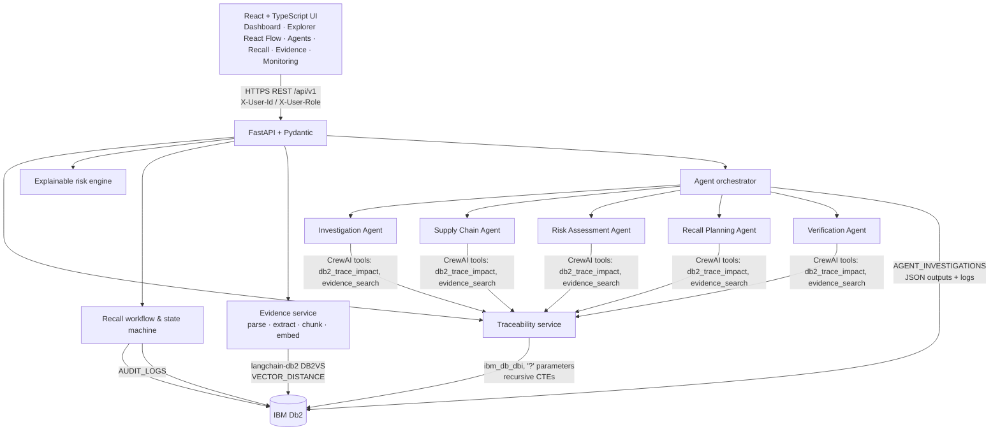

# RecallGuard AI — Architecture

## Overview
A React command-centre UI calls a FastAPI service. The service keeps **all** structured business data in **IBM Db2**, and Db2 also performs the authoritative supply-chain tracing through recursive SQL. Five CrewAI agents reason over facts returned by Db2, while an independent verification step re-checks the recall scope with different Db2 queries. A human Recall Manager approves or rejects every plan. Each state change is appended to a Db2 audit log.

## Architecture Diagram



## Component Breakdown
1. **Client layer:** React 18, Vite, TypeScript, Tailwind, shadcn/ui-style primitives, React Flow (genealogy graph), Recharts, TanStack Query (polling shows live agent progress), and React Router (8 pages).
2. **Backend layer:** FastAPI routes in `app/api/v1/routes.py`, services in `app/services/`, Pydantic request validation, a role dependency (`require("recall:approve")`), typed error handlers (404/409/422/503), and access logging.
3. **Database layer (IBM Db2):** 23 tables, 21 indexes, the `V_LOCATIONS` view, and recursive traceability SQL in `db/queries/traceability.sql`. It is reached through a repository interface (`app/database/base.py`) with `Db2Database` (ibm_db) as its implementation. A clearly labelled dev engine runs the same SQL when no Db2 is available.
4. **AI orchestration:**
   - `app/agents/` holds the five agents. Each one returns structured Pydantic output and shares context with the others.
   - The CrewAI `Agent`/`Task`/`Crew` path is used when an LLM is configured. Otherwise the deterministic fallback runs, and it is labelled as such.
   - Every agent's output and log is persisted in Db2.

## Data Flow
1. **Input ingestion:** `POST /incidents` checks that the lot or batch exists in Db2 before inserting. `POST /evidence/upload` validates type, size and PDF magic bytes. It then extracts claims (with page and section) and stores the document, chunks and vectors in Db2.
2. **Context retrieval:** the Supply Chain Agent executes the `IMPACT_CTES` statements in Db2: a genealogy recursion feeding a distribution recursion, plus per-location balances and gap queries.
3. **Augmentation & inference:** Db2 results are injected as JSON facts into the CrewAI task prompts. The LLM returns only narrative fields (validated by `output_pydantic`).
4. **Verification:** the reverse-direction recursive query, per-batch lineage checks, raw shipment joins, quantity reconciliation and an identifier check against Db2. The output is a verdict plus the reasons a human must review.
5. **State persistence:** the plan is written to `RECALL_CAMPAIGNS` and `RECALL_AFFECTED_ITEMS`. Approval creates `RECALL_ACTIONS` (channel `SIMULATED`), and all transitions go to `AUDIT_LOGS`.
6. **Response delivery:** the UI shows the scope, reasons, evidence references, risk factors and verification results.

## IBM Db2 Schema & Storage Design

```sql
-- Genealogy edge with full referential integrity for "lot OR batch" inputs
CREATE TABLE batch_transformations (
    transformation_id VARCHAR(30) NOT NULL PRIMARY KEY,
    input_kind  VARCHAR(5)  NOT NULL,             -- 'LOT' | 'BATCH'
    input_ref   VARCHAR(30) NOT NULL,             -- single join column for recursion
    input_lot_id   VARCHAR(30) REFERENCES ingredient_lots (lot_id),
    input_batch_id VARCHAR(30) REFERENCES production_batches (batch_id),
    output_batch_id VARCHAR(30) NOT NULL REFERENCES production_batches (batch_id),
    record_status VARCHAR(12) NOT NULL DEFAULT 'VERIFIED',
    CHECK ((input_kind='LOT' AND input_lot_id IS NOT NULL AND input_batch_id IS NULL AND input_ref=input_lot_id)
        OR (input_kind='BATCH' AND input_batch_id IS NOT NULL AND input_lot_id IS NULL AND input_ref=input_batch_id)),
    CHECK (input_ref <> output_batch_id),
    UNIQUE (input_ref, output_batch_id)
);

-- Downstream genealogy (Db2 recursive CTE; CAST in both legs; bounded depth)
WITH genealogy (node_ref, depth) AS (
    SELECT CAST(output_batch_id AS VARCHAR(30)), 1 FROM batch_transformations WHERE input_ref = ?
    UNION ALL
    SELECT CAST(t.output_batch_id AS VARCHAR(30)), g.depth + 1
    FROM genealogy g JOIN batch_transformations t ON t.input_ref = g.node_ref
    WHERE g.depth < 12)
SELECT DISTINCT node_ref FROM genealogy;
```

The full DDL is in `src/backend/db/migrations/`, and every query is documented in `docs/DATABASE_SCHEMA.md`.

## Security & Secrets Management
- All credentials come from environment variables (`.env`, git-ignored). `.env.example` contains placeholders only.
- SQL uses parameter markers only. Uploads are allow-listed (`.pdf`, `.txt`, `.md`, `.csv`), limited to 10 MB, checked for PDF magic bytes, de-duplicated by SHA-256 and stored under sanitised names.
- Role-based permissions: only `recall_manager`/`admin` can approve, reject, execute or verify evidence. Supplier contact details are redacted for other roles.
- AI agents cannot issue notices or mark anything safe. Every plan requires human approval, and all notifications are labelled `SIMULATED`.
