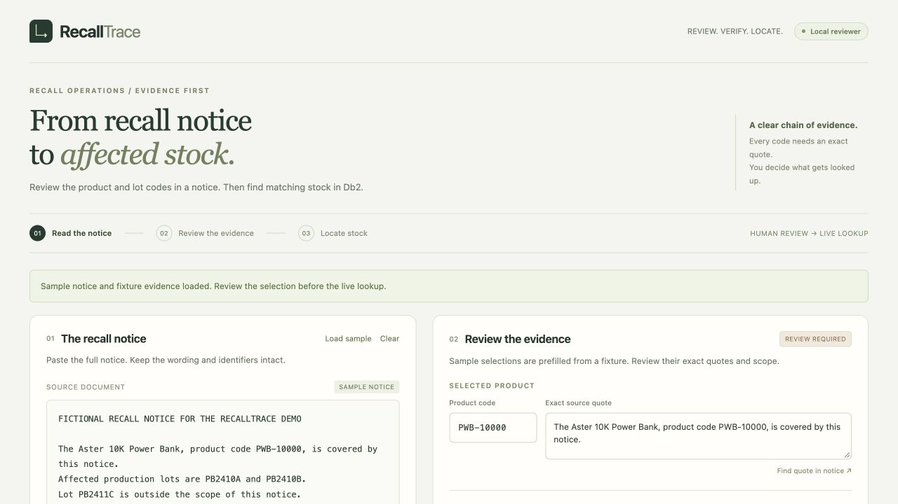

# RecallTrace

RecallTrace turns a product recall notice into a reviewed list of affected stock. A reviewer checks each product and lot code against a quote from the notice, then IBM Db2 returns the matching units and locations.

## Problem Statement

Operations teams need to decide which stock to quarantine when a supplier issues a recall. Notices often arrive as prose and may explicitly exclude similar lots or products. A lookup based on a product name or a lot alone can include the wrong stock. RecallTrace ties the lookup to the exact identifiers a reviewer confirms.

## Solution Overview

Paste a notice, draft candidate identifiers with AI or enter them manually, then review each code and its source quote. The browser highlights the quote in the notice. After confirmation, the app queries Db2 and shows units by location, selected lots with zero matches, and the evidence used. The reviewer can download the trace as JSON.

## IBM Db2 Integration

The recorded demo runs against IBM Db2 Community Edition in Podman, provisioned through the IBM Db2 Developer Extension for VS Code. Python connects through IBM's native `ibm_db` driver.

- `recalltrace_products` stores product codes and names.
- `recalltrace_inventory` stores the quantity for each product, lot and location. A foreign key connects it to the product table.
- A prepared `SELECT` joins the tables and binds the reviewed product and lot codes as parameters. The sample seed creates the tables and inserts the fictional rows. Running it again preserves existing rows.

## AI / LLM Architecture

LangChain prompts IBM Granite 3.3 2B through Ollama's local API and parses its proposed codes and source references. RecallTrace reconstructs quotes from the original notice and checks that each quote contains the complete code. The reviewer confirms scope, then the server performs the lookup. [Architecture and data flow](architecture.md)

## Tech Stack

Python 3, IBM Db2 Community Edition, `ibm_db`, LangChain, IBM Granite, Ollama, and a browser interface built with HTML, CSS, and JavaScript.

## Prerequisites

- Python 3.10–3.14 with `pip` and `venv`.
- VS Code with the IBM Db2 Developer Extension and Podman running. Create a local Db2 Community Edition instance with database `TESTDB` and wait for it to finish starting. [IBM Db2 instance setup](https://ibm.github.io/db2developerextension-about/docs/the-basics/creating-db2-instance.html)
- Ollama for the AI drafting path. [Ollama downloads](https://ollama.com/download)

## Setup & Installation

From the repository root, create the environment and install the demo dependencies.

```sh
cd submissions/recalltrace
python3 -m venv .venv
.venv/bin/python -m pip install -r src/requirements-ai.txt
cp .env.example src/.env
```

Start the Ollama app or run `ollama serve` in a separate terminal if the service needs to be started. Then download the demo model.

```sh
ollama pull granite3.3:2b
```

## Configuration

Edit `src/.env` with these settings for the local instance.

| Setting | Local value |
| --- | --- |
| `DB2_HOST` | `127.0.0.1` |
| `DB2_PORT` | `50000` |
| `DB2_DATABASE` | `TESTDB` |
| `DB2_USER` | `db2inst1` |
| `DB2_PASSWORD` | The password you chose when creating the instance |
| `DB2_SCHEMA` | Leave blank to use the schema assigned to the login |
| `DB2_TLS` | `0` for this loopback connection |
| `RECALLTRACE_PROVIDER` | `ollama` |
| `RECALLTRACE_MODEL` | `granite3.3:2b` |

Keep `src/.env` private. For a remote TLS-enabled Db2 endpoint, set its host and TLS port, set `DB2_TLS=1`, and set `DB2_SSL_CERT` to the absolute path of the endpoint certificate.

## Running the Project

```sh
.venv/bin/python src/db.py
.venv/bin/python src/seed.py
.venv/bin/python src/demo.py
```

Open the local demo. Click **Load sample**, review the quotes and scope, check the review box, then run the lookup. To try extraction, use **Draft with AI** before confirming. [RecallTrace on this computer](http://127.0.0.1:8765)

## Testing & Verification

Run the reviewed sample directly against Db2 from the submission folder.

```sh
.venv/bin/python src/trace_notice.py src/fixtures/notice.txt src/fixtures/selection.json --lookup
```

The recorded demo exercises three cases.

| Case | Observed result |
| --- | --- |
| Fictional recall for `PWB-10000` with lots `PB2410A` and `PB2410B` | 44 units across three locations. Melbourne Store had 6, Sydney DC had 24, and Brisbane DC had 14. |
| Reworded notice naming only `PB2410B` | 14 units at Brisbane DC. |
| Notice without any named lots | Drafting stopped for manual review before an inventory lookup. |

The sample data also contains `PB2411C` for the recalled product and `PB2410A` for a different product. Both rows are outside the reviewed scope and excluded from the 44-unit result.

## Screenshots & Demo

[Watch the 2-minute, 17-second demo](https://vimeo.com/1244598160?share=copy&fl=sv&fe=ci)



- [Source evidence and review](docs/screenshots/02-evidence.jpg)
- [Db2 results for two lots](docs/screenshots/03-db2-results.jpg)
- [Db2 result for one lot](docs/screenshots/04-narrower-result.jpg)
- [Manual review for a notice without named lots](docs/screenshots/05-manual-review.jpg)

## Known Limitations & Future Roadmap

This prototype uses fictional inventory and accepts one product and up to 20 explicitly named lots per lookup. Human review covers scope and contextual language. Potential next steps include importing inventory snapshots and adding a review history for multi-user operations.

## Team Members & Credits

Solo submission by [@onellio](https://github.com/onellio).

The project uses the organizer's submission template, IBM Db2 and its Python driver, IBM Granite, LangChain, and Ollama. [Submission template](https://github.com/KunalGolaIBM/IBM_Db2_TechX_Project_Submission/tree/main/submissions/_template) · [IBM Db2 Python driver](https://github.com/ibmdb/python-ibmdb) · [IBM Granite model](https://ollama.com/library/granite3.3) · [LangChain](https://docs.langchain.com/) · [Ollama](https://docs.ollama.com/)

Third-party dependencies declare Apache-2.0 for the `ibm_db` Python wrapper and the Granite model, MIT for the LangChain packages, and BSD-3-Clause for `python-dotenv`. IBM Db2 is installed separately under its own terms.

RecallTrace is distributed under the [MIT License](LICENSE).
