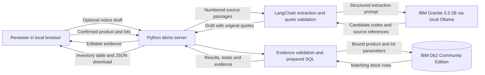

# RecallTrace System Architecture

## Overview

RecallTrace separates notice interpretation, human scope review, and inventory lookup. LangChain drafts candidate identifiers. The reviewer confirms the affected product and lots against the notice. IBM Db2 stores the inventory and returns the rows that match those selections.

## Architecture Diagram



## Component Breakdown

| Component | Responsibility |
| --- | --- |
| [Browser UI](src/web/index.html) | Accepts pasted notices, supports manual or AI-drafted evidence, highlights source quotes, requires reviewer confirmation, and presents a downloadable trace. |
| [Local demo server](src/demo.py) | Serves the browser app and sample fixture. `POST /api/draft` requests a draft. `POST /api/trace` validates the submitted evidence before looking up inventory. |
| [LangChain extractor](src/extract_notice.py) | Prompts the configured model with numbered passages, parses a structured response, copies exact source text into each evidence entry, and validates the proposed codes. |
| [Evidence validation](src/trace_notice.py) | Enforces one product, one to 20 unique lot codes, and a verbatim quote with a complete code for every entry. |
| [Db2 access](src/db.py) | Opens a connection through `ibm_db`, binds the reviewed identifiers, and returns inventory rows ordered by lot and site. |

## Data Flow

1. The reviewer loads the fictional sample or pastes a notice. They can enter the codes and quotes manually or ask LangChain for a draft.
2. In the AI path, the app numbers passages from the notice and sends them to the local Granite model. The model proposes codes and source references. The app builds quotes from the original notice and checks the code in each quote. An ambiguous draft with zero identifiable lots stops for manual review.
3. The reviewer confirms recall scope. Editing the notice or evidence clears the confirmation. On lookup, the server validates the submitted evidence again.
4. The server binds the reviewed product and lot codes in a prepared Db2 join. It totals returned quantities and identifies requested lot codes with zero rows. The browser displays the rows and offers a JSON download containing the selection and results.

## IBM Db2 Schema & Storage Design

| Table | Columns and keys |
| --- | --- |
| `recalltrace_products` | `product_code` primary key and `product_name`. |
| `recalltrace_inventory` | `product_code`, `lot_code`, and `site` form the primary key. `product_code` references the product table. `quantity` is a nonnegative integer. |

[Schema DDL](src/schema.sql) · [Fictional seed data](src/seed.py)

The example below shows the prepared lookup for two selected lots. Db2 receives identifiers as bound values. The number of requested lots determines the number of placeholders.

```sql
SELECT p.product_code, i.lot_code, p.product_name, i.site, i.quantity
FROM recalltrace_products p
JOIN recalltrace_inventory i ON i.product_code = p.product_code
WHERE p.product_code = ? AND i.lot_code IN (?, ?)
ORDER BY i.lot_code, i.site;
```

The seed uses a transaction and insert-only `MERGE` statements for repeatable setup. Runtime inventory lookups are read-only. The demo keeps request data in memory and creates the JSON download in the browser.

## Security & Secrets Management

- The browser app listens on loopback and checks request host and origin. The API applies request and notice size limits.
- Runtime credentials come from `src/.env` or the process environment. Db2 TLS connections take the configured server certificate. Database error messages omit raw connection diagnostics.
- The application treats notice text as data and checks model candidates against the source before presenting them. The reviewer determines scope. The lookup sends reviewed identifiers to Db2 as bound parameters.
- The recorded workflow runs Granite through local Ollama. With the optional OpenAI provider, notice text is sent to the configured service.
