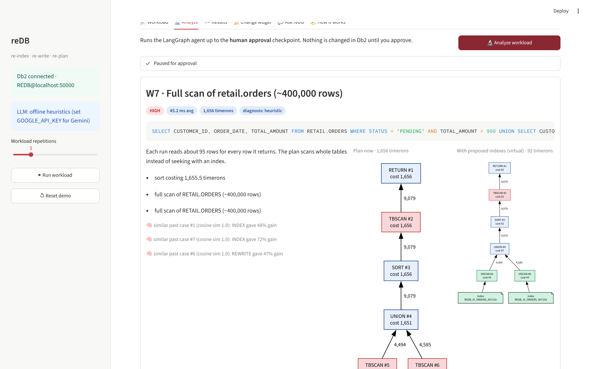
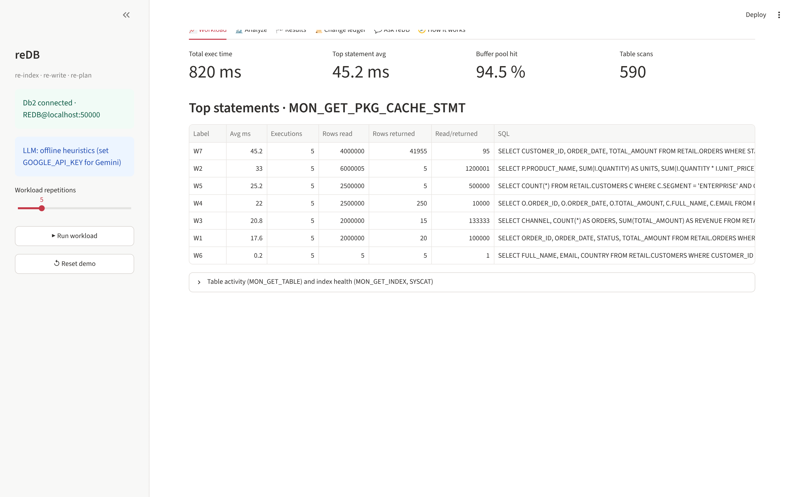
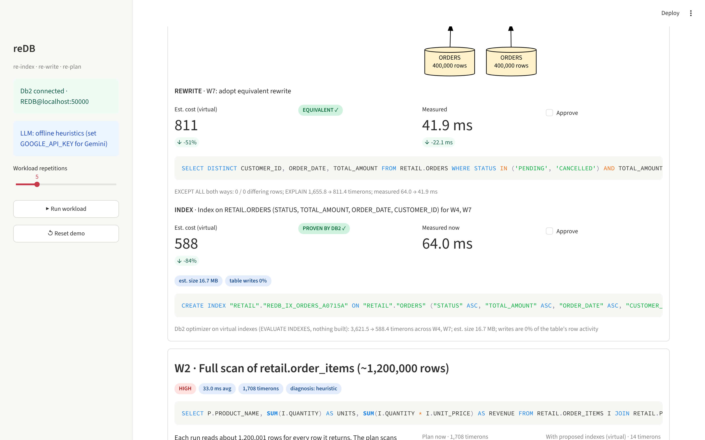
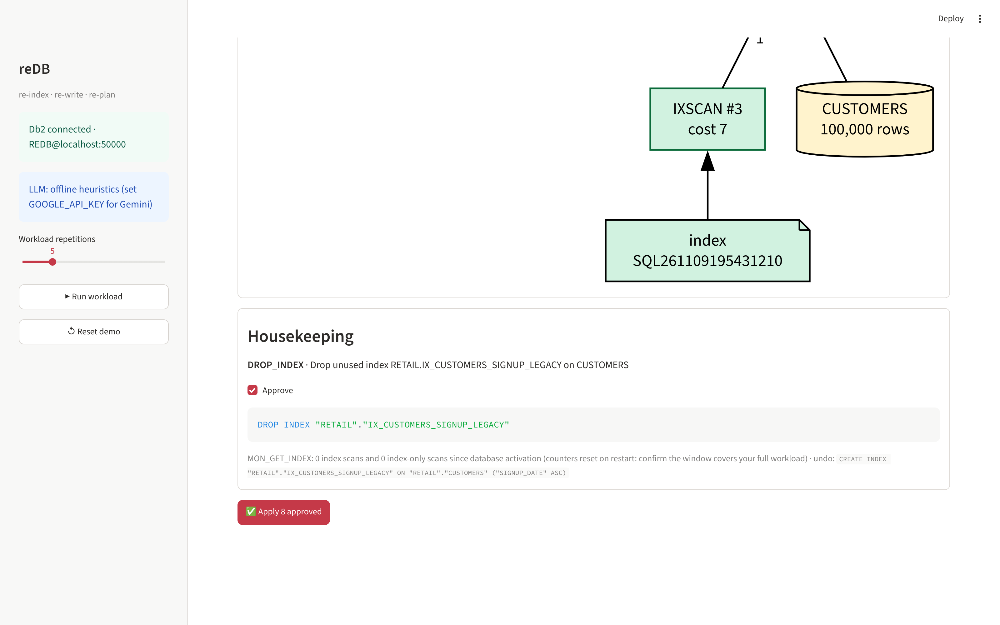
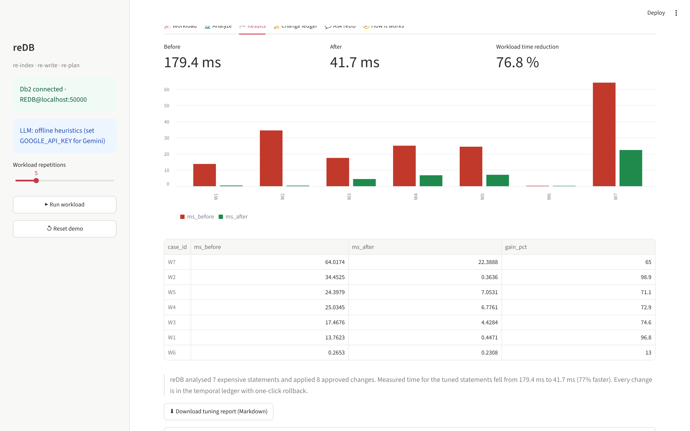
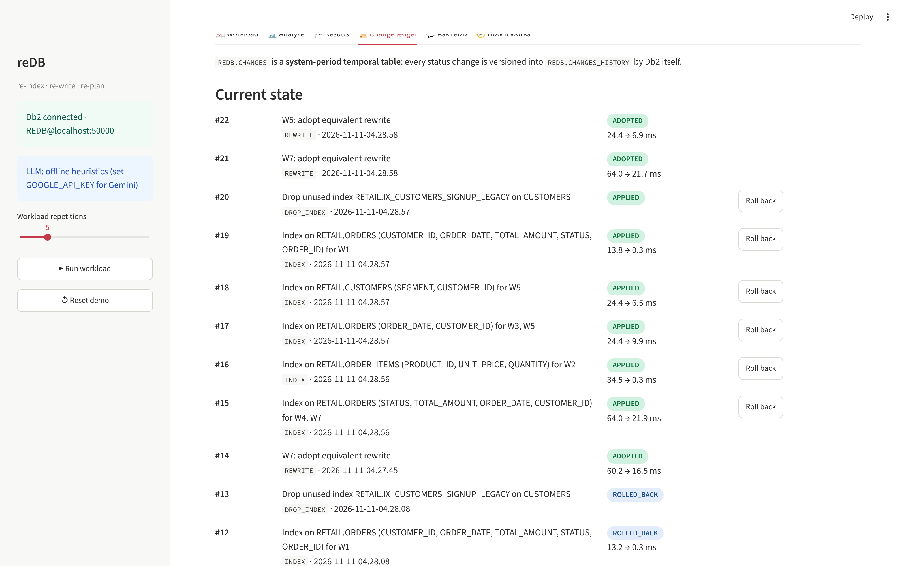
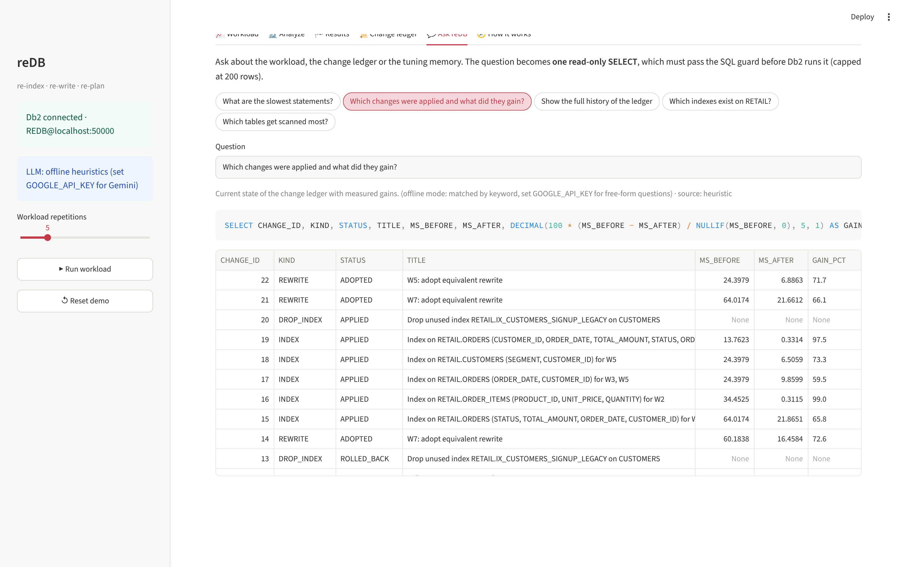
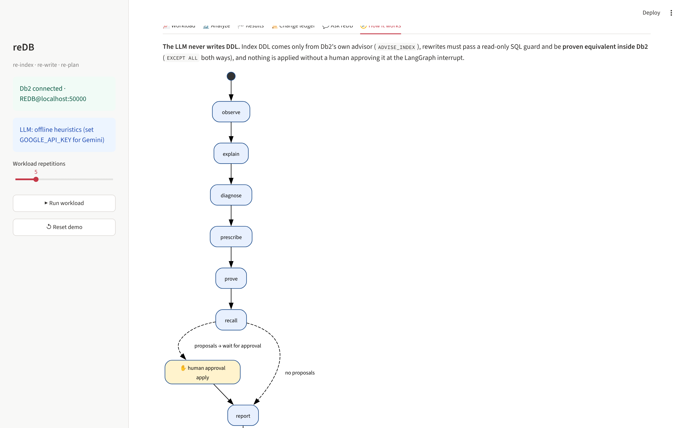

# reDB: the AI agent that tunes IBM Db2 and proves every fix

> **One-Line Pitch:** reDB watches a live IBM Db2 workload, finds the costliest queries, explains why they are slow, and fixes them, but only after **Db2's own optimizer proves the fix works** and a human approves it. Every change is audited in a temporal table with one-click rollback.

"re" = **re-index, re-write, re-plan**. On the demo workload reDB cut total measured query time by **79%** (166.4 ms → 34.7 ms) with **5 indexes instead of the 8 the advisor asked for**, each priced on *virtual* indexes before anything was built.



---

## Table of Contents
- [Problem Statement](#problem-statement)
- [Solution Overview](#solution-overview)
- [IBM Db2 Integration](#ibm-db2-integration)
- [AI / LLM Architecture (if applicable)](#ai--llm-architecture-if-applicable)
- [Tech Stack](#tech-stack)
- [Prerequisites](#prerequisites)
- [Setup & Installation](#setup--installation)
- [Configuration](#configuration)
- [Running the Project](#running-the-project)
- [Testing & Verification](#testing--verification)
- [Screenshots & Demo](#screenshots--demo)
- [Known Limitations & Future Roadmap](#known-limitations--future-roadmap)
- [Team Members & Credits](#team-members--credits)

---

## Problem Statement
- **The problem:** slow SQL costs money (CPU, licences, user wait time), but tuning it needs a DBA who can read access plans, and DBAs are scarce. Most teams only notice a missing index when something breaks.
- **Target audience:** application developers and small platform teams running IBM Db2 without a full-time DBA, and DBAs who want an assistant that shows its working.
- **Why existing tooling falls short:** Db2 already has world-class tools (monitoring table functions, EXPLAIN, the Design Advisor), but they are separate, expert-only, and produce raw tables. Meanwhile LLM "SQL advice" is cheap and confident and often wrong: a suggested rewrite can silently change results, and a suggested index may not help at all. **reDB never trusts the LLM. It makes Db2 prove every fix.**

---

## Solution Overview
reDB is a LangGraph agent with a Streamlit cockpit and a CLI. One run goes:

1. **Observe:** reads the package cache (`MON_GET_PKG_CACHE_STMT`) and ranks statements by total execution time, plus health signals (buffer pool hit ratio, table scans, unused indexes, stale statistics).
2. **Explain:** runs `EXPLAIN PLAN` on each statement, rebuilds the operator tree from the explain tables, and flags full table scans of large tables, sorts and costly joins. It draws the plan as a graph.
3. **Diagnose:** Gemini turns the plan, runtime metrics and catalog into a plain-English diagnosis (structured output).
4. **Prescribe:**
   - asks **Db2's own index advisor** for indexes per statement (`CURRENT EXPLAIN MODE RECOMMEND INDEXES` → `ADVISE_INDEX`);
   - **consolidates them across the whole workload**: with `CURRENT EXPLAIN MODE EVALUATE INDEXES` it prices subsets of the virtual indexes and drops every index the workload can do without while keeping ≥95% of the gain (8 advised → 5 kept in the demo);
   - shows the **write-side cost** of each index: estimated size (from `ADVISE_INDEX.NLEAF`) and the table's write share (`MON_GET_TABLE`), with warnings for wide indexes and write-heavy tables;
   - asks Gemini for an equivalent rewrite (passed through a read-only SQL guard);
   - proposes **dropping indexes nothing uses** (`MON_GET_INDEX`), with the `CREATE INDEX` to undo it, and `RUNSTATS` for tables without statistics.
5. **Prove:**
   - indexes: the optimizer's estimated cost **with the consolidated virtual indexes** (nothing is built) vs the current cost, shown as a **side-by-side plan diff**;
   - rewrites: **row-for-row equivalence checked inside Db2** with `EXCEPT ALL` in both directions, plus EXPLAIN cost and measured latency. A rewrite must be equivalent *and* faster.
6. **Recall:** looks up similar past cases in a Db2 `VECTOR` column (`VECTOR_DISTANCE`, cosine).
7. **Human approval:** the graph pauses (LangGraph interrupt). Nothing changes until a person ticks the proposals.
8. **Apply:** records each change in the ledger as PROPOSED, runs the DDL, refreshes statistics, **re-measures**, marks it APPLIED and stores the solved case in vector memory.
9. **Report:** before/after milliseconds per statement plus an executive summary, downloadable as a Markdown tuning report.

There is also an **Ask reDB** tab: a natural-language question about the workload, ledger or memory becomes one read-only `SELECT`, which must pass the same SQL guard before Db2 runs it.

Everything works **offline** too: without a Gemini key, deterministic heuristics replace the LLM and a feature-hashing embedding replaces Gemini embeddings, so judges can run all of it with only Docker.

---

## IBM Db2 Integration
- **Db2 Edition & Environment:** IBM Db2 Community Edition **12.1.5** in Docker (`icr.io/db2_community/db2:latest`). 12.1.2 or later is needed for `VECTOR`. Also works with the IBM Db2 for LUW VS Code extension or any reachable Db2 LUW (set `DB2_SECURITY=SSL` for TLS endpoints).
- **Connector / Driver Used:** `ibm_db` (Python, prepared statements with parameter markers), wrapped in a single `Toolkit` façade.
- **Database Schema / Data Models:**
  - `RETAIL` demo schema: `CUSTOMERS` (100k), `PRODUCTS` (2k), `ORDERS` (400k), `ORDER_ITEMS` (1.2M), with primary keys only, deliberately missing secondary indexes, plus informational foreign keys (`NOT ENFORCED ENABLE QUERY OPTIMIZATION`). All data is generated **inside Db2** with recursive CTEs in 100k-row batches (seeding takes about 10 s).
  - `REDB.CHANGES`: system-period **temporal** change ledger (+ `REDB.CHANGES_HISTORY`).
  - `REDB.TUNING_MEMORY`: solved cases with `EMBEDDING VECTOR(768, FLOAT32)`.
  - Explain and advise tables (`EXPLAIN_*`, `ADVISE_INDEX`), created by `SYSPROC.SYSINSTALLOBJECTS`.
  - Everything reDB owns lives in a **32K tablespace** `REDB_TS32` on bufferpool `REDB_BP32`.
  - Full DDL is in [architecture.md](architecture.md#ibm-db2-schema--storage-design).
- **Key Queries & Operations:**

| Db2 feature | How reDB uses it | Where |
|---|---|---|
| `MON_GET_PKG_CACHE_STMT` | rank statements by `STMT_EXEC_TIME`, rows read per row returned | `monitor.py` |
| `MON_GET_TABLE`, `MON_GET_INDEX`, `MON_GET_BUFFERPOOL` | table scans, write share per table, unused non-unique indexes (joined to `SYSCAT.INDEXES` on `IID`) that become drop proposals, buffer pool hit ratio | `monitor.py` |
| `EXPLAIN PLAN … SET QUERYNO … SET QUERYTAG` + `EXPLAIN_STATEMENT/OPERATOR/STREAM` | rebuild the operator tree, flag TBSCAN/SORT/joins, Graphviz plan | `explain.py` |
| `SET CURRENT EXPLAIN MODE RECOMMEND INDEXES` + `ADVISE_INDEX` | **virtual indexes**: estimated cost with indexes that do not exist yet; DDL comes only from Db2 | `advisor.py` |
| `SET CURRENT EXPLAIN MODE EVALUATE INDEXES` + `ADVISE_INDEX.USE_INDEX` | **workload-level what-if**: price any subset of virtual indexes to consolidate them, and read the "after" plan for the plan diff | `advisor.py`, `agent.py` |
| `EXCEPT ALL` (both directions) | prove a rewrite returns exactly the same multiset of rows | `verify.py` |
| `SYSPROC.ADMIN_CMD('RUNSTATS … WITH DISTRIBUTION AND DETAILED INDEXES ALL')` | statistics after seeding and after each new index; RUNSTATS proposals for stale tables | `seed.py`, `agent.py` |
| System-period temporal tables, `FOR SYSTEM_TIME FROM … TO …` / `AS OF` | tamper-evident change ledger with time travel | `ledger.py` |
| `VECTOR(768, FLOAT32)`, `VECTOR()`, `VECTOR_DISTANCE(…, COSINE)` | similarity search over past tuning cases | `memory.py` |
| `SELECT … FROM FINAL TABLE (INSERT …)` | get generated identity keys in one round trip | `ledger.py`, `memory.py` |
| Informational constraints (`NOT ENFORCED ENABLE QUERY OPTIMIZATION`) | give the optimizer join knowledge with no enforcement cost | `seed.py` |
| `CREATE BUFFERPOOL … PAGESIZE 32K`, `CREATE TABLESPACE … PAGESIZE 32K` | wide rows for the ledger and memory | `seed.py` |
| `SYSCAT.TABLES/COLUMNS/INDEXES/BUFFERPOOLS/TABLESPACES` | catalog context for the LLM, NOT NULL checks for safe rewrites, stale stats, idempotent setup | `toolkit.py`, `seed.py` |
| `FLUSH PACKAGE CACHE DYNAMIC` | start each demo workload from a clean cache | `workload.py` |
| `SYSPROC.SYSINSTALLOBJECTS('EXPLAIN','C',…)` | create explain/advise tables on first run | `explain.py` |
| `UPDATE DB CFG USING LOGSECOND` via `ADMIN_CMD` | headroom for the bulk load (avoids SQL0964C) | `seed.py` |

---

## AI / LLM Architecture (if applicable)
- **Framework:** **LangGraph** `StateGraph` (9 nodes, conditional edge, `MemorySaver` checkpointer, `interrupt_before=["apply"]` for human approval) + **LangChain** (`ChatGoogleGenerativeAI.with_structured_output(PydanticModel)` for diagnosis, rewrite, narrative and Ask-reDB answers, `GoogleGenerativeAIEmbeddings`).
- **Model Provider & Model:** Google Gemini. Chat model from `GEMINI_MODEL` (default `gemini-3.5-flash`), embeddings from `GEMINI_EMBED_MODEL` (default `models/gemini-embedding-001`), truncated to 768 dimensions and L2-renormalised to fit the Db2 `VECTOR(768)` column.
- **RAG / Tool Calling Workflow:** context comes from Db2, not from documents. For each statement the prompt gets the SQL, the access plan rebuilt from the EXPLAIN tables, the `MON_GET_PKG_CACHE_STMT` metrics and the catalog (column types, nullability, existing indexes). Gemini returns a typed `Diagnosis {headline, plain_english, root_causes[], severity}` and a typed `Rewrite {should_rewrite, sql, rationale}`. Retrieval-augmented memory: each solved case is embedded (normalised SQL + tables + plan operators) and stored in Db2, and similar cases are recalled with `VECTOR_DISTANCE`.
- **Safety model:** the LLM **never writes DDL**. Index DDL is generated only from `ADVISE_INDEX` rows, with identifiers validated against `^[A-Z0-9_#@$]+$`. LLM SQL must pass `sqlguard` (single `SELECT`/`WITH`, no `;`, none of INSERT/UPDATE/DELETE/MERGE/DROP/ALTER/CREATE/GRANT/REVOKE/TRUNCATE/CALL). Rewrites must be proven equivalent in Db2 and faster. Only proven proposals that a human approved are applied. Rollback only runs undo statements that match the exact index DDL shapes reDB generates. Ask-reDB SQL goes through the same guard and a 200-row cap.
- **Offline mode:** if `GOOGLE_API_KEY` is missing or Gemini errors, each `Brain` method falls back to deterministic heuristics (plan-flag diagnosis; sargable date-range, NOT NULL-checked `NOT IN`→`NOT EXISTS` and `UNION`→`IN` rewrites; keyword-matched Ask-reDB queries) and a 768-dim feature-hashing embedding.

---

## Tech Stack
- **Backend / Core:** Python 3.11+, LangGraph, LangChain, Pydantic v2
- **Database:** IBM Db2 12.1 Community Edition (Docker)
- **Frontend / UI:** Streamlit (Graphviz plans, charts) and a CLI (`python -m redb …`)
- **Libraries & Tools:** `ibm_db`, `langchain-google-genai`, pandas, python-dotenv, pytest, Docker Compose, GitHub Actions

---

## Prerequisites
- Docker (Docker Desktop on Mac; on Apple Silicon enable **"Use Rosetta for x86_64/amd64 emulation"** and give Docker **≥ 6 GB RAM**), or any reachable Db2 LUW 12.1.2+ database
- Python ≥ 3.11 and `pip`
- Optional: a Google Gemini API key (everything also runs offline)

---

## Setup & Installation

```bash
# 1. Get the code (from the submission repo use: cd submissions/redb)
git clone https://github.com/MohamedAtiyah/Hackathon-IBM-reDB.git && cd Hackathon-IBM-reDB
# 2. Configure (edit DB2_PASSWORD; GOOGLE_API_KEY is optional)
cp .env.example .env
# 3. Start Db2 (first start takes 5-10 min; ready when `docker logs redb-db2` shows "Setup has completed")
docker compose up -d
# 4. Install (a virtualenv is recommended: python -m venv .venv && source .venv/bin/activate)
pip install -e ".[dev]"
# 5. Create objects + seed data, run the workload, open the app
python -m redb setup && python -m redb workload && python -m redb ui
```

`pip install -r requirements.txt` also works; then run with `PYTHONPATH=src`.

---

## Configuration

Copy `.env.example` to `.env` and fill in your local or test credentials:

```bash
cp .env.example .env
```

| Variable | Default | Meaning |
|---|---|---|
| `DB2_HOST`, `DB2_PORT`, `DB2_DATABASE` | `localhost`, `50000`, `REDB` | Db2 endpoint |
| `DB2_USER`, `DB2_PASSWORD` | `db2inst1`, (none) | credentials; docker compose reads the same `DB2_PASSWORD` |
| `DB2_SECURITY` | empty | `SSL` for TLS endpoints such as Db2 on Cloud |
| `TARGET_SCHEMA` | `RETAIL` | schema whose statements reDB tunes |
| `GOOGLE_API_KEY` | empty | Gemini key; empty means offline mode |
| `GEMINI_MODEL` | `gemini-3.5-flash` | chat model |
| `GEMINI_EMBED_MODEL`, `EMBED_DIM` | `models/gemini-embedding-001`, `768` | embeddings |

> **Security Warning:** Never commit `.env` or any real API keys or database passwords to Git! `.env` is in `.gitignore`.

---

## Running the Project

```bash
python -m redb setup [--scale 1.0] [--reset]   # idempotent; --reset drops REDB_IX_% indexes to replay the demo
python -m redb setup --scale 10 --reseed       # regenerate RETAIL at 10x (4M orders, 12M order items)
python -m redb workload [--repeat 5]           # FLUSH PACKAGE CACHE DYNAMIC, then run W1-W7
python -m redb analyze                         # headless: stops at the approval checkpoint and prints proposals
python -m redb analyze --approve-all           # headless: applies every *proven* proposal and prints the report
python -m redb analyze --approve-all --report tuning.md   # also write the Markdown tuning report
python -m redb ui                              # Streamlit app on http://localhost:8501
```

UI walkthrough: **Workload** (KPIs + top statements) → **Analyze** (diagnosis, plan now vs plan with virtual indexes, proven proposals with size and write cost, housekeeping, approve) → **Results** (before/after chart, report download) → **Change ledger** (temporal timeline, "as of" time travel, rollback) → **Ask reDB** (guarded natural-language questions) → **How it works** (the live LangGraph diagram).

> **If `analyze` finds no statements after a container restart:** Db2 clears the package cache when the last connection closes unless the database is activated. Run `docker exec redb-db2 su - db2inst1 -c "db2 activate db REDB"` once, then re-run the workload. (A fresh `docker compose up` activates it for you; the Streamlit app is not affected because it keeps its connection.)

The demo workload (`src/redb/workload.py`):

| | Query | Why it is slow |
|---|---|---|
| W1 | last 20 orders of customer 4242 | no index on `ORDERS.CUSTOMER_ID` |
| W2 | revenue of product 77 (join) | scan of 1.2M `ORDER_ITEMS` |
| W3 | March 2024 revenue by channel with `YEAR()`/`MONTH()` | rewrite candidate, no date index |
| W4 | pending June-2025 orders joined to customers, top 50 | scan + sort |
| W5 | enterprise customers with no 2025 order (`NOT IN`) | rewrite candidate, two scans |
| W6 | primary-key lookup | control: reDB should leave it alone |
| W7 | `UNION` of pending and cancelled high-value orders | two scans + sort; rewrite to one `DISTINCT … IN` scan wins |

`setup` also plants one deliberately useless index (`IX_CUSTOMERS_SIGNUP_LEGACY`) for reDB to find and propose dropping.

---

## Testing & Verification
```bash
pytest -q        # 56 tests, no Db2 and no Gemini key needed (also runs in GitHub Actions)
```
Tests cover: the SQL guard (allow/deny, comment and string tricks), `ADVISE_INDEX` COLNAMES parsing, DDL generation and identifier validation, plan-tree building and TBSCAN detection from canned EXPLAIN rows plus DOT output, SQL normalisation and signatures, unit-length hashing embeddings, the `EXCEPT ALL` wrapper SQL and ordered comparison, offline heuristics, what-if index consolidation, the rollback undo guard, the Markdown report, offline Ask-reDB answers, and the **LangGraph agent with a FakeToolkit**: it pauses before `apply`, applies **only** approved and proven proposals after resume, writes ledger entries, never proposes indexes that do not help, carries size/write warnings and the plan diff, makes unused-index drops reversible, and rejects equivalent-but-slower rewrites.

**Verify the Db2 integration end to end:**
```bash
python -m redb setup --reset && python -m redb workload && python -m redb analyze --approve-all
```
You should see `what-if consolidation kept 5 and dropped 3`, `prove: 7/9 proposals proven by Db2`, six `APPLIED` changes plus one `ADOPTED` rewrite, and a total reduction of roughly 75-80%. Then check Db2 directly:
```sql
SELECT CHANGE_ID, STATUS, SYS_START, SYS_END FROM REDB.CHANGES FOR SYSTEM_TIME FROM '0001-01-01' TO '9999-12-31';
SELECT INDNAME, COLNAMES FROM SYSCAT.INDEXES WHERE INDNAME LIKE 'REDB_IX_%';
```

---

## Screenshots & Demo
- **Live Demo Link:** runs locally (needs a Db2 instance); see [Setup](#setup--installation).
- **Demo Video Link:** see `video_url` in [submission.json](submission.json).
- Measured numbers: [docs/RESULTS.md](docs/RESULTS.md)

| | |
|---|---|
| IBM Db2 for LUW VS Code extension  | Workload: MON_GET KPIs and top statements  |
| Analyze: diagnosis and plan diff on virtual indexes  | Proposals: proven rewrite, index with size and write cost  |
| Housekeeping: drop an unused index, reversibly  | Results: measured before/after  |
| Temporal change ledger with rollback  | Ask reDB: guarded natural-language questions  |
| The LangGraph agent  | |

### Measured results (Db2 12.1.5, scale 1.0, offline mode)

| Stmt | Measured before → after (ms) | Gain | Fixed by |
|---|---|---:|---|
| W1 | 13.2 → 0.3 | 98% | index |
| W2 | 33.9 → 0.3 | 99% | index |
| W3 | 17.0 → 4.2 | 75% | index shared with W5 |
| W4 | 21.4 → 6.2 | 71% | index shared with W7 |
| W5 | 20.4 → 6.6 | 68% | 2 indexes |
| W6 (control) | 0.3 → 0.3 | noise | left alone |
| W7 | 60.2 → 16.9 | 72% | **rewrite** (proven equivalent, 60 → 37 ms alone) + index |
| **Total** | **166.4 → 34.7** | **79%** | 5 indexes (advisor asked for 8), 1 rewrite, 1 unused index dropped |

- **Consolidation:** Db2's advisor recommended 8 indexes statement by statement. Pricing subsets with `EVALUATE INDEXES` showed 5 keep ≥95% of the gain, so 3 were never built.
- **Rewrites:** the W7 `UNION` → `DISTINCT … IN` rewrite was proven equivalent and adopted. The two textbook rewrites (W3 `YEAR()/MONTH()` → date range, W5 `NOT IN` → `NOT EXISTS`) were **proven equivalent and then rejected**, because Db2 12.1 already optimises the originals. reDB is built to make exactly that call.
- **At scale 10** (4M orders, 12M order items, seeded in 83 s): **1,990 ms → 352 ms (82%)**, again with 5 indexes kept out of 9 advised. Details in [docs/RESULTS.md](docs/RESULTS.md).

---

## Known Limitations & Future Roadmap
- **Current Limitations:**
  - Rewrite equivalence is proven **on the current data** (`EXCEPT ALL` both ways), not for all possible data. The NOT NULL catalog check and human approval cover the gap, but this is not a formal proof.
  - Statements with parameter markers are explained but skipped by the index advisor (it needs literal values).
  - Adopting a rewrite is recorded in the ledger but the application's SQL must still be changed by its owner.
  - Latencies on the small demo data set are in milliseconds; at real scale gains are larger but take longer to measure. Sub-millisecond controls are within timer noise.
  - Index write cost is shown (estimated size, table write share, warnings) but not yet priced into the decision; the demo workload is read-only, so the write share shows 0%.
  - Consolidation is greedy (largest index first), so it finds a good index set, not a guaranteed minimum.
  - "Unused index" is judged from `MON_GET_INDEX` counters, which reset when the database restarts; the proposal says so and needs human approval.
  - Ask reDB without a Gemini key only answers a handful of keyword-matched questions.
  - Do not switch between Gemini and offline mode once the vector memory holds cases: the two embedding spaces are not comparable.
- **Next Steps:** price index maintenance into the consolidation using insert/update rates; a regression watchdog that re-checks changed statements and proposes rollback; MQT and statistical-view proposals; scheduled runs with drift alerts; multi-database fleets; watsonx.ai / Granite as an alternative LLM.

---

## Team Members & Credits
| Name | GitHub Handle | Role / Contribution |
|---|---|---|
| Mohamed Atiyah | [@MohamedAtiyah](https://github.com/MohamedAtiyah) | Solo: design, Db2 integration, LangGraph agent, UI, docs |

Built with IBM Db2 Community Edition, LangGraph/LangChain, Google Gemini and Streamlit. Licensed under the [MIT License](LICENSE).
