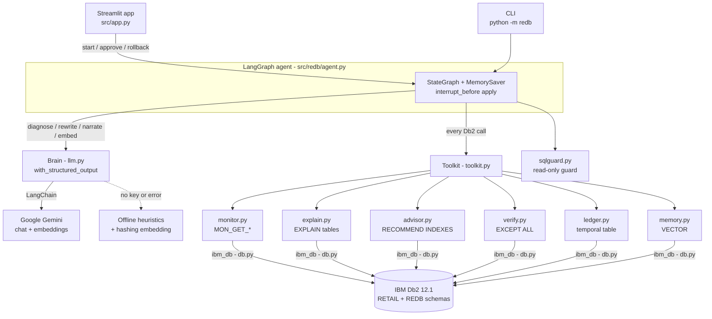
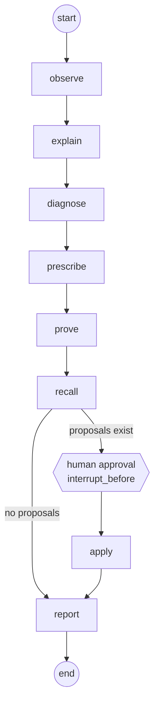

# System Architecture

## Overview
reDB is a Python application with two front ends (a Streamlit cockpit and a CLI) that drive one **LangGraph** agent. The agent reaches IBM Db2 only through a single `Toolkit` façade (one `ibm_db` connection), and reaches Google Gemini only through a `Brain` class with deterministic offline fallbacks. Db2 plays three roles at once:

1. **The patient:** the `RETAIL` workload being tuned.
2. **The judge:** Db2's own monitor, optimizer, index advisor (virtual indexes) and `EXCEPT ALL` prove or reject every proposal.
3. **The memory:** reDB's audit ledger (a system-period temporal table) and its case memory (a `VECTOR` column) live in Db2.

---

## Architecture Diagram



### LangGraph flow



The live graph is rendered in the app's **How it works** tab from `graph.get_graph()` (the `draw_mermaid()` source is shown too). State holds plain data only: `statements`, `health`, `cases`, `proposals`, `approved`, `applied`, `report`, and an append-only `log`. The run is resumed with `graph.update_state(config, {"approved": [...]})` then `graph.invoke(None, config)`.

---

## Component Breakdown

1. **User Interface / Client Layer**:
   - `src/app.py` (Streamlit): sidebar (Db2 connection, Gemini on/off, run workload, reset demo) and six tabs: Workload KPIs, Analyze (diagnosis, Graphviz plan now vs with virtual indexes, proven proposals, approval checkboxes), Results (before/after chart, report download), Change ledger (timeline, `AS OF` time travel, rollback), Ask reDB, How it works.
   - `src/redb/cli.py`: `setup [--scale N --reseed --reset] | workload | analyze [--approve-all] [--report FILE] | ui`.
2. **Application Backend Layer**:
   - `toolkit.py`: the only object that touches Db2, so the agent is unit-tested with a `FakeToolkit`.
   - `db.py`: `ibm_db` wrapper (`query`, `execute`, `exec_immediate`, `scalar`, `timed` = median ms with every row fetched). Internal statements are prefixed `/*REDB*/` so the monitor never tunes reDB itself.
   - `sqlguard.py`: read-only guard for anything an LLM writes.
   - `seed.py`, `workload.py`: idempotent setup, in-database data generation, demo workload.
3. **Database Layer (IBM Db2)**:
   - `monitor.py`: `MON_GET_PKG_CACHE_STMT`, `MON_GET_TABLE`, `MON_GET_INDEX` ⋈ `SYSCAT.INDEXES`, `MON_GET_BUFFERPOOL`, `SYSCAT.TABLES` stats age.
   - `explain.py`: `EXPLAIN PLAN SET QUERYNO/QUERYTAG`, then `EXPLAIN_STATEMENT` → `EXPLAIN_OPERATOR` + `EXPLAIN_STREAM` keyed by `(EXPLAIN_TIME, SOURCE_NAME, STMTNO, SECTNO)`; operator tree, flags and DOT.
   - `advisor.py`: `SET CURRENT EXPLAIN MODE RECOMMEND INDEXES`, compile the statement (SQL0217W expected), always reset to `NO` in `finally`; read the P-level cost after a timestamp marker and `ADVISE_INDEX` rows with `EXISTS='N'` (including `NLEAF` for a size estimate). `evaluate()` flips `ADVISE_INDEX.USE_INDEX` and compiles under `EVALUATE INDEXES` to price any subset of virtual indexes; `consolidate()` uses that to prune the advised set greedily while keeping ≥95% of the workload gain.
   - `report.py`: Markdown tuning report from the final agent state.
   - `verify.py`: `EXCEPT ALL` both ways inside Db2, plus an ordered comparison if the outer query has `ORDER BY`.
   - `ledger.py`, `memory.py`: temporal ledger and vector memory.
4. **AI / Model Orchestration Layer**:
   - `agent.py`: the LangGraph `StateGraph` described above.
   - `llm.py`: `Brain.diagnose / rewrite / narrate / ask / embed` with Pydantic structured output via `ChatGoogleGenerativeAI.with_structured_output`; every method falls back to a heuristic.

---

## Data Flow

1. **Input Ingestion**: the application workload runs against `RETAIL`; Db2 accumulates per-statement metrics in the package cache. The user clicks *Analyze* (or runs `analyze`).
2. **Context Retrieval**: `observe` reads the top statements and health; `explain` stores and reads access plans; the toolkit adds catalog context (column types, NOT NULL, existing indexes, cardinalities).
3. **Augmentation & Inference**: `diagnose` sends SQL + plan summary + metrics + catalog to Gemini and gets a typed diagnosis. `prescribe` asks Db2's advisor for indexes per statement, consolidates them across the workload with `EVALUATE INDEXES` (which also yields each statement's "after" plan for the plan diff), attaches size and write-share warnings, asks Gemini for a rewrite (guarded), and turns unused indexes into reversible drop proposals. `prove` checks the consolidated virtual-index costs, checks rewrite equivalence with `EXCEPT ALL`, EXPLAIN the rewrite and time both versions. `recall` searches `REDB.TUNING_MEMORY` with `VECTOR_DISTANCE`.
4. **State Persistence**: after approval, `apply` inserts a PROPOSED ledger row (`FINAL TABLE`), runs the advisor DDL, runs `ADMIN_CMD RUNSTATS`, re-measures, updates the row to APPLIED/ADOPTED (Db2 versions the old row into `CHANGES_HISTORY`), and inserts the solved case with its embedding into vector memory.
5. **Response Delivery**: `report` re-times every statement, computes the total reduction, and Gemini writes an executive summary; the UI renders the cards, charts, ledger and time travel.

---

## IBM Db2 Schema & Storage Design

```sql
-- reDB storage (32K pages for wide ledger/memory rows)
CREATE BUFFERPOOL REDB_BP32 SIZE 2000 PAGESIZE 32K;
CREATE TABLESPACE REDB_TS32 PAGESIZE 32K MANAGED BY AUTOMATIC STORAGE BUFFERPOOL REDB_BP32;

-- explain + advise tables (EXPLAIN_INSTANCE, EXPLAIN_STATEMENT, EXPLAIN_OPERATOR, EXPLAIN_STREAM, ADVISE_INDEX, ...)
CALL SYSPROC.SYSINSTALLOBJECTS('EXPLAIN', 'C', CAST(NULL AS VARCHAR(128)), 'DB2INST1');

-- temporal change ledger
CREATE TABLE REDB.CHANGES (
  CHANGE_ID INTEGER GENERATED ALWAYS AS IDENTITY PRIMARY KEY,
  KIND VARCHAR(20) NOT NULL, TITLE VARCHAR(400), STMT_TEXT VARCHAR(8000),
  DDL VARCHAR(4000), UNDO_DDL VARCHAR(4000), STATUS VARCHAR(20) NOT NULL,
  COST_BEFORE DOUBLE, COST_AFTER DOUBLE, MS_BEFORE DOUBLE, MS_AFTER DOUBLE,
  RATIONALE VARCHAR(8000), APPROVED_BY VARCHAR(128),
  SYS_START TIMESTAMP(12) NOT NULL GENERATED ALWAYS AS ROW BEGIN,
  SYS_END TIMESTAMP(12) NOT NULL GENERATED ALWAYS AS ROW END,
  TRANS_ID TIMESTAMP(12) GENERATED ALWAYS AS TRANSACTION START ID,
  PERIOD SYSTEM_TIME (SYS_START, SYS_END)) IN REDB_TS32;
CREATE TABLE REDB.CHANGES_HISTORY LIKE REDB.CHANGES IN REDB_TS32;
ALTER TABLE REDB.CHANGES ADD VERSIONING USE HISTORY TABLE REDB.CHANGES_HISTORY;

-- vector memory of solved cases
CREATE TABLE REDB.TUNING_MEMORY (
  CASE_ID INTEGER GENERATED ALWAYS AS IDENTITY PRIMARY KEY,
  CREATED_AT TIMESTAMP NOT NULL DEFAULT CURRENT TIMESTAMP,
  SIGNATURE VARCHAR(4000), STMT_TEXT CLOB(1M), FIX_KIND VARCHAR(20),
  FIX_DETAIL VARCHAR(4000), GAIN_PCT DOUBLE,
  EMBEDDING VECTOR(768, FLOAT32)) IN REDB_TS32;

-- demo schema: primary keys only + informational FKs
CREATE TABLE RETAIL.CUSTOMERS (CUSTOMER_ID INTEGER NOT NULL PRIMARY KEY, FULL_NAME VARCHAR(100) NOT NULL, EMAIL VARCHAR(120) NOT NULL, COUNTRY CHAR(2) NOT NULL, SEGMENT VARCHAR(20) NOT NULL, SIGNUP_DATE DATE NOT NULL);
CREATE TABLE RETAIL.PRODUCTS (PRODUCT_ID INTEGER NOT NULL PRIMARY KEY, SKU VARCHAR(20) NOT NULL, PRODUCT_NAME VARCHAR(100) NOT NULL, CATEGORY VARCHAR(40) NOT NULL, UNIT_PRICE DECIMAL(10,2) NOT NULL);
CREATE TABLE RETAIL.ORDERS (ORDER_ID INTEGER NOT NULL PRIMARY KEY, CUSTOMER_ID INTEGER NOT NULL, ORDER_DATE DATE NOT NULL, STATUS VARCHAR(12) NOT NULL, CHANNEL VARCHAR(10) NOT NULL, TOTAL_AMOUNT DECIMAL(12,2) NOT NULL);
CREATE TABLE RETAIL.ORDER_ITEMS (ORDER_ID INTEGER NOT NULL, LINE_NO SMALLINT NOT NULL, PRODUCT_ID INTEGER NOT NULL, QUANTITY INTEGER NOT NULL, UNIT_PRICE DECIMAL(10,2) NOT NULL, PRIMARY KEY (ORDER_ID, LINE_NO));
ALTER TABLE RETAIL.ORDERS ADD CONSTRAINT FK_ORD_CUST FOREIGN KEY (CUSTOMER_ID) REFERENCES RETAIL.CUSTOMERS NOT ENFORCED ENABLE QUERY OPTIMIZATION;
ALTER TABLE RETAIL.ORDER_ITEMS ADD CONSTRAINT FK_ITEM_ORD FOREIGN KEY (ORDER_ID) REFERENCES RETAIL.ORDERS NOT ENFORCED ENABLE QUERY OPTIMIZATION;
ALTER TABLE RETAIL.ORDER_ITEMS ADD CONSTRAINT FK_ITEM_PROD FOREIGN KEY (PRODUCT_ID) REFERENCES RETAIL.PRODUCTS NOT ENFORCED ENABLE QUERY OPTIMIZATION;

-- example DDL generated from ADVISE_INDEX (never by the LLM)
CREATE INDEX "RETAIL"."REDB_IX_ORDERS_2EE839" ON "RETAIL"."ORDERS" ("CUSTOMER_ID" ASC, "ORDER_DATE" DESC, "TOTAL_AMOUNT" ASC, "STATUS" ASC, "ORDER_ID" ASC);
-- undo
DROP INDEX "RETAIL"."REDB_IX_ORDERS_2EE839";
```

Key queries:

```sql
-- top statements (package cache)
SELECT HEX(EXECUTABLE_ID) AS EXEC_ID, NUM_EXECUTIONS, STMT_EXEC_TIME, TOTAL_CPU_TIME, ROWS_READ, ROWS_RETURNED,
       CAST(SUBSTR(STMT_TEXT,1,8000) AS VARCHAR(8000)) AS STMT_TEXT
FROM TABLE(MON_GET_PKG_CACHE_STMT('D', NULL, NULL, -2)) T
WHERE NUM_EXECUTIONS > 0 ORDER BY STMT_EXEC_TIME DESC FETCH FIRST 200 ROWS ONLY;

-- what-if: cost with virtual indexes
SET CURRENT EXPLAIN MODE RECOMMEND INDEXES;  -- then compile the statement (SQL0217W)
SET CURRENT EXPLAIN MODE NO;
SELECT NAME, TBCREATOR, TBNAME, COLNAMES FROM ADVISE_INDEX WHERE EXISTS = 'N' AND EXPLAIN_TIME >= TIMESTAMP(?);

-- workload-level what-if: price a chosen subset of the virtual indexes
UPDATE ADVISE_INDEX SET USE_INDEX = CASE WHEN NAME IN (?, ...) THEN 'Y' ELSE 'N' END;
SET CURRENT EXPLAIN MODE EVALUATE INDEXES;   -- then compile each workload statement, read EXPLAIN_STATEMENT
SET CURRENT EXPLAIN MODE NO;

-- rewrite equivalence on current data
SELECT (SELECT COUNT(*) FROM ((SELECT * FROM (<A>) X) EXCEPT ALL (SELECT * FROM (<B>) Y)) D1),
       (SELECT COUNT(*) FROM ((SELECT * FROM (<B>) X) EXCEPT ALL (SELECT * FROM (<A>) Y)) D2)
FROM SYSIBM.SYSDUMMY1;

-- ledger time travel
SELECT * FROM REDB.CHANGES FOR SYSTEM_TIME FROM '0001-01-01' TO '9999-12-31';
SELECT * FROM REDB.CHANGES FOR SYSTEM_TIME AS OF TIMESTAMP(?);

-- vector recall
SELECT CASE_ID, FIX_KIND, GAIN_PCT,
       VECTOR_DISTANCE(EMBEDDING, VECTOR(CAST(? AS VARCHAR(32000)), 768, FLOAT32), COSINE) AS DIST
FROM REDB.TUNING_MEMORY ORDER BY DIST FETCH FIRST 3 ROWS ONLY;
```

---

## Safety Model

| Risk | Control |
|---|---|
| LLM writes destructive SQL | The LLM **never writes DDL**. Its only SQL output (a rewrite) must pass `sqlguard`: one statement, starts with `SELECT`/`WITH`, no `;`, no INSERT/UPDATE/DELETE/MERGE/DROP/ALTER/CREATE/GRANT/REVOKE/TRUNCATE/CALL (checked after removing comments and string literals). It is only ever read, never executed as DDL. |
| Bad or injected index DDL | DDL is generated only from Db2's `ADVISE_INDEX` rows, always non-unique, with every identifier validated against `^[A-Z0-9_#@$]+$` and quoted. |
| Too many indexes | Advised indexes are consolidated across the workload with `EVALUATE INDEXES`; an index is only proposed if a final plan uses it, and each proposal shows estimated size, table write share and wide/write-heavy warnings. |
| Advice that does not help | Index proposals must lower the optimizer's cost on virtual indexes; rewrites must be equivalent (`EXCEPT ALL` both ways, ordered comparison when ordered) **and** clearly cheaper to plan without being slower, or ≥25% faster measured. Unproven proposals cannot be approved in the UI and are skipped by `apply`. Statements under 100 timerons are left alone. |
| Unreviewed changes | LangGraph `interrupt_before=["apply"]`: nothing changes until a human approves specific proposal ids. |
| No audit trail / no undo | Every change goes through `REDB.CHANGES` (kinds INDEX, DROP_INDEX, REWRITE, RUNSTATS; PROPOSED → APPLIED → ROLLED_BACK, or ADOPTED / FAILED), versioned by Db2 into `CHANGES_HISTORY` with `TRANS_ID`. Rollback runs only undo statements matching the exact `DROP INDEX` / `CREATE INDEX` shapes reDB generates (so a dropped unused index can be restored). A failed apply undoes any partial DDL. |
| Free-form questions (Ask reDB) | The generated SQL passes the same `sqlguard`, runs wrapped in a 200-row cap, and is shown to the user. |
| Session left in advisor mode | `SET CURRENT EXPLAIN MODE NO` always runs in a `finally` block. |

---

## Security & Secrets Management
- All database credentials and the Gemini API key are read at runtime from environment variables (`python-dotenv` loads a local `.env`).
- `.env` is in `.gitignore`; only `.env.example` with placeholders is committed. `docker-compose.yml` reads the same `DB2_PASSWORD` variable.
- SQL that uses runtime values uses `ibm_db` parameter markers; the few interpolated identifiers (index, table, column names) are validated against a strict identifier pattern first.
- `DB2_SECURITY=SSL` turns on TLS for remote Db2 (for example Db2 on Cloud).
- Gemini receives SQL text, plans, metrics and catalog metadata only, never table rows. Offline mode sends nothing anywhere.
