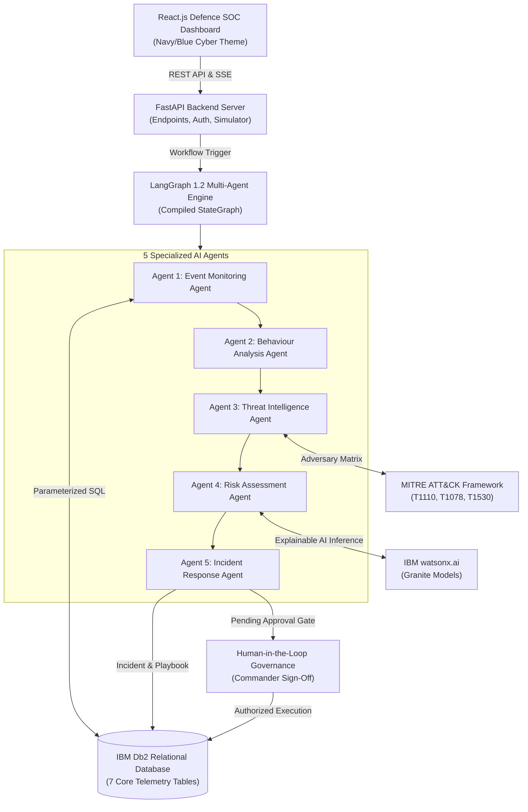

# System Architecture: SENTINEL AI

## Overview
SENTINEL AI is an Agentic AI-powered cybersecurity intelligence platform designed for defence organisations to identify potentially compromised user accounts and suspicious activities within internal networks. 

The system's core innovation is **Multi-Agent Security Event Correlation**: instead of monitoring isolated alerts, 5 specialized LangGraph AI agents work collaboratively over IBM Db2 telemetry records to identify credential brute-forcing, unfamiliar device logins, and unauthorized access to classified military resources.

---

## Architecture Diagram



---

## Component Breakdown

1. **User Interface / Client Layer (React.js + TailwindCSS + Lucide)**:
   - Modern military Security Operations Centre (SOC) dashboard.
   - Live telemetry tables for login events, resource access, and security alerts.
   - Interactive LangGraph pipeline flow visualizer.
   - Incident investigation deep-dive with visual risk gauge and MITRE ATT&CK badges.
   - Human-in-the-loop response authorization interface.
   - Executive AI Security Report generator with PDF/print capabilities.

2. **Application Backend Layer (Python FastAPI)**:
   - Asynchronous RESTful service handling authentication, telemetry querying, simulation triggers, and database transactions.
   - Parameterized SQL execution through Python's `ibm_db` connector.
   - Single-click Section 8 Multi-Vector Attack Simulator.

3. **Database Layer (IBM Db2)**:
   - Central repository managing 7 structured tables (`USER_ACCOUNTS`, `LOGIN_EVENTS`, `ACCESS_LOGS`, `SECURITY_ALERTS`, `INCIDENTS`, `AI_ANALYSIS`, `RESPONSE_RECOMMENDATIONS`).
   - Ensures data integrity, foreign key relations, and strict audit logging for military compliance.

4. **AI & Multi-Agent Orchestration Layer (LangGraph + IBM watsonx.ai)**:
   - **Agent 1 (Event Monitoring):** Retrieves logs, calculates authentication failure velocity, flags bursts.
   - **Agent 2 (Behaviour Analysis):** Baselines historical behavior, flags unregistered hosts and foreign IPs.
   - **Agent 3 (Threat Intelligence):** Correlates events against MITRE ATT&CK techniques (`T1110.001`, `T1078.002`, `T1530`, `T1021`).
   - **Agent 4 (Risk Assessment):** Calculates mathematical risk score ($0 - 100$) and invokes IBM watsonx.ai for explainable security reasoning.
   - **Agent 5 (Incident Response):** Formulates defense containment actions (`LOCK_ACCOUNT`, `REVOKE_SESSIONS`, `ISOLATE_ENDPOINT`) queued strictly for authorized human approval.

---

## Data Flow

1. **Event Ingestion:** Authentication and access events are recorded into `LOGIN_EVENTS` and `ACCESS_LOGS` in IBM Db2.
2. **Correlation Trigger:** The system or analyst invokes the LangGraph pipeline for a target account.
3. **Sequential Agent Analysis:**
   - Agent 1 queries Db2 telemetry and identifies bursts ($\ge 5$ failures).
   - Agent 2 compares with baseline profiles and identifies unfamiliar device/IP anomalies.
   - Agent 3 maps anomalies to MITRE ATT&CK techniques.
   - Agent 4 calculates composite risk score and generates natural-language explainability via watsonx.ai.
   - Agent 5 builds containment recommendations with `status: PENDING_APPROVAL`.
4. **State Persistence:** Results are committed to `INCIDENTS`, `AI_ANALYSIS`, and `RESPONSE_RECOMMENDATIONS` in IBM Db2.
5. **Human Authorization:** An authorized Cyber Commander reviews recommendations in the UI and signs off to execute account locking or IP quarantine.

---

## IBM Db2 Schema Design (7 Tables)

```sql
-- 1. Fictional User Accounts
CREATE TABLE USER_ACCOUNTS (
    user_id VARCHAR(64) PRIMARY KEY,
    username VARCHAR(100) NOT NULL UNIQUE,
    full_name VARCHAR(150) NOT NULL,
    email VARCHAR(150) NOT NULL UNIQUE,
    role VARCHAR(100) NOT NULL,
    department VARCHAR(100) NOT NULL,
    security_clearance VARCHAR(50) NOT NULL,
    status VARCHAR(50) DEFAULT 'ACTIVE',
    created_at TIMESTAMP DEFAULT CURRENT_TIMESTAMP
);

-- 2. Login Telemetry
CREATE TABLE LOGIN_EVENTS (
    event_id VARCHAR(64) PRIMARY KEY,
    user_id VARCHAR(64) NOT NULL,
    timestamp TIMESTAMP DEFAULT CURRENT_TIMESTAMP,
    ip_address VARCHAR(45) NOT NULL,
    device_name VARCHAR(150),
    device_type VARCHAR(50),
    location VARCHAR(100),
    status VARCHAR(20) NOT NULL,
    failure_reason VARCHAR(255),
    user_agent VARCHAR(255)
);

-- 3. Resource Access Audits
CREATE TABLE ACCESS_LOGS (
    log_id VARCHAR(64) PRIMARY KEY,
    user_id VARCHAR(64) NOT NULL,
    timestamp TIMESTAMP DEFAULT CURRENT_TIMESTAMP,
    resource_id VARCHAR(100) NOT NULL,
    resource_name VARCHAR(255) NOT NULL,
    resource_type VARCHAR(100) NOT NULL,
    access_type VARCHAR(50) NOT NULL,
    status VARCHAR(20) NOT NULL,
    classification_level VARCHAR(50) NOT NULL
);

-- 4. Security Alerts
CREATE TABLE SECURITY_ALERTS (
    alert_id VARCHAR(64) PRIMARY KEY,
    user_id VARCHAR(64) NOT NULL,
    event_type VARCHAR(100) NOT NULL,
    severity VARCHAR(20) NOT NULL,
    description TEXT NOT NULL,
    timestamp TIMESTAMP DEFAULT CURRENT_TIMESTAMP,
    correlated_incident_id VARCHAR(64),
    status VARCHAR(50) DEFAULT 'OPEN'
);

-- 5. Correlated Incidents
CREATE TABLE INCIDENTS (
    incident_id VARCHAR(64) PRIMARY KEY,
    title VARCHAR(255) NOT NULL,
    user_id VARCHAR(64) NOT NULL,
    status VARCHAR(50) DEFAULT 'INVESTIGATING',
    severity VARCHAR(20) NOT NULL,
    risk_score INTEGER NOT NULL,
    mitre_technique_ids TEXT,
    summary TEXT NOT NULL,
    created_at TIMESTAMP DEFAULT CURRENT_TIMESTAMP,
    updated_at TIMESTAMP DEFAULT CURRENT_TIMESTAMP
);

-- 6. AI Agent Analysis Records
CREATE TABLE AI_ANALYSIS (
    analysis_id VARCHAR(64) PRIMARY KEY,
    incident_id VARCHAR(64) NOT NULL,
    agent_name VARCHAR(100) NOT NULL,
    analysis_type VARCHAR(100) NOT NULL,
    findings TEXT NOT NULL,
    reasoning TEXT NOT NULL,
    confidence_score REAL NOT NULL,
    created_at TIMESTAMP DEFAULT CURRENT_TIMESTAMP
);

-- 7. Response Recommendations
CREATE TABLE RESPONSE_RECOMMENDATIONS (
    recommendation_id VARCHAR(64) PRIMARY KEY,
    incident_id VARCHAR(64) NOT NULL,
    action_type VARCHAR(100) NOT NULL,
    description TEXT NOT NULL,
    status VARCHAR(50) DEFAULT 'PENDING_APPROVAL',
    approved_by VARCHAR(100),
    approved_at TIMESTAMP,
    execution_notes TEXT,
    created_at TIMESTAMP DEFAULT CURRENT_TIMESTAMP
);
```
