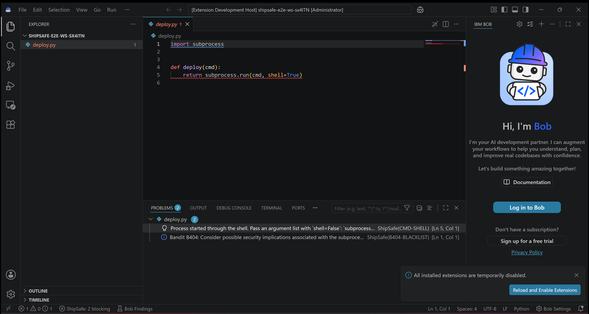
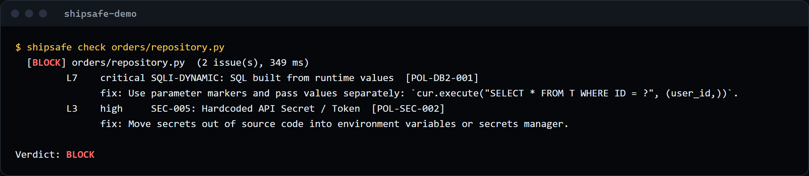
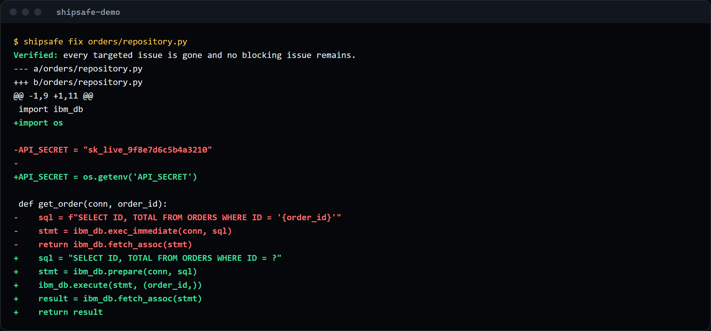
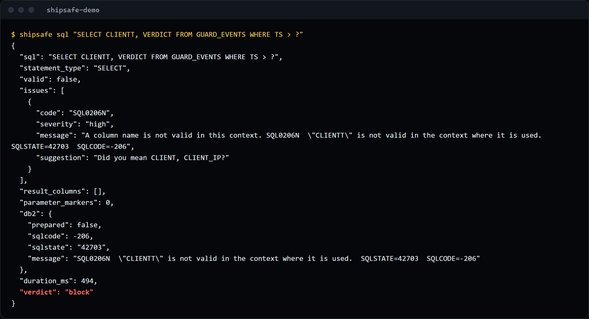
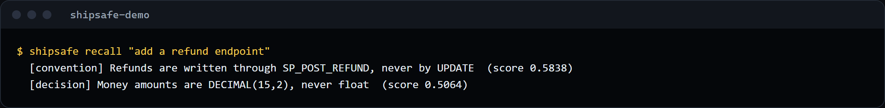
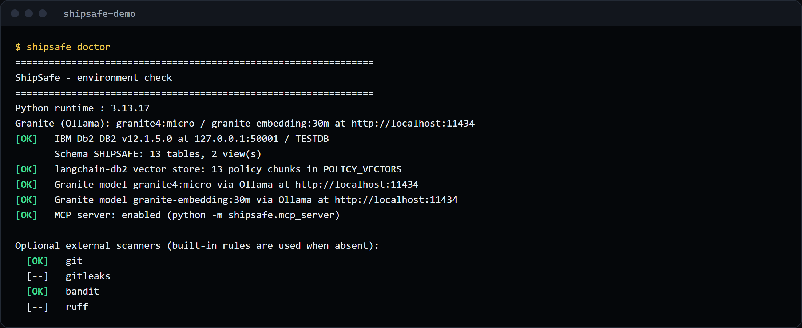
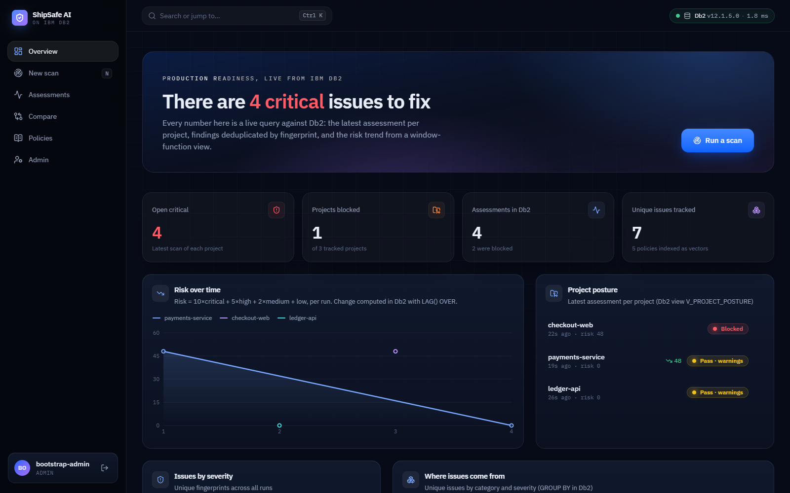
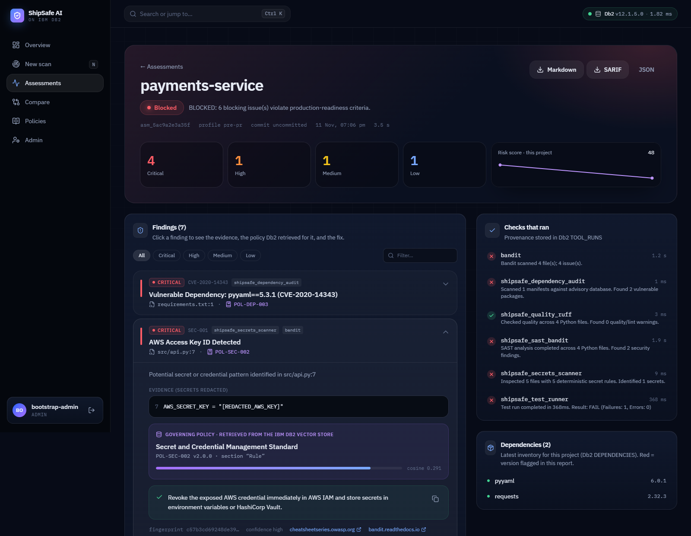
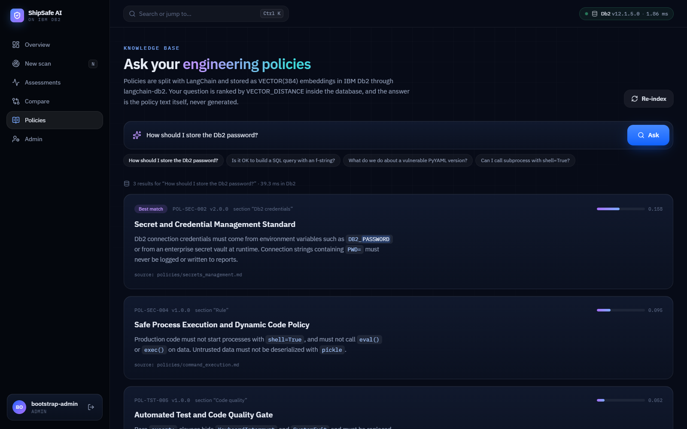
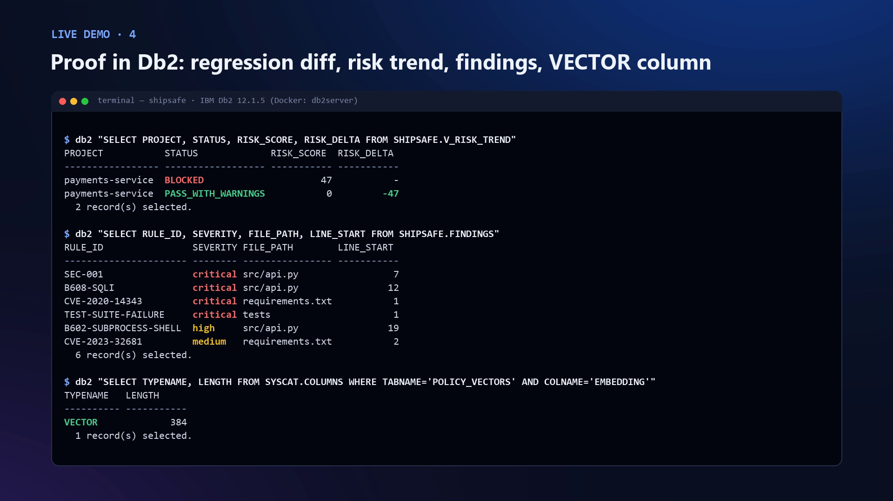

# ShipSafe for IBM Bob

**Your AI writes the code. ShipSafe makes it shippable.**

ShipSafe is an add-on for **IBM Bob** and any MCP-capable AI IDE (VS Code, Claude Code, Cursor). While the
assistant works, it checks every file *before* it is written, fixes problems with local **IBM Granite** and
proves each fix, validates SQL against your real **IBM Db2** database, and remembers your team's decisions
between sessions. Every check, fix, memory and policy lives in IBM Db2.

> 11 MCP tools · 3 Db2 stored procedures · 2 Db2 vector stores · 218 tests, 99% coverage, no mocks ·
> everything runs on your machine

**Live site, install guide and downloads: [shipsafe-bob.vercel.app](https://shipsafe-bob.vercel.app)**


*Real IBM Bob window from our end-to-end test: ShipSafe flags `shell=True` (CMD-SHELL, policy POL-SEC-004) and the status bar shows "ShipSafe: 2 blocking".*

| Read next | |
|---|---|
| [docs/INNOVATIONS.md](docs/INNOVATIONS.md) | What is new, and how each claim was proved |
| [architecture.md](architecture.md) | Components, data flow, Db2 schema |
| [docs/getting-started.md](docs/getting-started.md) | Install in four steps, IDE setup, troubleshooting |
| [docs/mcp-tools.md](docs/mcp-tools.md) | Every tool, its arguments and output, the rule catalogue |
| [docs/db2-design.md](docs/db2-design.md) | Tables, vectors, procedures, PREPARE validation |
| [docs/SECURITY.md](docs/SECURITY.md) · [docs/threat-model.md](docs/threat-model.md) | Security scan results, fixes, controls, threats |
| [docs/testing.md](docs/testing.md) | How the tests run on real Db2 and Granite |

## Table of Contents
1. [Problem Statement](#problem-statement)
2. [Solution Overview](#solution-overview)
3. [IBM Db2 Integration](#ibm-db2-integration)
4. [AI / LLM Architecture](#ai--llm-architecture)
5. [Tech Stack](#tech-stack)
6. [Prerequisites](#prerequisites)
7. [Setup & Installation](#setup--installation)
8. [Configuration](#configuration)
9. [Running the Project](#running-the-project)
10. [Testing & Verification](#testing--verification)
11. [Screenshots & Demo](#screenshots--demo)
12. [Known Limitations & Future Roadmap](#known-limitations--future-roadmap)
13. [Team Members & Credits](#team-members--credits)

---

## Problem Statement

AI assistants such as IBM Bob now write a large share of new code. They are fast, but the checks that keep
code safe (security rules, team conventions, database correctness) still run later, in CI or in review. By
then the assistant has moved on, a person has to explain the problem back to it, and the same mistakes
return in the next session because nothing remembers the team's decisions.

Three gaps stand out:
- **Nothing checks code at the moment it is written.** Secrets, SQL injection and shell commands reach the
  repository before anyone looks.
- **AI fixes are trusted, not verified.** A model's patch can look right and still be insecure or broken.
- **The assistant does not know your database or your decisions.** It guesses table and column names, and
  it forgets agreements as soon as the chat ends.

## Solution Overview

ShipSafe gives the assistant tools that it calls on its own. A rules file installed into Bob says when.

| When | Tool | What happens |
|---|---|---|
| Start of a task | `shipsafe_recall` | Relevant team decisions come back from a Db2 vector table |
| Before writing a file | `shipsafe_check_code` | clean / warn / block in about 0.4 s, each issue with the reason, the fix and the team policy |
| After a block | `shipsafe_fix_code` | A CrewAI crew on Granite rewrites the file; the same checks must pass before it is accepted |
| Before using SQL | `shipsafe_db2_schema`, `shipsafe_check_sql` | The real schema, and Db2 itself validates the statement without running it |
| When unsure | `shipsafe_ask_standards` | Granite answers from team policies found by Db2 vector search, with checked citations |
| After a decision | `shipsafe_remember` | Stored as a Granite embedding in Db2 for later sessions |
| Before "done" | `shipsafe_readiness_check` | Full gate: secrets, code, dependency CVEs, tests, risk trend |

The same server powers a **VS Code / Bob extension** (Problems panel on save, verified quick fix, SQL check,
memory commands), a **CLI** with a git pre-commit hook, and a **REST API with a team dashboard**.

**Highlights** (details and proof in [docs/INNOVATIONS.md](docs/INNOVATIONS.md)):
- Python rules read the syntax tree, so comments and docstrings never raise false alarms, and SQL is
  followed through variables.
- A Granite fix is tested by running the fixed function against a real Db2 table: the query still works
  and the injection returns nothing.
- A Db2-specific rule (`DB2-API-MISUSE`) came from mistakes the model made in testing: code that was
  secure but would have failed at runtime.

## IBM Db2 Integration

Db2 is the system of record for everything ShipSafe does ([docs/db2-design.md](docs/db2-design.md)):

| Capability | How Db2 is used |
|---|---|
| Policy citations | `POLICY_VECTORS` with `VECTOR(384, FLOAT32)`, ranked by `VECTOR_DISTANCE(COSINE)` through **LangChain `langchain-db2`** |
| Project memory | `MEMORY_VECTORS` through **Haystack `ibm-db-haystack`**, filtered by project and kind inside Db2 |
| SQL validation | Server-side `PREPARE` with deferred prepare off: SQL0104N / SQL0204N / SQL0206N, result columns, nothing executed |
| Schema awareness | Catalog read through **SQLAlchemy + `ibm_db_sa`** inspector, used for "did you mean" suggestions |
| Analytics | `SP_PROJECT_RISK` (OUT parameters), `SP_GUARD_SUMMARY` (dynamic result set) over views using `LAG` and `ROW_NUMBER` |
| Retention | `SP_PURGE_HISTORY` with `SIGNAL SQLSTATE`, `GET DIAGNOSTICS` and `ON DELETE CASCADE` |
| Records | `GUARD_EVENTS`, `FIX_ATTEMPTS`, assessments and findings; `MERGE` upserts; atomic multi-table saves |
| Security | Hashed API tokens, append-only audit log, least-privilege role script, `?` markers everywhere |

## AI / LLM Architecture

All models are **IBM Granite**, served locally by **Ollama**: `granite4:micro` for chat and
`granite-embedding:30m` (384 dimensions) for vectors. Each framework has one job:

- **CrewAI**: the fix crew. A security analyst writes a plan from the exact findings and the policy
  retrieved from Db2; an engineer returns the corrected file. Verification is deterministic, with up to three rounds.
- **LangChain**: policy ingestion (Markdown splitters), the `DB2VS` vector store, and an LCEL retrieval
  chain that answers questions from retrieved policy text only.
- **Haystack**: the remember and recall pipelines (Ollama embedders, `DocumentWriter`, `IBMDb2EmbeddingRetriever`).
- **Guardrails**: the model never decides a verdict. Fixes must pass the deterministic checks, and cited
  policy ids are compared with what Db2 actually returned.

See [architecture.md](architecture.md) for the full diagram and data flow.

## Tech Stack

| Layer | Technology |
|---|---|
| Database | IBM Db2 12.1.5 Community Edition (created with the IBM Db2 Developer Extension) |
| Drivers | `ibm_db`, `ibm_db_dbi`, `ibm_db_sa` + SQLAlchemy 2 |
| AI frameworks | LangChain (`langchain-db2`, `langchain-ollama`), Haystack (`ibm-db-haystack`, `ollama-haystack`), CrewAI |
| Models | IBM Granite via Ollama: `granite4:micro`, `granite-embedding:30m` |
| IDE integration | Model Context Protocol (official Python SDK), VS Code / Bob extension (TypeScript) |
| Analysis | Python `ast`, Bandit, pip-audit |
| API and dashboard | FastAPI, React, Tailwind, React Bits |
| Tests | pytest, pytest-cov, Node test runner |

## Prerequisites

- Python **3.11–3.13**
- IBM Db2 12.1 (the free IBM Db2 Developer Extension for VS Code creates one locally), or Docker
- Ollama with `granite4:micro` and `granite-embedding:30m`
- IBM Bob or VS Code (Node 20+ only if you build the extension yourself)

## Setup & Installation

```bash
# 1. Clone and enter the submission
git clone https://github.com/ddevSharma/IBM_Db2_TechX_Project_Submission.git
cd IBM_Db2_TechX_Project_Submission/submissions/shipsafe-ai

# 2. Install (Python 3.11-3.13)
python -m venv .venv && . .venv/bin/activate        # Windows: .venv\Scripts\activate
pip install -e ".[dev,scanners]"

# 3. Models
ollama pull granite4:micro
ollama pull granite-embedding:30m

# 4. Point at your Db2 and set everything up (schema, procedures, policy vectors)
cp .env.example .env        # fill in DB2_PASSWORD
shipsafe setup

# 5. Connect your IDE inside the project you work on
shipsafe connect bob        # or: vscode | claude | cursor
```

Extension: download it from [shipsafe-bob.vercel.app](https://shipsafe-bob.vercel.app/#get) (or build it with
`cd extension && npm ci && npm run package`), then
`bobide --install-extension "$HOME/Downloads/shipsafe-3.0.0.vsix"` (or `code --install-extension ...`).
Step-by-step guide with expected output: [docs/getting-started.md](docs/getting-started.md).

## Configuration

All settings come from environment variables, `./.env` or `~/.shipsafe/.env` (written by `shipsafe setup`).
See [.env.example](.env.example).

| Variable | Default | Purpose |
|---|---|---|
| `DB2_HOST` / `DB2_PORT` / `DB2_NAME` | `127.0.0.1` / `50001` / `TESTDB` | Db2 instance (defaults match the IBM Db2 VS Code extension) |
| `DB2_USERNAME` / `DB2_PASSWORD` | `db2inst1` / — | Credentials (never committed) |
| `DB2_SSL` | `false` | TLS for Db2 on Cloud |
| `DB2_SCHEMA` | `SHIPSAFE` | Schema for every table, view, procedure and vector table |
| `OLLAMA_HOST` | `http://localhost:11434` | Local model server |
| `SHIPSAFE_CHAT_MODEL` / `SHIPSAFE_EMBED_MODEL` | `granite4:micro` / `granite-embedding:30m` | Granite models |
| `SHIPSAFE_WORKSPACE` | current folder | Workspace root for file tools (the IDE sets it) |

## Running the Project

```bash
shipsafe-mcp                        # the MCP server (your IDE starts this for you)
shipsafe check src/app.py           # guard a file; exit code 1 on block
shipsafe fix src/app.py --write     # Granite crew; writes only a verified fix
shipsafe sql "SELECT NAME FROM CUSTOMERS WHERE ID = ?"
shipsafe ask "How must we store API keys?"
shipsafe remember "Money is DECIMAL(15,2), never float" --kind decision
shipsafe recall "add a refund endpoint"
shipsafe report                     # what was caught per IDE (SP_GUARD_SUMMARY)
shipsafe hook                       # git pre-commit hook
shipsafe serve                      # REST API + team dashboard on http://127.0.0.1:8080
shipsafe doctor                     # Db2, vectors, Granite and scanner health
```

## Testing & Verification

```bash
pytest --cov=shipsafe               # 218 tests, 99% coverage, real Db2 + Granite, no mocks
cd extension && npm test            # extension unit tests
```

Tests run in a separate schema, `SHIPSAFE_TEST`, recreated on every run. Notable tests:
- the MCP server driven over stdio by the official MCP client, the way Bob launches it;
- a Granite fix executed against a real Db2 table;
- every stored procedure, cascade and the atomic save on Db2;
- a killed Db2 connection replaced by the pool.

Security checks on our own code (Bandit: 0 medium/high; npm audit: 0; ShipSafe on itself: no blocking
issue) are in [docs/SECURITY.md](docs/SECURITY.md). [docs/testing.md](docs/testing.md) lists the bugs these
real-infrastructure tests found.

## Screenshots & Demo

Every image below is the real output of the command shown, run against IBM Db2 12.1.5 and local Granite.

**The guard blocks an SQL injection and a hardcoded secret, citing team policies from Db2**


**Granite fixes it; the same checks verify the fix (2 rounds, saved to Db2 `FIX_ATTEMPTS`)**


**Db2 itself rejects a wrong column name (SQL0206N) and the catalog suggests the right one**


**Project memory recalled from a Db2 vector table**


**Health check: Db2, vector store, Granite models and scanners**



- **Landing page (live):** [https://shipsafe-bob.vercel.app](https://shipsafe-bob.vercel.app), install guide and downloads ([source](https://github.com/ddevSharma/IBM_Db2_TechX_Project_Submission_ShipSafe_AI_Landing_Page))
- **Team dashboard** (`shipsafe serve`):






## Known Limitations & Future Roadmap

- Code rules cover Python deeply and JavaScript/TypeScript at token level; Java and Go are next.
- `granite4:micro` is small enough for a laptop; fixes take about 30 s per round. A larger Granite model on a
  GPU server is a configuration change (`SHIPSAFE_CHAT_MODEL`, `OLLAMA_HOST`).
- Project memory has no review step yet; a team approval flow for shared decisions is planned.
- CrewAI pulls in `chromadb`, which has open advisories without a fix; ShipSafe does not use it
  (see [docs/SECURITY.md](docs/SECURITY.md)).
- Planned: a Db2 SQL migration reviewer, and IDE events streamed to a team dashboard view.

## Team Members & Credits

- **Devanshu Sharma** ([@ddevSharma](https://github.com/ddevSharma)): solo developer.

Built for **Db2Hack** at the IBM Db2 TechX Summit 2026. Thanks to the IBM Db2 team for the Db2 Developer
Extension, `langchain-db2` and `ibm-db-haystack`, and to the IBM Granite team for open models.
Licence: Apache-2.0.
