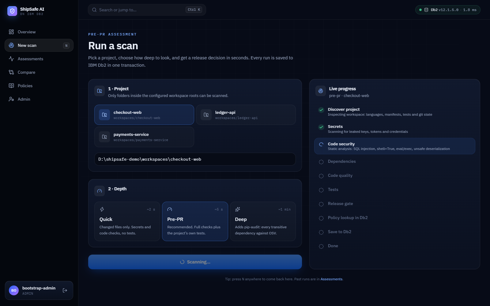
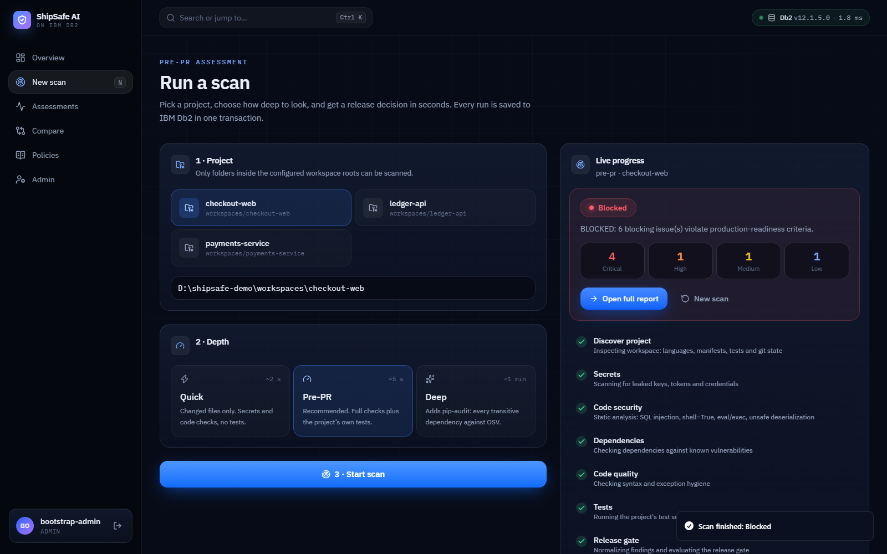
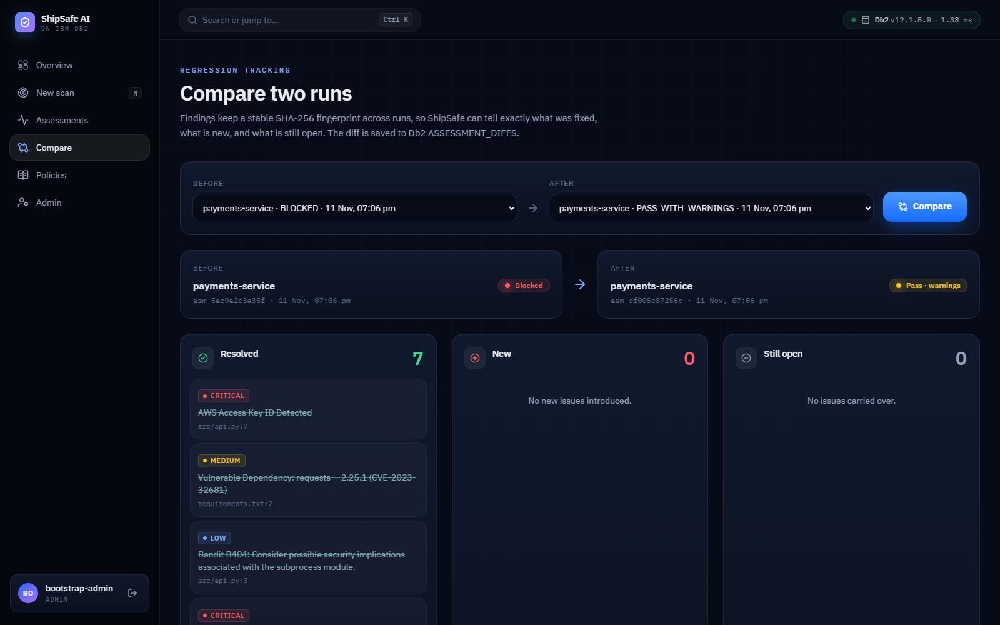
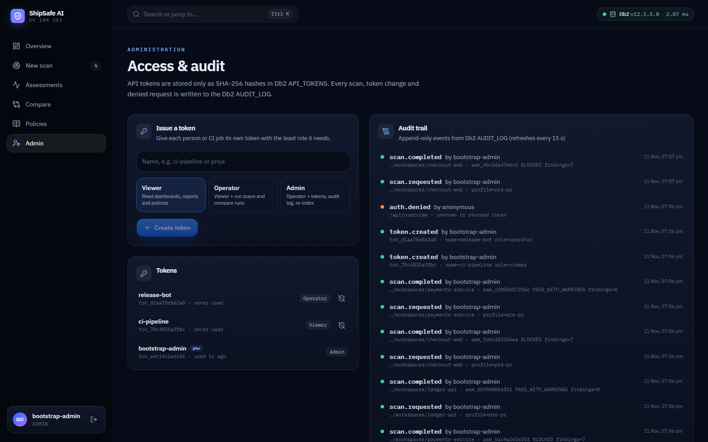
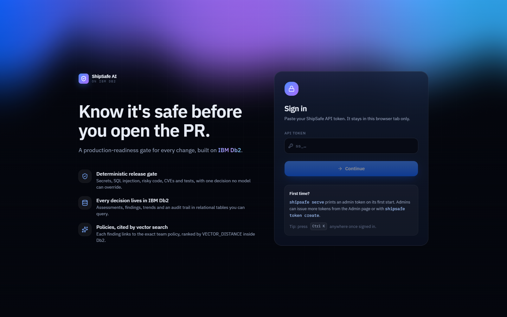
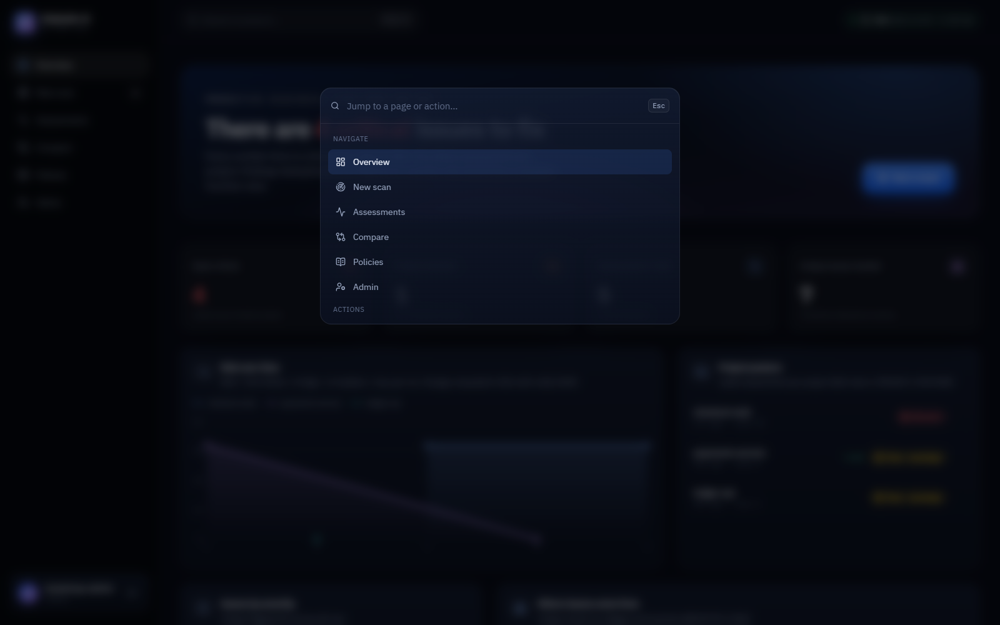
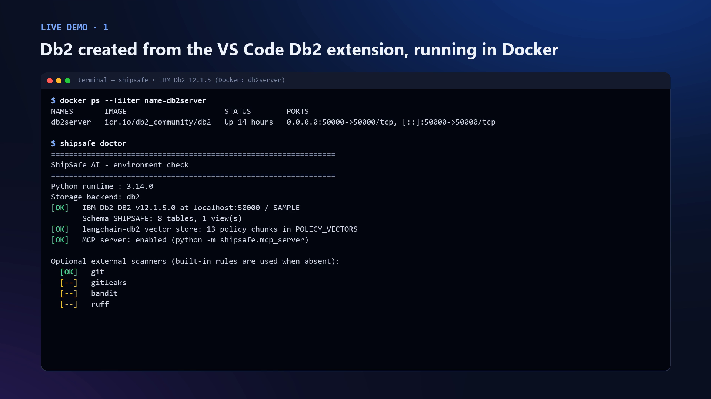

# ShipSafe AI: Pre-PR Production-Readiness Gate on IBM Db2

> **One-line pitch:** ShipSafe AI tells you whether a change is safe to open as a pull request. It scans for leaked secrets, SQL injection, risky code, vulnerable dependencies and failing tests; gives one deterministic **PASS / PASS_WITH_WARNINGS / BLOCKED** decision; cites the exact team policy behind every finding using **LangChain + IBM Db2 vector search**; and keeps every assessment, trend and audit event in **IBM Db2**. It ships as a polished web app, a REST API, a CLI and an MCP server for IBM Bob.


---

## Table of Contents
- [Problem Statement](#problem-statement)
- [Solution Overview](#solution-overview)
- [Product Tour](#product-tour)
- [IBM Db2 Integration](#ibm-db2-integration)
- [AI / LLM Architecture](#ai--llm-architecture)
- [Security & Production Readiness](#security--production-readiness)
- [Tech Stack](#tech-stack)
- [Prerequisites](#prerequisites)
- [Setup & Installation](#setup--installation)
- [Configuration](#configuration)
- [Running the Project](#running-the-project)
- [Testing & Verification](#testing--verification)
- [Screenshots & Demo](#screenshots--demo)
- [Known Limitations & Future Roadmap](#known-limitations--future-roadmap)
- [Team Members & Credits](#team-members--credits)

---

## Problem Statement
- **Code now ships faster than it can be reviewed.** With AI assistants and tight deadlines, pull requests compile and pass a quick test but still carry a hardcoded key, an f-string SQL query, a `shell=True` call or a package with a known CVE.
- **Who feels it:** developers who want a fast "is this safe to open?" answer; reviewers and tech leads who need consistent, explainable merge decisions; Db2, platform and security teams who own rules like "always use parameter markers" and need proof they are followed.
- **Why current tooling falls short:** Bandit, Gitleaks and pip-audit each print their own output and remember nothing. None of them links a finding to *your* written policy, tracks whether last week's issue was really fixed, or gives one decision that the whole team can trust.

## Solution Overview
1. **Discover** the project: languages, manifests, tests and git state.
2. **Scan** with deterministic, explainable checks: secrets; SAST (SQL built from f-strings, `%` or concatenation, `shell=True`, `eval`/`exec`, `pickle`); dependency CVEs; syntax and bare `except:`; and the project's own test suite. **Bandit** and **pip-audit** run automatically when installed, and their results are merged with the built-in rules.
3. **Normalize** every result into one finding with a stable SHA-256 fingerprint. Duplicates from different tools collapse into one finding that lists every source.
4. **Gate** deterministically: any critical or high finding, or a failing test, means `BLOCKED`. No model can override it.
5. **Explain** each finding with the governing team policy, retrieved from **IBM Db2's native vector store** through **LangChain** and quoted word for word.
6. **Remember** everything in IBM Db2, in one transaction per assessment: history, regression diffs (new / resolved / still open), risk trends computed with window functions, and an append-only audit trail.

One engine, four ways in: a **web app** for the team, a **REST API** for automation, a **CLI** for developers and CI (with **SARIF** for GitHub code scanning), and an **MCP server** for IBM Bob.

## Product Tour
| | |
|---|---|
| **Run a scan in three clicks.** Pick a project, choose a depth, and watch each check complete live. |  |
| **Get one clear decision.** The verdict, severity counts and a link straight to the full report. |  |
| **Understand every finding.** Redacted evidence, the policy Db2 retrieved for it with its similarity score, a copyable fix and references. |  |
| **Prove the fix landed.** Compare two runs by fingerprint: resolved, new and still open. |  |
| **Ask your policies.** Plain-language questions answered by `VECTOR_DISTANCE` inside Db2, never generated. |  |
| **Control access.** Role-based API tokens and a live audit trail, both stored in Db2. |  |

Keyboard-first: <kbd>Ctrl</kbd>+<kbd>K</kbd> opens a command palette from anywhere, and <kbd>N</kbd> starts a new scan.

## IBM Db2 Integration
- **Edition & environment:** IBM Db2 Community Edition **12.1.5** in Docker (`icr.io/db2_community/db2`), including instances created with the **IBM Db2 Developer Extension for VS Code**. Db2 on Cloud works with `DB2_SECURITY=SSL`. The native `VECTOR` type needs 12.1.2 or later.
- **Connectors:** `ibm_db` / `ibm_db_dbi` (DB-API 2.0) through a thread-safe, self-healing **connection pool**; `langchain-db2` (`DB2VS`) for the vector store on the same connections.
- **Schema `SHIPSAFE`** (created idempotently; full DDL in [`docs/db2-schema.sql`](docs/db2-schema.sql)):

  | Object | Purpose |
  |---|---|
  | `PROJECTS` | One row per scanned repository |
  | `ASSESSMENTS` | One row per run: profile, gate decision, reason, severity counts, timings |
  | `TOOL_RUNS` | Provenance for every check: tool, version, exit code, duration, `passed` / `failed` / `skipped` |
  | `FINDINGS` | Normalized findings: fingerprint, rule, severity, location, redacted evidence (`CLOB` JSON), policy citation, fix |
  | `DEPENDENCIES` | Latest dependency inventory per project |
  | `KNOWLEDGE_DOCS` | Source policy documents and versions |
  | `POLICY_VECTORS` | Policy chunks with `VECTOR(384, FLOAT32)` embeddings (managed by `langchain-db2`) |
  | `ASSESSMENT_DIFFS` | Regression results between two runs |
  | `API_TOKENS` | API tokens stored only as SHA-256 hashes, with a `CHECK`-constrained role |
  | `AUDIT_LOG` | Append-only security events: scans, token changes, denied requests |
  | `V_RISK_TREND` (view) | Risk score per run with `LAG()` delta and `ROW_NUMBER()` recency rank |
  | `V_PROJECT_POSTURE` (view) | Latest assessment per project, built on `V_RISK_TREND` |

  Foreign keys cascade on delete; 7 secondary indexes cover time, severity, fingerprint, package and audit lookups.
- **Key queries & operations:**
  - **Atomic persistence:** project `MERGE`, inventory, assessment, tool runs and findings commit together or roll back together.
  - **Vector search:** `VECTOR_DISTANCE(EMBEDDING, VECTOR(?, 384, FLOAT32), COSINE)` ranks policy chunks inside Db2, scoped by the finding's category.
  - **Analytics:** window functions for the risk trend and posture; `GROUP BY` with `COUNT(DISTINCT FINGERPRINT)` for unique issues; dashboard KPIs in a single round-trip.
  - **Operations:** `SYSCAT` checks for idempotent DDL, `SYSIBMADM.ENV_INST_INFO` for the live server level, and `SYSIBM.SYSDUMMY1` pings for pool health and the latency shown in the UI.

## AI / LLM Architecture
- **Framework:** **LangChain**. `MarkdownHeaderTextSplitter` and `RecursiveCharacterTextSplitter` chunk the policies, and `langchain_db2.DB2VS` stores and searches them.
- **Embeddings:** offline, deterministic `HashingEmbeddings` (a LangChain `Embeddings` implementation over word unigrams, bigrams and character trigrams, 384 dimensions). It needs no downloads and gives reproducible results. Set `SHIPSAFE_EMBEDDINGS=huggingface` for `sentence-transformers/all-MiniLM-L6-v2`.
- **Retrieval workflow:** each finding's title and description become a query. Db2 ranks chunks within the finding's policy category, falling back to all policies, and the top match is attached with its ID, version, section and similarity score.
- **Evidence before AI:** findings and the gate are fully deterministic. Retrieval only adds citations, and the answer to a policy question is always the stored policy text, never generated.

## Security & Production Readiness
| Area | What ShipSafe does |
|---|---|
| **Authentication** | Bearer tokens (`ss_` + 256-bit random), stored only as SHA-256 hashes in Db2 and shown once at creation. The first `shipsafe serve` prints a one-time admin token. |
| **Authorization** | Roles: `viewer` (read), `operator` (+ run scans, compare), `admin` (+ tokens, audit, re-index). Enforced on every API route and mirrored in the UI. |
| **Audit** | Every scan, token change, re-index and denied request is written to the append-only Db2 `AUDIT_LOG`, viewable live on the Admin page. |
| **Input safety** | All SQL uses `?` parameter markers. API inputs are validated with Pydantic. Scan targets must resolve inside `SHIPSAFE_ALLOWED_ROOTS`, so path traversal is rejected. Scans are rate-limited per token. |
| **Execution safety** | Fixed argument lists with `shell=False`, timeouts and output caps. Scanned code is never modified, and Docker mounts workspaces read-only. |
| **Secrets** | Credentials come only from the environment. Logs and evidence redact keys, tokens and `PWD=` values. The UI keeps its token in `sessionStorage` for the tab only. |
| **HTTP hardening** | Strict CSP, `X-Frame-Options: DENY`, `nosniff`, `no-referrer`, `no-store` on API responses, CORS off unless configured, and a request ID on every response. |
| **Resilience** | Db2 connection pool with validation, retry and backoff, and automatic replacement of dead connections. All-or-nothing writes. If Db2 is down, scans still run and say clearly that results were not saved. Health (`/api/health`) and readiness (`/api/ready`) endpoints. |
| **Least privilege** | `init-db` can run with admin credentials while the app runs as a DML-only role; see [`docs/db2-least-privilege.sql`](docs/db2-least-privilege.sql). |
| **Operations** | Structured JSON logs, startup config validation, a non-root container with a healthcheck, and Docker Compose for Db2 + app. |
| **CI** | `shipsafe scan --offline --format sarif` fails a PR on `BLOCKED` and shows findings inline through GitHub code scanning; see [`ci/github-actions-shipsafe.yml`](ci/github-actions-shipsafe.yml). |

Threat model: [`docs/threat-model.md`](docs/threat-model.md).

## Tech Stack
- **Backend:** Python 3.10+ (test suite run on 3.14; Docker image runs 3.12), FastAPI + Uvicorn, standard-library CLI, MCP over stdio
- **Database:** IBM Db2 Community Edition 12.1.5 (`ibm_db`, `ibm_db_dbi`)
- **AI / retrieval:** LangChain, `langchain-db2`
- **Scanners:** built-in rules, Bandit, pip-audit (Gitleaks when installed)
- **Frontend:** React 19, TypeScript, Vite, Tailwind CSS v4, Motion, Recharts, cmdk, with [React Bits](https://reactbits.dev) components (Aurora, BlurText, GradientText, ShinyText, SpotlightCard, CountUp, ClickSpark, DecryptedText)
- **Ops:** Docker multi-stage image, Docker Compose, GitHub Actions template

## Prerequisites
- Docker Desktop (for Db2 Community Edition and/or the app image), or a running Db2 12.1.2+ instance
- For local development: Python 3.10+ and Node.js 20+

## Setup & Installation

**Option A: everything in Docker (recommended).**
```bash
cd submissions/shipsafe-ai
cp .env.example .env                 # set DB2_PASSWORD
docker compose up -d --build         # first Db2 start takes ~5-10 minutes
docker compose logs shipsafe         # copy the one-time admin token
# open http://localhost:8080 and paste the token
```
Put projects to scan in `./workspaces` (mounted read-only). Already have Db2 running, for example from the VS Code Db2 extension? Set `DB2_HOST=host.docker.internal` in `.env` and run `docker compose up -d --build --no-deps shipsafe`.

**Option B: local Python + Node.**
```bash
cd submissions/shipsafe-ai
cp .env.example .env                 # point DB2_* at your Db2
python -m venv .venv && source .venv/bin/activate     # Windows: .venv\Scripts\activate
pip install -e ".[scanners]"
(cd web && npm ci && npm run build)
shipsafe serve                       # prints the one-time admin token on first start
```

## Configuration
Everything is configured through environment variables (`.env` is read automatically). [`.env.example`](.env.example) documents each one. The most important:

| Variable | Default | Meaning |
|---|---|---|
| `DB2_HOST` / `DB2_PORT` / `DB2_DATABASE` | `localhost` / `50000` / `SAMPLE` | Where Db2 is |
| `DB2_USERNAME` / `DB2_PASSWORD` | `db2inst1` / *(required)* | Runtime credentials |
| `DB2_ADMIN_USERNAME` / `DB2_ADMIN_PASSWORD` | *(unset)* | Optional admin credentials for `init-db` only |
| `SHIPSAFE_ALLOWED_ROOTS` | `./fixtures` | Folders the API may scan |
| `SHIPSAFE_AUTH` | `true` | Token auth (can only be disabled on localhost) |
| `SHIPSAFE_PIP_AUDIT` | `deep` | When to run pip-audit: `deep`, `always` or `off` |
| `SHIPSAFE_LOG_FORMAT` | `text` | `json` for structured logs |

## Running the Project
**Web app:** `shipsafe serve` → http://localhost:8080. Interactive API docs at `/api/docs`.

**CLI:**
```bash
shipsafe doctor                                          # Db2 version, schema, vector store, scanners
shipsafe scan --target ./workspaces/payments-service     # BLOCKED -> exit code 1
shipsafe scan --target . --format sarif --output shipsafe.sarif
shipsafe scan --target . --offline                       # CI without a database
shipsafe history                                         # risk trend from V_RISK_TREND
shipsafe assessment compare <previous_id> <current_id>
shipsafe knowledge query "how should I store the Db2 password?"
shipsafe token create --name ci-pipeline --role viewer
shipsafe audit
```

**REST API** (all routes except health and readiness need `Authorization: Bearer <token>`):

| Method & path | Role | Purpose |
|---|---|---|
| `GET /api/health`, `GET /api/ready` | public | Liveness; Db2 readiness with version, latency and vector count |
| `GET /api/overview` | viewer | KPIs, posture, trend and breakdown |
| `GET /api/assessments`, `GET /api/assessments/{id}` | viewer | History and full report |
| `GET /api/assessments/{id}/report?format=markdown\|json\|sarif` | viewer | Export |
| `GET /api/compare?previous=&current=` | viewer | Regression diff |
| `POST /api/scans`, `GET /api/scans/{job}` | operator / viewer | Start a scan, follow its progress |
| `POST /api/policies/search` | viewer | Vector search in Db2 |
| `POST /api/policies/reindex`, `/api/tokens`, `/api/audit` | admin | Administration |

**MCP (IBM Bob):** `python -m shipsafe.mcp_server`, with 7 tools: discover, run assessment, get assessment, get finding, retrieve guidance, compare, export report.

## Testing & Verification
```bash
pip install -e ".[scanners,dev]"
PYTHONPATH=src python -m unittest discover -s tests -p "test_*.py"                              # offline
SHIPSAFE_DB2_INTEGRATION=1 PYTHONPATH=src python -m unittest discover -s tests -p "test_*.py"   # + live Db2
```
42 tests: API auth, roles, path allowlisting, rate limiting, scan jobs and exports; Bandit and pip-audit adapters; cross-tool merging; SARIF; connection-pool recovery; the release gate; and **live IBM Db2 integration** (real connection, vector search, persisted scans, audit trail, policy search through the API).

**Check Db2 directly:**
```sql
SET SCHEMA SHIPSAFE;
SELECT PROJECT_NAME, STATUS, RISK_SCORE, RISK_DELTA FROM V_RISK_TREND ORDER BY STARTED_AT;
SELECT RULE_ID, SEVERITY, FILE_PATH, LINE_START FROM FINDINGS WHERE ASSESSMENT_ID = '<id>';
SELECT ACTION, ACTOR, OUTCOME FROM AUDIT_LOG ORDER BY TS DESC FETCH FIRST 10 ROWS ONLY;
SELECT TYPENAME, LENGTH FROM SYSCAT.COLUMNS WHERE TABNAME = 'POLICY_VECTORS' AND COLNAME = 'EMBEDDING';
```

## Screenshots & Demo
- **Demo video:** linked in the pull request description
- **Sample report:** [`docs/sample-report.md`](docs/sample-report.md)

| Sign in | Command palette |
|---|---|
|  |  |

Straight from the terminal and the Db2 command line:




## Known Limitations & Future Roadmap
- **Limitations:**
  - Built-in rules and Bandit target Python. Other languages are discovered but only checked for secrets.
  - The curated CVE list is small; full coverage comes from pip-audit (the `deep` profile, which needs network).
  - Hashing embeddings match shared vocabulary rather than deep meaning. Use the Hugging Face option for better recall.
  - The dependency inventory is the latest per project, not a snapshot per assessment.
  - Scan jobs are held in the API process's memory (results themselves are in Db2). A multi-replica setup would need a shared queue.
- **Next steps:** IBM Granite fix suggestions through watsonx.ai or Ollama (never allowed to change the gate); a GitHub App that comments on PRs; per-assessment SBOM snapshots; SSO (OIDC) for the web app.

## Team Members & Credits
| Name | GitHub Handle | Role / Contribution |
|---|---|---|
| Devanshu Sharma | [@ddevSharma](https://github.com/ddevSharma) | Design and engineering: scanners, IBM Db2 schema and persistence, LangChain/Db2 vector retrieval, API, web app, MCP server, docs |

**Credits:** IBM Db2 Community Edition; [`langchain-db2`](https://pypi.org/project/langchain-db2/) and LangChain; [Bandit](https://github.com/PyCQA/bandit) and [pip-audit](https://github.com/pypa/pip-audit); UI components from [React Bits](https://reactbits.dev) (MIT + Commons Clause), IBM Plex fonts (OFL) and Lucide icons (ISC). ShipSafe AI is licensed under [Apache-2.0](LICENSE).
