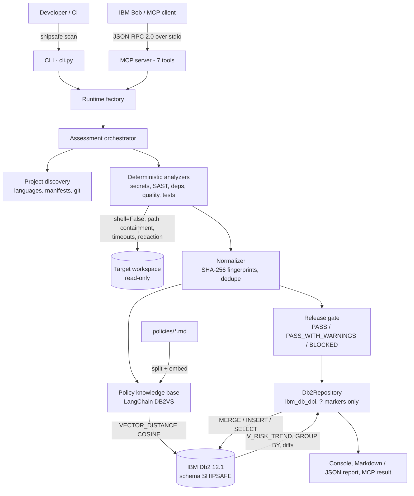

# ShipSafe AI: System Architecture

## Overview
ShipSafe AI is a local-first Python engine with two entry points: a CLI for developers and CI, and an MCP server over stdio for IBM Bob and other MCP clients. Both call one orchestrator that runs deterministic checks, normalizes and fingerprints findings, evaluates a release gate, and persists everything to **IBM Db2**. Engineering policies are stored as vectors in Db2 through **LangChain (`langchain-db2`)**, and each finding is linked to its governing policy by a cosine-distance search executed inside Db2.

---

## Architecture Diagram



---

## Component Breakdown

1. **Interface layer**
   - `cli.py`: `doctor`, `init-db`, `ingest`, `discover`, `scan`, `assessment show|compare`, `history`, `knowledge query`. `scan` exits with code 1 when the gate is `BLOCKED`, so it can fail a CI job.
   - `mcp_server.py`: MCP protocol `2024-11-05` over stdio with 7 typed tools. It connects to Db2 lazily, so `initialize` and `tools/list` answer immediately, and it ignores JSON-RPC notifications as the spec requires.
2. **Application layer**
   - `runtime.py` connects to Db2, ensures the schema exists, ingests policies on first use, and wires the services.
   - `orchestration/engine.py` plans checks by profile (`quick` limits scanning to changed files and skips tests; `pre-pr` and `deep` run the test suite), runs the analyzers, deduplicates, gates, retrieves policies and persists.
   - `analyzers/`: secrets (5 rules, or Gitleaks when installed), SAST (SQL built with f-strings / `%` / concatenation, `shell=True`, `eval`/`exec`, `pickle`), dependencies (curated CVE advisories plus inventory), quality (AST syntax and bare `except`), tests (runs the project's `unittest` suite with the current interpreter).
   - `analyzers/base.py`: `SafeExecutionBoundary` — fixed argument lists with `shell=False`, path canonicalization against the workspace root, timeouts, output caps and secret redaction.
   - `policies/gate.py`: deterministic gate. Critical or high findings, or a failed test run, give `BLOCKED`. Medium/low findings or skipped checks give `PASS_WITH_WARNINGS`. A skipped check is never counted as passed.
3. **Database layer (IBM Db2)**
   - `db2/repository.py`: DB-API 2.0 over `ibm_db_dbi`. All values are bound with `?` markers. The only identifiers built into SQL are the validated schema name and integer row limits.
   - `db2/schema.py`: 7 tables, 5 indexes and the `V_RISK_TREND` view, created idempotently by checking `SYSCAT`.
4. **AI / retrieval layer**
   - `knowledge/policy_store.py`: LangChain splitters chunk `policies/*.md`, and `langchain_db2.DB2VS` writes chunks into `POLICY_VECTORS (EMBEDDING VECTOR(384, FLOAT32))`. Search runs `VECTOR_DISTANCE(..., COSINE)` in Db2 and results are de-duplicated per policy document.
   - `knowledge/embeddings.py`: `HashingEmbeddings` (offline and deterministic) or Hugging Face sentence-transformers (optional).

---

## Data Flow

1. **Input:** `shipsafe scan --target <repo>`, or the MCP tool `shipsafe_run_assessment`.
2. **Discovery:** bounded directory walk (skips `.git`, `node_modules`, virtualenvs), `git rev-parse` / `git status` through fixed argument lists.
3. **Deterministic analysis:** each analyzer returns a `ToolRun` (provenance) and normalized `Finding`s. Evidence snippets are redacted before storage.
4. **Normalization:** `fingerprint = sha256(rule_id:file_path:line_start:title)`, with paths normalized to `/` so fingerprints match across operating systems. Duplicates merge.
5. **Gate:** deterministic evaluation. The status and reasons are recorded.
6. **Context retrieval:** for each finding, `title + description` is embedded → Db2 `VECTOR_DISTANCE` ranks `POLICY_VECTORS` → the best policy (ID, version, section, verbatim text) is attached as a reference.
7. **Persistence:** `MERGE` the project, replace the dependency inventory, then `INSERT` the assessment, tool runs and findings, and commit.
8. **Delivery:** console summary, Markdown/JSON report, or MCP JSON result. `history` and `compare` read back from Db2.

---

## IBM Db2 Schema & Storage Design

Full DDL: [`docs/db2-schema.sql`](docs/db2-schema.sql) (generated from `src/shipsafe/db2/schema.py`).

```sql
CREATE TABLE ASSESSMENTS (
    ASSESSMENT_ID  VARCHAR(64) NOT NULL PRIMARY KEY,
    PROJECT_ID     VARCHAR(96) NOT NULL,
    PROFILE        VARCHAR(32) NOT NULL,
    STATUS         VARCHAR(32) NOT NULL,          -- PASS | PASS_WITH_WARNINGS | BLOCKED
    GATE_REASON    VARCHAR(512),
    STARTED_AT     BIGINT NOT NULL,
    CRITICAL_COUNT INTEGER DEFAULT 0, HIGH_COUNT INTEGER DEFAULT 0, ...
    CONSTRAINT FK_ASM_PROJ FOREIGN KEY (PROJECT_ID) REFERENCES PROJECTS(PROJECT_ID) ON DELETE CASCADE
);

CREATE TABLE FINDINGS (
    FINDING_ID    VARCHAR(96) NOT NULL PRIMARY KEY,
    ASSESSMENT_ID VARCHAR(64) NOT NULL,
    FINGERPRINT   CHAR(64)    NOT NULL,           -- stable across runs, used for regression diffs
    RULE_ID       VARCHAR(64) NOT NULL,
    SEVERITY      VARCHAR(16) NOT NULL,
    FILE_PATH     VARCHAR(512), LINE_START INTEGER,
    EVIDENCE_JSON CLOB(1M),                       -- redacted evidence
    ...
);

-- Policy chunks written by langchain-db2 (DB2VS)
CREATE TABLE POLICY_VECTORS (ID CHAR(16) PRIMARY KEY, TEXT CLOB, METADATA BLOB, EMBEDDING VECTOR(384, FLOAT32));

-- Risk trend computed in Db2
CREATE OR REPLACE VIEW V_RISK_TREND AS
SELECT A.PROJECT_ID, A.ASSESSMENT_ID, A.STATUS, A.STARTED_AT,
       (A.CRITICAL_COUNT*10 + A.HIGH_COUNT*5 + A.MEDIUM_COUNT*2 + A.LOW_COUNT) AS RISK_SCORE,
       ... - LAG(...) OVER (PARTITION BY A.PROJECT_ID ORDER BY A.STARTED_AT) AS RISK_DELTA
FROM ASSESSMENTS A JOIN PROJECTS P ON P.PROJECT_ID = A.PROJECT_ID;
```

Indexes: `ASSESSMENTS(PROJECT_ID, STARTED_AT DESC)`, `FINDINGS(ASSESSMENT_ID, SEVERITY)`, `FINDINGS(FINGERPRINT)`, `TOOL_RUNS(ASSESSMENT_ID)`, `DEPENDENCIES(PACKAGE_NAME, VERSION)`.

Representative operations:

| Operation | Db2 feature |
|---|---|
| Upsert project | `MERGE INTO ... USING (VALUES (CAST(? AS ...)))` |
| Policy search | `VECTOR`, `VECTOR_DISTANCE(..., COSINE)`, `FETCH FIRST k ROWS ONLY` |
| Risk trend | `LAG()` and `ROW_NUMBER()` window functions in a view |
| Analytics | `GROUP BY CATEGORY, SEVERITY` with `COUNT(DISTINCT FINGERPRINT)` |
| Regression diff | Fingerprint set comparison, results written to `ASSESSMENT_DIFFS` |
| Health check | `SYSIBMADM.ENV_INST_INFO`, `SYSCAT.TABLES` |

---

## Security & Secrets Management
- Db2 credentials come only from environment variables or `.env` (git-ignored). The connection string is never logged or written to reports.
- All SQL values are bound parameters. The schema identifier is validated as alphanumeric/underscore before use in `SET SCHEMA`.
- Scanned repositories are treated as untrusted. ShipSafe never edits them, and runs only fixed commands (`git`, optional scanners, the project's own test suite) with `shell=False`, a timeout and an output cap.
- Secrets found during scanning are redacted before they reach Db2, reports or MCP clients.
- Threat model: [`docs/threat-model.md`](docs/threat-model.md).
