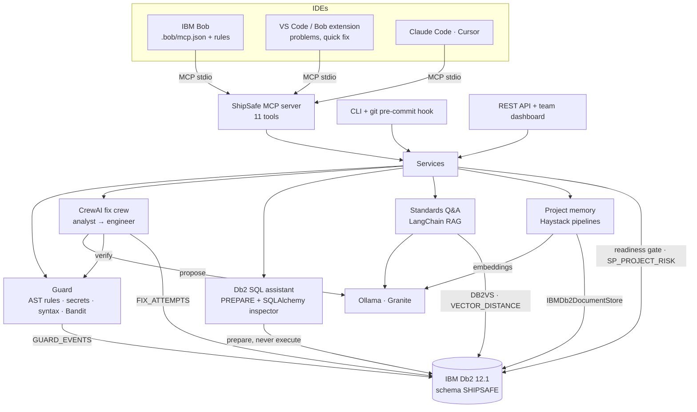

# ShipSafe: System Architecture

## Overview

ShipSafe is an add-on for AI coding assistants. It runs as a local **MCP server** that IBM Bob (and VS Code,
Claude Code, Cursor or any MCP client) launches over stdio. The assistant calls ShipSafe's tools while it
works: before it writes a file, when a check blocks, before it uses SQL, and at the start and end of a task.

Everything ShipSafe knows or records lives in **one IBM Db2 database**: relational tables for checks, fixes,
assessments, tokens and audit; native `VECTOR` columns for team policies (LangChain) and project memory
(Haystack); and SQL PL stored procedures for analytics and retention. Models run locally in **Ollama**
(IBM Granite for chat, Granite embeddings for vectors). No code leaves the machine.

Each framework has exactly one job:

| Component | Job |
|---|---|
| `ibm_db` / `ibm_db_dbi` | Every table, transaction and stored-procedure call |
| SQLAlchemy + `ibm_db_sa` | Read the live catalog (tables, columns, keys, indexes) for the SQL assistant |
| LangChain + `langchain-db2` | Policy vector store (`DB2VS`) and the standards Q&A retrieval chain |
| Haystack + `ibm-db-haystack` | Project-memory document store and the remember / recall pipelines |
| CrewAI | Fix crew: security analyst and engineer agents on Granite |
| Ollama + Granite | `granite4:micro` (chat) and `granite-embedding:30m` (384-dim embeddings) |
| MCP Python SDK | The stdio server every IDE talks to |

---

## Architecture Diagram



---

## Component Breakdown

1. **MCP server** (`src/shipsafe/mcp_server.py`). Built on the official MCP Python SDK (FastMCP), stdio
   transport. Tools: `check_code`, `check_files`, `fix_code`, `check_sql`, `db2_schema`, `ask_standards`,
   `remember`, `recall`, `readiness_check`, `session_report`, `status` (all prefixed `shipsafe_`). The calling
   IDE's name from the MCP handshake is recorded with every event. Native libraries are imported before the
   transport starts, and Db2 and the policy index are warmed up in the background.
2. **Guard** (`src/shipsafe/guard/`, `analyzers/ast_rules.py`). Checks code text before it is written.
   Python is parsed with `ast`, so comments, docstrings and strings never trigger rules; a small data-flow pass
   follows SQL built in a variable to the call that runs it. JS/TS rules run on text with comments and string
   contents blanked. Secret patterns, a syntax check and Bandit (on a temporary copy) complete the picture.
   Findings from different tools on the same line and rule family are merged. Verdict: `block` for critical or
   high, `warn` for medium or low, otherwise `clean`.
3. **Fix crew** (`src/shipsafe/agents/fix_crew.py`). CrewAI, sequential process, two agents on Granite. The
   analyst writes a plan from the exact issues and the team policy retrieved from Db2; the engineer returns the
   whole corrected file. Verification is deterministic: the new code is checked again with the guard, and the
   fix is accepted only when every targeted issue is gone and no new blocking issue appeared. Up to three rounds,
   feeding remaining issues back each time.
4. **Db2 SQL assistant** (`src/shipsafe/db2sql/`). Statements are `PREPARE`d on the Db2 server with deferred
   prepare turned off, so Db2 reports syntax errors (SQL0104N), unknown objects (SQL0204N) and unknown columns
   (SQL0206N) and describes the result columns; the statement is never executed and the transaction is rolled
   back. Unknown names get "did you mean" suggestions from the catalog, read through SQLAlchemy's inspector on
   `ibm_db_sa`. Static rules catch valid-but-risky SQL: UPDATE/DELETE without WHERE, Python placeholders,
   multiple statements, unbounded reads.
5. **Standards Q&A** (`src/shipsafe/knowledge/`). Markdown policies are split with LangChain's header and
   recursive splitters, embedded with Granite and stored in `POLICY_VECTORS` through `DB2VS`. An LCEL chain
   retrieves with `VECTOR_DISTANCE(..., COSINE)` in Db2 and asks Granite to answer only from those excerpts.
   Every policy id in the answer is checked against the retrieved ids; near-misses are corrected and unknown ids
   are marked unverified.
6. **Project memory** (`src/shipsafe/memory/`). Haystack pipelines over `ibm-db-haystack`:
   `OllamaDocumentEmbedder → DocumentWriter → IBMDb2DocumentStore` to remember, and
   `OllamaTextEmbedder → IBMDb2EmbeddingRetriever` to recall. Project, kind, tags and author are stored as
   Db2 metadata and used as filters inside the database. The memory id is a hash of project and normalised
   text, so saving the same decision twice updates it.
7. **Readiness gate** (`src/shipsafe/orchestration/`). The full workspace assessment (secrets, code rules,
   Bandit, dependency CVEs, tests) with a deterministic PASS / PASS_WITH_WARNINGS / BLOCKED gate, saved in one
   transaction; the risk trend comes from the `SP_PROJECT_RISK` stored procedure.
8. **Surfaces.** The VS Code / Bob extension (`extension/`) is an MCP client of the same server and adds
   Problems-panel diagnostics, a verified quick fix and one-click IDE wiring. The CLI adds `setup`, `connect`,
   `check --staged` with a git pre-commit hook, and every tool as a command. The REST API and web dashboard
   serve teams.

---

## Data Flow: Bob writes a file

1. Bob reads `.bob/rules/shipsafe.md` and calls `shipsafe_recall` with the task; relevant decisions come back
   from `MEMORY_VECTORS`.
2. Before writing, Bob calls `shipsafe_check_code` with the full file. The guard answers in well under a second
   (about 0.4 s with Bandit) with a verdict and issues; each issue is matched to its policy by a vector search
   in `POLICY_VECTORS`. The event is written to `GUARD_EVENTS`.
3. On `block`, Bob calls `shipsafe_fix_code`. The crew proposes, the guard verifies, and the attempt (rounds,
   issues before and after, diff) is written to `FIX_ATTEMPTS`. Bob writes the file only with a verified fix.
4. For SQL, Bob calls `shipsafe_db2_schema` and `shipsafe_check_sql` and binds values with `?` markers.
5. Before saying it is done, Bob runs `shipsafe_readiness_check`; `shipsafe_session_report` (stored procedure
   `SP_GUARD_SUMMARY`) shows what was caught per IDE.

If Db2 is unreachable, the guard still returns its verdict from the code alone and says that policy citations
and logging were skipped; `shipsafe_status` shows the exact error.

---

## IBM Db2 Schema & Storage Design

Full DDL is generated from `src/shipsafe/db2/schema.py`; objects are created only when missing, so the
runtime can use a DML-only user.

```sql
CREATE TABLE GUARD_EVENTS (
    EVENT_ID       VARCHAR(40) NOT NULL PRIMARY KEY,
    TS             BIGINT      NOT NULL,
    CLIENT         VARCHAR(32) NOT NULL,          -- IDE name from the MCP handshake
    TOOL           VARCHAR(48) NOT NULL,
    FINDINGS_COUNT INTEGER     NOT NULL DEFAULT 0,
    RULE_IDS       VARCHAR(1024),
    VERDICT        VARCHAR(16) NOT NULL,
    CONSTRAINT CK_GUARD_VERDICT CHECK (VERDICT IN ('clean', 'warn', 'block'))
);

CREATE TABLE FIX_ATTEMPTS (
    FIX_ID VARCHAR(40) NOT NULL PRIMARY KEY, MODEL VARCHAR(96) NOT NULL, ITERATIONS SMALLINT NOT NULL,
    VERIFIED SMALLINT NOT NULL, ISSUES_BEFORE INTEGER NOT NULL, ISSUES_AFTER INTEGER NOT NULL, PATCH CLOB(1M),
    CONSTRAINT CK_FIX_VERIFIED CHECK (VERIFIED IN (0, 1))
);

-- Vector tables (created by the frameworks in the same schema)
POLICY_VECTORS (ID, TEXT CLOB, METADATA BLOB, EMBEDDING VECTOR(384, FLOAT32))        -- LangChain DB2VS
MEMORY_VECTORS (ID, CONTENT CLOB, META BLOB,  EMBEDDING VECTOR(384, FLOAT32))        -- Haystack ibm-db

CREATE OR REPLACE PROCEDURE SP_GUARD_SUMMARY (IN P_SINCE BIGINT)
LANGUAGE SQL READS SQL DATA DYNAMIC RESULT SETS 1
BEGIN
  DECLARE C1 CURSOR WITH RETURN TO CALLER FOR
    SELECT CLIENT, COUNT(*) AS CHECKS, SUM(CASE WHEN VERDICT = 'block' THEN 1 ELSE 0 END) AS BLOCKED, ...
    FROM GUARD_EVENTS WHERE TS >= P_SINCE GROUP BY CLIENT;
  OPEN C1;
END
```

| Need | Db2 feature |
|---|---|
| Policy citations, project memory | `VECTOR(384, FLOAT32)`, `VECTOR_DISTANCE(..., COSINE)`, metadata filters |
| SQL validation | Server-side `PREPARE` with deferred prepare off; SQLCODE/SQLSTATE mapping; catalog via SQLAlchemy |
| Risk trend | `SP_PROJECT_RISK` (OUT parameters) over the `V_RISK_TREND` view (`LAG`, `ROW_NUMBER`) |
| IDE report | `SP_GUARD_SUMMARY` returning a dynamic result set |
| Retention | `SP_PURGE_HISTORY` with `SIGNAL SQLSTATE` validation and `GET DIAGNOSTICS ROW_COUNT`; FK `ON DELETE CASCADE` |
| Integrity | Foreign keys, `CHECK` and `UNIQUE` constraints, atomic multi-table assessment save, `MERGE` upserts |
| Security | Hashed API tokens, append-only `AUDIT_LOG`, least-privilege role script |

Two driver details matter in practice: procedures are called schema-qualified (`CALL SHIPSAFE.SP_...`)
because routine resolution uses `CURRENT PATH`, and OUT parameters are never NULL so every client can bind them.

---

## Distribution and degraded modes

| Piece | Where it comes from | Needs |
|---|---|---|
| Python package (MCP server, CLI, Db2 schema) | `pip install https://shipsafe-bob.vercel.app/downloads/shipsafe-3.0.0-py3-none-any.whl` | Python 3.11–3.13 |
| Extension for IBM Bob / VS Code | `.vsix` from [shipsafe-bob.vercel.app](https://shipsafe-bob.vercel.app) | the Python package on PATH, or `shipsafe.pythonPath` |
| Bob rules + MCP config | `shipsafe connect bob` | the Python package |

ShipSafe is useful from the first minute and gets richer as each dependency appears:

| Available | Behaviour |
|---|---|
| Python package only | `check_code` gives the full verdict (AST rules, secrets, syntax, Bandit) and returns one note: connect Db2 with `shipsafe setup`. After a failed connect, Db2 is not retried for 30 s, so calls stay fast. |
| + IBM Db2 | policy citations by `VECTOR_DISTANCE`, guard history, procedures, SQL PREPARE checks, project memory |
| + Ollama (Granite) | verified fixes (CrewAI), answers about team standards (LangChain), Granite embeddings |

If the extension cannot start the server (package missing, wrong interpreter), it shows one install prompt per
session with links to the guide and the `shipsafe.pythonPath` setting, instead of an error on every save.
Fresh-machine installs are tested on Windows and Linux ([docs/testing.md](docs/testing.md)).

---

## Testing

All tests run against the real Db2 from `.env` in a separate schema, `SHIPSAFE_TEST`, which is dropped and
recreated per run, and against the real Granite models. There are no mocks. Highlights:

- the MCP server is driven over stdio with the official MCP client, the way Bob runs it;
- a Granite fix is executed against a real `ORDERS` table to prove the injection is gone and the query still works;
- stored procedures, cascades and the atomic save are exercised on Db2;
- the extension has its own unit tests (`npm test` in `extension/`).

## Security

- Credentials come only from environment variables or a private settings file (`~/.shipsafe/.env`).
- The guard never reads or writes the user's files to check code; Bandit runs on a temporary copy.
- Subprocesses use fixed argument lists, `shell=False`, timeouts and an empty stdin.
- Workspace tools resolve paths inside the workspace and refuse anything outside it.
- CrewAI and LiteLLM telemetry are switched off; models are local.
- Threat model: [`docs/threat-model.md`](docs/threat-model.md).
