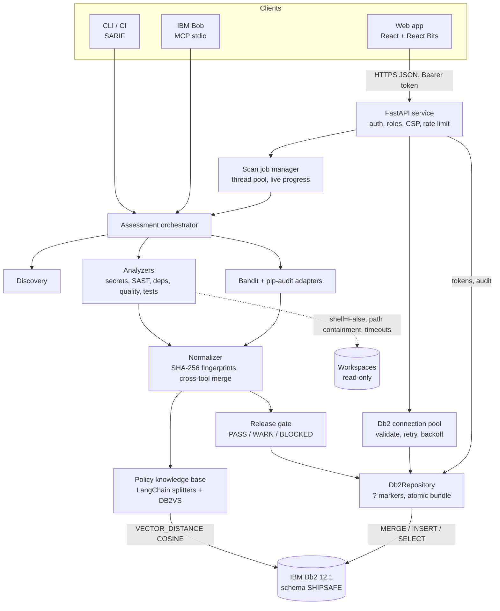

# ShipSafe AI: System Architecture

## Overview
ShipSafe AI is a production-readiness gate with four entry points over one engine:
- a **React web app** served by a **FastAPI** service (REST API with role-based tokens),
- a **CLI** for developers and CI (with SARIF output),
- an **MCP server** over stdio for IBM Bob.

The engine runs deterministic checks, normalizes and fingerprints findings, evaluates a release gate, retrieves the governing policy for each finding from **IBM Db2 vector search through LangChain (`langchain-db2`)**, and persists everything to **IBM Db2** in a single transaction. Db2 is also the store for history, risk analytics, API tokens and the audit trail.

---

## Architecture Diagram



---

## Component Breakdown

1. **Web app** (`web/`): React 19 + TypeScript + Vite + Tailwind v4.
   - Pages: Overview (KPIs, risk trend per project, posture, breakdowns), New scan (workspace picker, depth, live step-by-step progress), Assessments, Report (findings with evidence, Db2 policy citation and fix; checks; dependencies; exports), Compare, Policies (ask-a-question vector search), Admin (tokens, live audit trail).
   - React Bits components for motion and polish; a ⌘K command palette; skeleton loading and empty states; works without a GPU (no backdrop filters on content surfaces).
   - Talks only to the same-origin API, so the strict CSP needs no third-party hosts (fonts are self-hosted).
2. **API service** (`src/shipsafe/api/`): FastAPI.
   - `principal()` resolves bearer tokens against `API_TOKENS` (SHA-256 lookup); `require(role)` enforces viewer, operator or admin.
   - Middleware adds security headers, a request ID and structured access logs; Db2 outages map to `503` JSON.
   - `JobManager` runs scans on a bounded thread pool and records each step for the live progress view. `RateLimiter` caps scans per token per minute.
   - Serves the built UI with an SPA fallback.
3. **Engine** (`src/shipsafe/orchestration/`, `analyzers/`, `findings/`, `policies/`):
   - Profiles: `quick` (changed files, no tests), `pre-pr` (adds tests), `deep` (adds pip-audit).
   - Built-in analyzers plus external-tool adapters; `FindingNormalizer` merges duplicates by fingerprint and by (file, line, rule family), keeping the highest severity and listing all sources.
   - The deterministic gate never consults a model.
4. **Database layer** (`src/shipsafe/db2/`):
   - `ConnectionPool`: one `ibm_db_dbi` connection per request or scan; validated with `SELECT 1 FROM SYSIBM.SYSDUMMY1`, replaced when stale, and rolled back before reuse.
   - `Db2Repository`: autocommit off, explicit transactions, `?` markers only; `save_assessment_bundle()` is all-or-nothing.
   - `schema.py`: 9 application tables plus `POLICY_VECTORS`, 7 indexes and 2 views, created only when missing so the runtime can use a DML-only user.
5. **Knowledge layer** (`src/shipsafe/knowledge/`): Markdown policies → LangChain splitters → `HashingEmbeddings` → `DB2VS` (`VECTOR(384, FLOAT32)`). Retrieval is scoped to the finding's policy category, with a fallback to all policies.
6. **Security helpers** (`src/shipsafe/security/`): token issuing and hashing, role ranking, and `resolve_target()` path allowlisting.

---

## Data Flow (web scan)

1. The operator chooses a workspace and depth; the UI sends `POST /api/scans`.
2. The API checks the token and role, resolves the target inside `SHIPSAFE_ALLOWED_ROOTS`, applies the rate limit, writes `scan.requested` to `AUDIT_LOG`, and queues a job.
3. A worker checks out a Db2 connection and runs the orchestrator, reporting progress through: discover → secrets → code security (built-in + Bandit) → dependencies (curated, + pip-audit when `deep`) → quality → tests → gate → policy lookup in Db2 → save.
4. Findings are normalized, the gate is decided, and each finding is matched to its policy by `VECTOR_DISTANCE` in Db2.
5. `save_assessment_bundle()` writes the project, inventory, assessment, tool runs and findings in one transaction, then `scan.completed` is audited.
6. The UI polls the job, shows the verdict, and opens the report from `GET /api/assessments/{id}`.
7. **If Db2 is unavailable**, the scan still runs without persistence or citations. The job result says so plainly, and `/api/ready` returns `503`.

---

## IBM Db2 Schema & Storage Design

Full DDL: [`docs/db2-schema.sql`](docs/db2-schema.sql) (generated from `src/shipsafe/db2/schema.py`). Least-privilege grants: [`docs/db2-least-privilege.sql`](docs/db2-least-privilege.sql).

```sql
CREATE TABLE FINDINGS (
    FINDING_ID    VARCHAR(96) NOT NULL PRIMARY KEY,
    ASSESSMENT_ID VARCHAR(64) NOT NULL,
    FINGERPRINT   CHAR(64)    NOT NULL,           -- stable across runs -> regression diffs
    RULE_ID       VARCHAR(64) NOT NULL,
    SEVERITY      VARCHAR(16) NOT NULL,
    FILE_PATH     VARCHAR(512), LINE_START INTEGER,
    EVIDENCE_JSON CLOB(1M),                       -- redacted evidence + policy citation
    ...
    CONSTRAINT FK_FND_ASM FOREIGN KEY (ASSESSMENT_ID) REFERENCES ASSESSMENTS(ASSESSMENT_ID) ON DELETE CASCADE
);

CREATE TABLE API_TOKENS (
    TOKEN_ID   VARCHAR(32) NOT NULL PRIMARY KEY,
    ROLE       VARCHAR(16) NOT NULL,
    TOKEN_HASH CHAR(64)    NOT NULL,              -- SHA-256 only; plaintext is never stored
    REVOKED    SMALLINT    NOT NULL DEFAULT 0,
    CONSTRAINT UQ_TOKEN_HASH UNIQUE (TOKEN_HASH),
    CONSTRAINT CK_TOKEN_ROLE CHECK (ROLE IN ('viewer', 'operator', 'admin'))
);

CREATE TABLE POLICY_VECTORS (ID CHAR(16) PRIMARY KEY, TEXT CLOB, METADATA BLOB, EMBEDDING VECTOR(384, FLOAT32));

CREATE OR REPLACE VIEW V_PROJECT_POSTURE AS
SELECT ... FROM V_RISK_TREND WHERE RECENCY_RANK = 1;   -- latest run per project (ROW_NUMBER)
```

| Operation | Db2 feature |
|---|---|
| Persist an assessment | One transaction: `MERGE` project, replace inventory, `INSERT` assessment, tool runs and findings |
| Policy citation | `VECTOR`, `VECTOR_DISTANCE(..., COSINE)`, `FETCH FIRST k ROWS ONLY` |
| Risk trend and posture | `LAG()` and `ROW_NUMBER()` window functions in views |
| Dashboard KPIs | Scalar subqueries in one statement from `SYSIBM.SYSDUMMY1` |
| Analytics | `GROUP BY CATEGORY, SEVERITY` with `COUNT(DISTINCT FINGERPRINT)` |
| Security | Hashed tokens with `CHECK` and `UNIQUE` constraints; append-only `AUDIT_LOG` (`INSERT` only for the app role) |
| Health | `SYSIBMADM.ENV_INST_INFO`, `SYSCAT.TABLES`, pool pings |

---

## Deployment

- **Docker image** (`Dockerfile`): Node build stage for the UI, then `python:3.12-slim` running as non-root user `shipsafe` with a healthcheck and JSON logs.
- **Docker Compose** (`docker-compose.yml`): Db2 Community Edition with a healthcheck, plus the ShipSafe service. Workspaces are mounted read-only.
- **CI** (`ci/github-actions-shipsafe.yml`): `shipsafe scan --offline --format sarif` fails the check on `BLOCKED` and uploads SARIF to GitHub code scanning.

---

## Security & Secrets Management
- Credentials come only from environment variables or a git-ignored `.env`; the Db2 connection string is never logged, and log lines redact `PWD=`, bearer tokens and `ss_` tokens.
- API tokens are 256-bit random values stored as SHA-256 hashes and shown once. Roles are enforced on every route, and denied requests are audited.
- All SQL values are bound parameters. The schema identifier is validated, and row limits are integers.
- Scan targets are allowlisted; scanned code is never modified; subprocesses use fixed arguments, `shell=False`, timeouts and output caps.
- Strict CSP and security headers on every response; CORS is disabled unless explicitly configured.
- Threat model: [`docs/threat-model.md`](docs/threat-model.md).
