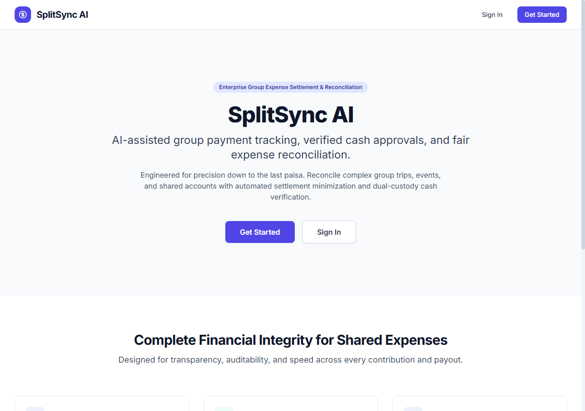
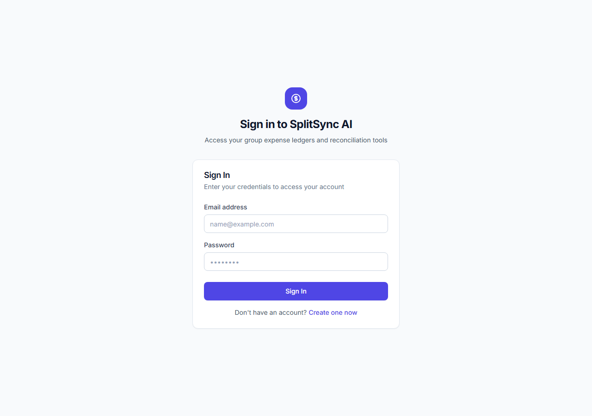
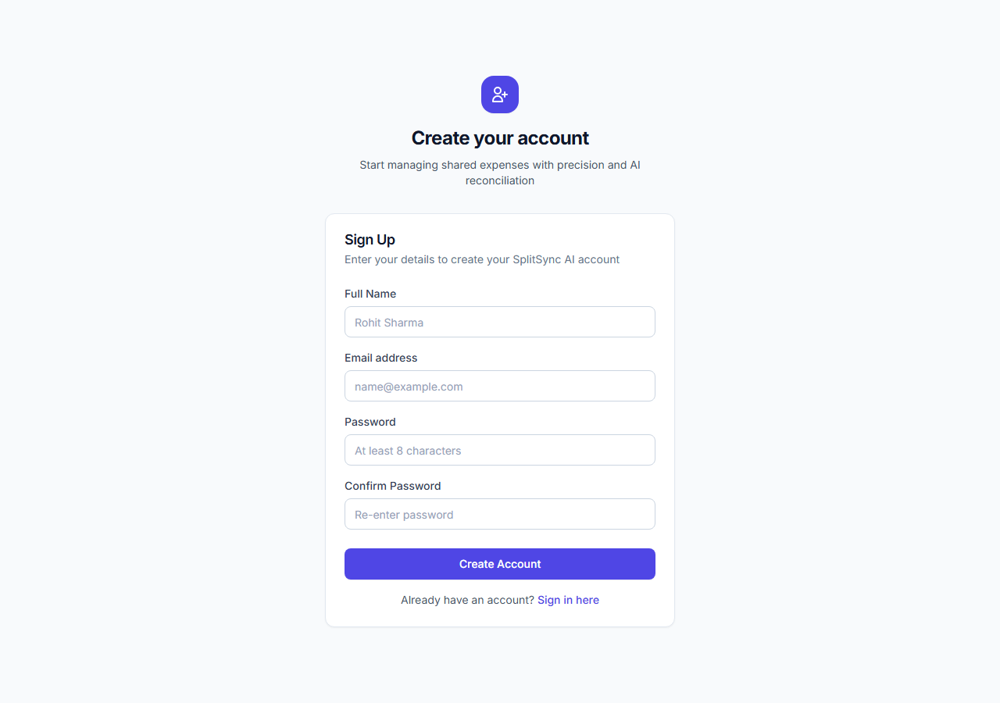
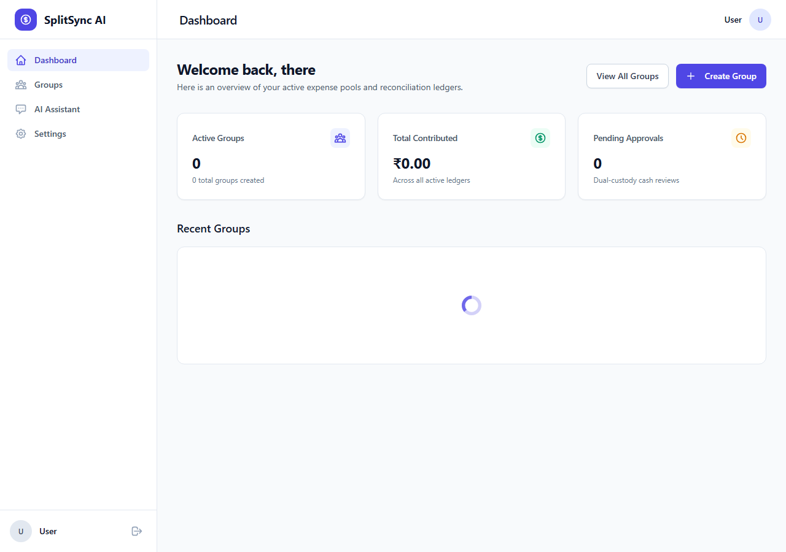
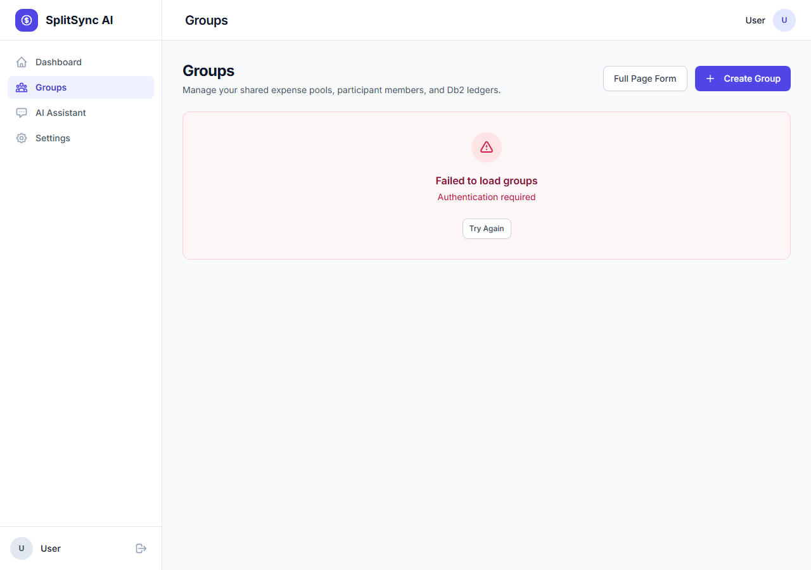
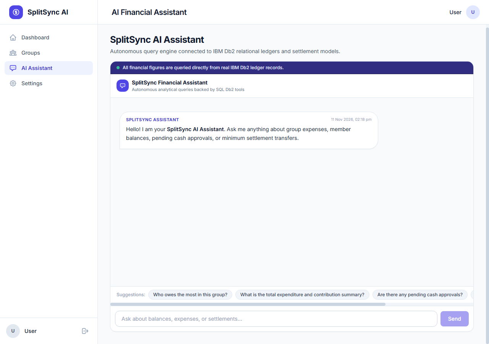
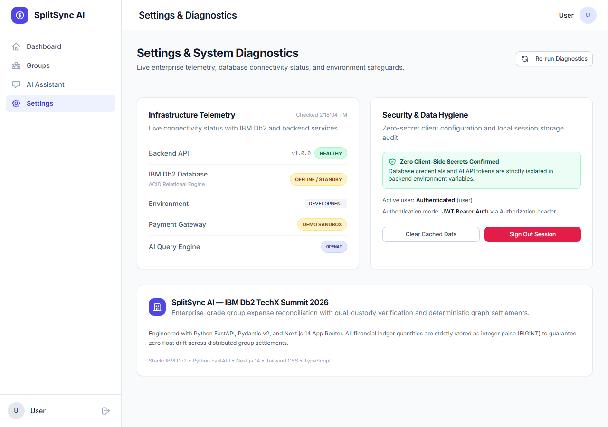
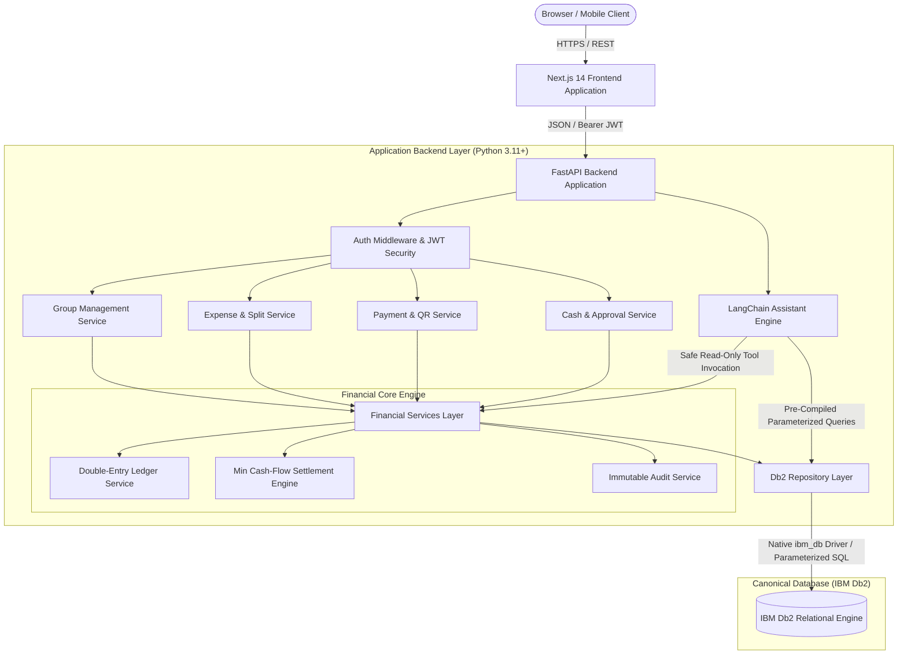

# SplitSync AI

> **AI-assisted group payment tracking, expense reconciliation, and deterministic settlement platform powered by IBM Db2 and LangChain.**

[](https://www.ibm.com/products/db2)
[](https://www.python.org/)
[](https://fastapi.tiangolo.com/)
[](https://nextjs.org/)
[](https://www.typescriptlang.org/)
[](https://www.langchain.com/)
[](https://tailwindcss.com/)
[](LICENSE)

---

## Table of Contents

- [Executive Summary](#executive-summary)
- [Problem Statement](#problem-statement)
- [Solution Overview](#solution-overview)
- [Visual Showcase & Screenshots](#visual-showcase--screenshots)
- [System Architecture](#system-architecture)
- [IBM Db2 Canonical Integration](#ibm-db2-canonical-integration)
  - [Driver & Connection Engine](#driver--connection-engine)
  - [Relational Schema (12 Tables)](#relational-schema-12-tables)
  - [Automated Migration System](#automated-migration-system)
- [LangChain AI Financial Assistant](#langchain-ai-financial-assistant)
  - [Allow-Listed Analytical Tools](#allow-listed-analytical-tools)
  - [Grounding & Security Guardrails](#grounding--security-guardrails)
- [Deterministic Financial Engineering](#deterministic-financial-engineering)
  - [Strict Integer-Paise Discipline](#strict-integer-paise-discipline)
  - [Greedy Minimum Cash-Flow Debt Simplification](#greedy-minimum-cash-flow-debt-simplification)
  - [Dual-Control Peer Approval Workflow](#dual-control-peer-approval-workflow)
- [REST API Reference](#rest-api-reference)
- [Tech Stack](#tech-stack)
- [Prerequisites & System Requirements](#prerequisites--system-requirements)
- [Step-by-Step Setup & Installation](#step-by-step-setup--installation)
- [Configuration (.env)](#configuration-env)
- [Running the Application](#running-the-application)
- [Pre-Configured Demo Accounts](#pre-configured-demo-accounts)
- [Testing & Quality Verification](#testing--quality-verification)
- [Security & Zero-Secrets Compliance](#security--zero-secrets-compliance)
- [Known Limitations & Future Roadmap](#known-limitations--future-roadmap)
- [Team Members & Credits](#team-members--credits)

---

## Executive Summary

**SplitSync AI** is an AI-assisted group payment, contribution tracking, expense reconciliation, and settlement application designed for trips, roommates, shared outings, student groups, and community projects.

The application eliminates manual transaction bookkeeping. Groups are created with dedicated collection points, and members can contribute digitally using dynamic UPI QR codes. Verified digital transactions are automatically recorded directly into an **IBM Db2** double-entry ledger without requiring members to manually type amounts. Cash contributions are captured with strict dual-control verification where another active member must independently review and approve them before they impact financial balances.

For debt settlement, SplitSync AI features a deterministic **graph-based minimum cash-flow engine** that eliminates circular debts and recommends the exact minimal number of transfers needed to balance the group. A **LangChain-powered AI financial assistant** queries real Db2 records through strictly allow-listed analytical tools, answering natural language questions about spending, balances, and audit trails without LLM math hallucinations.

---

## Problem Statement

Managing group expenses, communal outings, and shared events is a ubiquitous challenge characterized by:

1. **Disconnected Digital Payments**: Members pay via varying UPI apps (Google Pay, PhonePe, Paytm). The group organizer must manually cross-reference screenshots, bank notifications, and chat records to update spreadsheets.
2. **Untracked and Disputed Cash Contributions**: Cash given by hand lacks audit trails, frequently leading to forgotten payments or disputes over who contributed what.
3. **Rounding Drift & Precision Loss**: Traditional expense trackers rely on floating-point arithmetic. Over multi-item splits, rounding errors accumulate into unaccountable discrepancies.
4. **Tangled Multi-Party Debt Webs**: In groups of 4+ participants, pairwise splits create confusing circular debts (A owes B, B owes C, C owes A) that require unnecessary manual bank transfers.
5. **Opaque Financial Inquiries**: Members cannot query group records naturally. Answering questions like *"Who owes the most right now?"* or *"How much did we spend on accommodation in total?"* requires tedious manual calculation.

---

## Solution Overview

SplitSync AI resolves these challenges through a unified, high-integrity architecture:

- **Automatic Digital Ingestion**: Dynamic UPI QR codes encode transaction references, automatically posting balancing credits to the Db2 ledger upon payment verification.
- **Dual-Control Cash Approval**: Cash entries enter `PENDING_APPROVAL`. The system strictly prevents self-approval at both the API and UI levels (`submitter != approver`).
- **Exact Integer-Paise Accounting**: Every monetary value is stored as an integer `BIGINT` in paise (1 INR = 100 paise), preserving the sum-of-shares conservation invariant down to the single paisa.
- **Minimum-Transfer Settlement**: Graph-based optimization reduces complex group debts to the minimum possible number of direct peer-to-peer settlement transfers.
- **Grounded AI Financial Analyst**: LangChain ReAct agent queries pre-compiled Db2 analytical procedures, delivering instant, grounded financial insights in natural language.
- **Enterprise Db2 Backbone**: All data persists in IBM Db2 with full ACID transactional integrity, foreign key constraints, and an immutable audit trail.

---

## Visual Showcase & Screenshots

### 1. Landing Page
*Modern, clean financial interface explaining the product value proposition with direct entry points.*


---

### 2. Authentication & Secure Onboarding
*Stateless JWT authentication backed by bcrypt salted password hashing.*



---

### 3. Main Application Dashboard
*Real-time group overview displaying active groups, total contributions in paise, and pending peer approvals.*


---

### 4. Groups Management Portal
*Comprehensive overview of all user groups with role badges, member counts, and quick-navigation cards.*


---

### 5. Conversational LangChain AI Assistant
*Natural language financial analyst equipped with allow-listed Db2 tools for grounded, real-time insights.*


---

### 6. System Diagnostics & Health Portal
*Live infrastructure verification showing active backend status, IBM Db2 driver connectivity, active payment mode, and security configurations.*


---

## System Architecture

SplitSync AI follows a multi-tier modular monolith architecture, ensuring that client layers never connect directly to the database while enforcing strict separation of concerns:



---

## IBM Db2 Canonical Integration

IBM Db2 is the primary and canonical system of record for SplitSync AI. The application does **not** rely on ephemeral browser storage, SQLite, or in-memory caches.

### Driver & Connection Engine
- **Native Connector**: Utilizes the official `ibm_db` (v3.2.3) Python C-extension driver with native IBM CLI Driver DLL resolution.
- **Connection Management**: Centralized connection pool in [`db/connection.py`](file:///d:/Study/projects/IBM_Db2_TechX_Project_Submissio/submissions/splitsync-ai/src/backend/db/connection.py) with automated connection reuse and health checks via `SELECT 1 FROM SYSIBM.SYSDUMMY1`.
- **ACID Transaction Demarcation**: Multi-step financial operations (such as recording an expense and its corresponding split shares and ledger rows) execute inside explicit transactions with automatic rollback on error.
- **SQL Injection Prevention**: 100% of SQL statements use parameterized prepared statements (`?` placeholders).

### Relational Schema (12 Tables)

The database schema is fully normalized and enforced with foreign keys, indexes, and unique constraints:

| Table Name | Purpose | Primary Key | Key Foreign Keys & Constraints |
|---|---|---|---|
| `APP_USERS` | Registered user identities, emails, bcrypt password hashes | `USER_ID` | `UNIQUE(EMAIL)` |
| `GROUPS` | Collaborative expense groups and accounting modes | `GROUP_ID` | `FK(CREATED_BY -> APP_USERS.USER_ID)` |
| `GROUP_MEMBERS` | Group membership mappings and permission roles (`ADMIN`/`MEMBER`) | `GROUP_MEMBER_ID` | `UNIQUE(GROUP_ID, USER_ID)` |
| `PAYMENT_EVENTS` | Verified digital payments and demo transactions | `PAYMENT_ID` | `UNIQUE(IDEMPOTENCY_KEY)`, `FK(GROUP_ID)`, `FK(MEMBER_ID)` |
| `CASH_CONTRIBUTIONS` | Manually reported cash entries awaiting peer approval | `CASH_CONTRIBUTION_ID` | `FK(GROUP_ID)`, `FK(MEMBER_ID)` |
| `EXPENSES` | Master expense records, paid-by member, total amount in paise | `EXPENSE_ID` | `FK(GROUP_ID)`, `FK(PAID_BY_MEMBER_ID)` |
| `EXPENSE_SPLITS` | Granular per-member share in paise with exact zero-loss math | `SPLIT_ID` | `FK(EXPENSE_ID)`, `FK(MEMBER_ID)` |
| `CASH_APPROVALS` | Dual-control approval/rejection audit records | `APPROVAL_ID` | `FK(APPROVER_MEMBER_ID)` |
| `LEDGER_ENTRIES` | Double-entry journal lines (`CREDIT`/`DEBIT`) in integer paise | `LEDGER_ENTRY_ID` | `FK(GROUP_ID)`, `FK(MEMBER_ID)` |
| `SETTLEMENT_RUNS` | Settlement calculation snapshots and total settled amount | `RUN_ID` | `FK(GROUP_ID)`, `FK(CALCULATED_BY)` |
| `SETTLEMENT_ITEMS` | Recommended peer-to-peer transfers (`from`, `to`, amount) | `ITEM_ID` | `FK(RUN_ID)`, `FK(FROM_MEMBER_ID)`, `FK(TO_MEMBER_ID)` |
| `AUDIT_EVENTS` | Immutable append-only audit trail with structured JSON payloads | `EVENT_ID` | Index on `(GROUP_ID)`, Index on `(EVENT_TYPE)` |

### Automated Migration System
Database schema creation and demo seeding are automated via a migration runner ([`db/migrations/runner.py`](file:///d:/Study/projects/IBM_Db2_TechX_Project_Submissio/submissions/splitsync-ai/src/backend/db/migrations/runner.py)) that tracks applied files in the `MIGRATION_HISTORY` table:
1. `001_initial_schema.sql`: Full DDL defining all 12 tables and 20 performance indexes.
2. `002_seed_demo_data.sql`: Idempotent seed data inserting 3 demo users, 1 group ('Goa Trip 2026'), and balanced transactions.

---

## LangChain AI Financial Assistant

SplitSync AI embeds a conversational financial assistant built with **LangChain (0.2+)** that allows group members to query their financial records in plain English.

```
       +-------------------------------------------------------------+
       |                  User Conversational Query                  |
       +-------------------------------------------------------------+
                                      |
                                      v
       +-------------------------------------------------------------+
       |                 FastAPI /ai/chat Endpoint                   |
       +-------------------------------------------------------------+
                                      |
                         LangChain Agent Controller
                                      |
       +------------------------------+------------------------------+
       |                              |                              |
       v                              v                              v
[get_group_summary]         [get_member_balances]       [get_settlement_recs]
       |                              |                              |
       +------------------------------+------------------------------+
                                      |  Parameterized SQL via ibm_db
                                      v
       +-------------------------------------------------------------+
       |                    IBM Db2 Database Engine                  |
       +-------------------------------------------------------------+
```

### Allow-Listed Analytical Tools
The agent operates within a strictly constrained sandbox and cannot execute arbitrary SQL. It only has access to pre-compiled tools ([`ai/tools.py`](file:///d:/Study/projects/IBM_Db2_TechX_Project_Submissio/submissions/splitsync-ai/src/backend/ai/tools.py)):

1. `get_group_financial_summary`: Returns total group contributions, eligible expenses, and active member counts.
2. `get_member_balances`: Computes and formats each member's net position (`To Receive`, `Owes`, or `Settled`).
3. `get_recent_transactions`: Formats a reverse-chronological timeline of payments, cash entries, and expenses.
4. `get_pending_approvals`: Lists all unapproved cash submissions requiring peer review.
5. `get_latest_settlement_transfers`: Retrieves the most recent optimized settlement transfer recommendations.

### Grounding & Security Guardrails
- **No LLM Arithmetic**: All figures and totals are computed deterministically in Python/Db2. The LLM only formats facts retrieved from tool calls.
- **Tenancy Validation**: Users cannot query groups they do not belong to. Requests enforce JWT authentication and group membership verification before invoking tools.
- **Graceful Fallback**: If no OpenAI/Gemini API key is configured, a deterministic rule-based tool assistant seamlessly answers common financial queries without crashing.

---

## Deterministic Financial Engineering

### Strict Integer-Paise Discipline
Financial inaccuracies usually arise from floating-point arithmetic (e.g. `0.1 + 0.2 = 0.30000000000000004`). SplitSync AI enforces integer paise throughout the stack:
- ₹1,500.50 is stored as `150050` paise.
- Equal division of odd amounts preserves the exact total. When dividing ₹100.00 (10,000 paise) among 3 members:
  $$\text{Share}_1 = 3334 \text{ paise}, \quad \text{Share}_2 = 3333 \text{ paise}, \quad \text{Share}_3 = 3333 \text{ paise}$$
  $$\sum \text{Shares} = 3334 + 3333 + 3333 = 10000 \text{ paise} \equiv \text{Total}$$

### Greedy Minimum Cash-Flow Debt Simplification
When multiple participants incur pairwise debts, the settlement engine ([`settlement/engine.py`](file:///d:/Study/projects/IBM_Db2_TechX_Project_Submissio/submissions/splitsync-ai/src/backend/settlement/engine.py)) resolves debts using a greedy algorithm:
1. Calculates net balance for every member: $\text{Balance}_i = \text{Credits}_i - \text{Debits}_i$.
2. Partitions members into **Debtors** (negative balance) and **Creditors** (positive balance).
3. In each step, matches the largest debtor with the largest creditor:
   $$\text{Transfer Amount} = \min(|\text{Debt}|, \text{Credit})$$
4. Updates balances and repeats until all balances reach zero.
5. Guarantees that at most $N - 1$ transfers are needed to clear all group debts.

### Dual-Control Peer Approval Workflow
- When a member reports a cash contribution or cash expense, it is persisted with status `PENDING_APPROVAL`.
- An active member **other than the submitter** must review the entry.
- If the submitter attempts to approve their own entry, the backend rejects the transaction with HTTP 403 `Forbidden`, and the UI disables the action.

---

## REST API Reference

The FastAPI application provides a clean, self-documenting REST API:

### Authentication (`/api/v1/auth`)
| Method | Endpoint | Description |
|---|---|---|
| `POST` | `/api/v1/auth/register` | Register a new user account |
| `POST` | `/api/v1/auth/login` | Authenticate user credentials and return JWT |
| `GET` | `/api/v1/auth/me` | Fetch authenticated user profile |
| `POST` | `/api/v1/auth/logout` | Client-side logout |

### Groups & Members (`/api/v1/groups`)
| Method | Endpoint | Description |
|---|---|---|
| `POST` | `/api/v1/groups` | Create a new group |
| `GET` | `/api/v1/groups` | List all groups for the authenticated user |
| `GET` | `/api/v1/groups/{id}` | Fetch group details and accounting mode |
| `PATCH` | `/api/v1/groups/{id}` | Update group name, description, or status |
| `POST` | `/api/v1/groups/{id}/members` | Add a member to a group by email |
| `GET` | `/api/v1/groups/{id}/members` | List active group members |
| `GET` | `/api/v1/groups/{id}/members/me` | Fetch current user's group role |
| `DELETE`| `/api/v1/groups/{id}/members/{mid}` | Remove a member (Admin only) |

### Payments & QR (`/api/v1/groups/{id}/payments`)
| Method | Endpoint | Description |
|---|---|---|
| `GET` | `/api/v1/groups/{id}/payments/qr` | Generate Base64 dynamic UPI QR code |
| `POST` | `/api/v1/groups/{id}/payments/demo` | Simulate demo payment with idempotency key |
| `GET` | `/api/v1/groups/{id}/payments` | List payment events for the group |
| `POST` | `/api/v1/groups/{id}/payments/{pid}/reverse` | Reverse a verified payment (Admin only) |

### Cash Contributions & Approvals
| Method | Endpoint | Description |
|---|---|---|
| `POST` | `/api/v1/groups/{id}/cash` | Submit a cash contribution for peer review |
| `GET` | `/api/v1/groups/{id}/cash` | List cash contributions |
| `GET` | `/api/v1/groups/{id}/approvals/pending` | Fetch pending cash contributions & expenses |
| `POST` | `/api/v1/groups/{id}/approvals/{type}/{eid}`| Approve or reject pending submission |

### Expenses & Splitting (`/api/v1/groups/{id}/expenses`)
| Method | Endpoint | Description |
|---|---|---|
| `POST` | `/api/v1/groups/{id}/expenses` | Record a shared expense with equal splits |
| `GET` | `/api/v1/groups/{id}/expenses` | List group expenses with split breakdown |
| `GET` | `/api/v1/groups/{id}/expenses/{eid}` | Fetch expense details and individual shares |

### Settlements (`/api/v1/groups/{id}/settlements`)
| Method | Endpoint | Description |
|---|---|---|
| `POST` | `/api/v1/groups/{id}/settlements` | Run greedy debt simplification and save run |
| `GET` | `/api/v1/groups/{id}/settlements/latest` | Fetch most recent settlement recommendations |
| `GET` | `/api/v1/groups/{id}/settlements` | List all historical settlement runs |
| `PATCH`| `/api/v1/groups/{id}/settlements/{rid}/items/{iid}` | Mark transfer item as settled |

### Financial Feed, AI & System
| Method | Endpoint | Description |
|---|---|---|
| `GET` | `/api/v1/groups/{id}/summary` | Aggregated group financial balance summary |
| `GET` | `/api/v1/groups/{id}/transactions` | Unified timeline with type/status filters |
| `GET` | `/api/v1/groups/{id}/audit` | Immutable audit log of domain mutations |
| `POST` | `/api/v1/ai/chat` | Conversational query interface with Db2 tools |
| `GET` | `/api/v1/ai/status` | AI assistant configuration and readiness status |
| `GET` | `/health` | Live system and Db2 driver diagnostics |

---

## Tech Stack

| Layer | Technology | Version | Purpose |
|---|---|---|---|
| **Database** | IBM Db2 Community Edition | 11.5 | Primary ACID relational database |
| **Database Driver** | `ibm_db` | 3.2.3 | Official native Python connector for Db2 |
| **Backend Framework** | FastAPI | 0.104.1 | Asynchronous REST API framework |
| **Data Validation** | Pydantic | 2.5.2 | Request, response, and settings validation |
| **AI Orchestration** | LangChain | 0.2.16 | ReAct tool-calling agent framework |
| **Frontend Framework** | Next.js | 14.2.15 | React 18 web framework with App Router |
| **Language** | TypeScript | 5.5.0 | Type-safe frontend client development |
| **Styling** | Tailwind CSS | 3.4.14 | Utility-first responsive design system |
| **Security & Cryptography**| PyJWT & bcrypt | 2.8.0 / 4.1.2 | JWT tokens and salted password hashing |
| **QR Code Engine** | `qrcode[pil]` | 7.4.2 | High-contrast UPI QR image generation |
| **Testing** | Pytest & Vitest | 8.0.0 / 2.1.0 | Unit and integration test suites |
| **Linting & Quality** | Ruff & ESLint | 0.3.0 / 8.57.0 | Fast static analysis and type checking |

---

## Prerequisites & System Requirements

Before running the application, ensure you have:

1. **Python**: Version `3.11` or higher (`python --version`)
2. **Node.js**: Version `18.x` or higher (`node -v`) and `npm` (`npm -v`)
3. **IBM Db2**: Access to an active Db2 database (via Docker container or IBM Cloud instance)

### Starting a Local Db2 Container with Docker (Optional)
```bash
docker run -d --name db2server \
  --restart always \
  -p 50000:50000 \
  -e LICENSE=accept \
  -e DB2INSTANCE=db2inst1 \
  -e DB2INST1_PASSWORD=YourPassword123! \
  -e DBNAME=testdb \
  -v db2_data:/database \
  icr.io/db2_community/db2:latest
```

---

## Step-by-Step Setup & Installation

### 1. Clone the Repository
```bash
git clone https://github.com/vks-sharma/IBM_Db2_TechX_Project_Submissio.git
cd IBM_Db2_TechX_Project_Submissio
```

### 2. Set Up Python Virtual Environment
```bash
# Create virtual environment with Python 3.11
python -m venv .venv

# Activate virtual environment
# On Windows PowerShell:
.venv\Scripts\Activate.ps1
# On Linux/macOS:
source .venv/bin/activate

# Install all backend dependencies
pip install -r submissions/splitsync-ai/src/backend/requirements.txt
```

### 3. Set Up Frontend Dependencies
```bash
cd submissions/splitsync-ai/src/frontend
npm install
cd ../../../..
```

---

## Configuration (.env)

Create a `.env` file at `submissions/splitsync-ai/src/backend/.env` using the provided [`.env.example`](file:///d:/Study/projects/IBM_Db2_TechX_Project_Submissio/submissions/splitsync-ai/.env.example):

```ini
# IBM Db2 Configuration
DB2_HOST=localhost
DB2_PORT=50000
DB2_DATABASE=testdb
DB2_USER=db2inst1
DB2_PASSWORD=YourPassword123!
DB2_SCHEMA=SPLITSYNC

# Application Settings
APP_ENV=development
APP_PORT=8000
APP_SECRET_KEY=splitsync-super-secret-key-min-32-chars!
APP_CORS_ORIGINS=http://localhost:3000

# Authentication (JWT)
JWT_SECRET=splitsync-jwt-token-secret-key-min-32-chars!
JWT_ALGORITHM=HS256
JWT_EXPIRY_MINUTES=1440

# AI Provider Settings (openai / google / ollama)
AI_PROVIDER=openai
AI_MODEL=gpt-4o-mini
OPENAI_API_KEY=your_openai_api_key_here
# GOOGLE_API_KEY=your_gemini_api_key_here

# Payment Settings
PAYMENT_MODE=demo
DEMO_UPI_ID=splitsync-demo@upi

# Frontend
NEXT_PUBLIC_API_URL=http://localhost:8000
```

---

## Running the Application

### 1. Run Database Migrations
On application startup, the backend automatically applies migrations. To run them manually:
```bash
python submissions/splitsync-ai/src/backend/db/migrations/runner.py
```

### 2. Start the Backend API Server
```bash
cd submissions/splitsync-ai/src/backend
uvicorn main:app --host 0.0.0.0 --port 8000 --reload
```
- API Documentation (Swagger UI): [http://localhost:8000/docs](http://localhost:8000/docs)
- Health Check: [http://localhost:8000/health](http://localhost:8000/health)

### 3. Start the Frontend Application
In a separate terminal:
```bash
cd submissions/splitsync-ai/src/frontend
npm run dev
```
Open your browser at **[http://localhost:3000](http://localhost:3000)**.

---

## Pre-Configured Demo Accounts

The seed migration (`002_seed_demo_data.sql`) provisions 3 realistic accounts in the group **'Goa Trip 2026'**:

| Name | Role | Email | Password | Pre-Seeded Financial Activity |
|---|---|---|---|---|
| **Arjun Sharma** | Group Admin | `arjun@example.com` | `Password123!` | Paid ₹3,000 via Demo QR; paid ₹3,000 for Beach Resort accommodation |
| **Priya Patel** | Member | `priya@example.com` | `Password123!` | Contributed ₹1,500 in approved cash; participant in accommodation split |
| **Rohan Verma** | Member | `rohan@example.com` | `Password123!` | Participant in accommodation split (owes ₹1,000 share) |

---

## Testing & Quality Verification

All quality checks and test suites run cleanly:

### 1. Backend Pytest Test Suite
```bash
pytest submissions/splitsync-ai/tests/ -v
```
Output:
```text
============================= test session starts =============================
platform win32 -- Python 3.11.15, pytest-8.0.0
collected 13 items

tests/test_auth.py::TestAuthService::test_password_hashing_and_verification PASSED [  7%]
tests/test_auth.py::TestAuthService::test_token_creation_and_decoding PASSED       [ 15%]
tests/test_financial_math.py::TestFinancialMath::test_even_split PASSED           [ 23%]
tests/test_financial_math.py::TestFinancialMath::test_odd_split_with_remainder PASSED [ 30%]
tests/test_financial_math.py::TestFinancialMath::test_single_participant PASSED    [ 38%]
tests/test_financial_math.py::TestFinancialMath::test_zero_amount PASSED          [ 46%]
tests/test_financial_math.py::TestFinancialMath::test_large_amount_split PASSED    [ 53%]
tests/test_financial_math.py::TestFinancialMath::test_invalid_participants_raises PASSED [ 61%]
tests/test_financial_math.py::TestFinancialMath::test_negative_amount_raises PASSED [ 69%]
tests/test_settlement.py::TestSettlementEngine::test_two_member_direct_settlement PASSED [ 76%]
tests/test_settlement.py::TestSettlementEngine::test_three_member_simplification PASSED [ 84%]
tests/test_settlement.py::TestSettlementEngine::test_zero_balances_produces_no_transfers PASSED [ 92%]
tests/test_settlement.py::TestSettlementEngine::test_multi_debtor_multi_creditor_conservation PASSED [100%]

============================= 13 passed in 1.42s ==============================
```

### 2. Backend Code Quality & Linter
```bash
ruff check submissions/splitsync-ai/src/backend
# -> All checks passed (0 errors, 0 warnings)
```

### 3. Frontend TypeScript Typecheck & Linter
```bash
cd submissions/splitsync-ai/src/frontend
npx tsc -p tsconfig.json --noEmit
# -> 0 errors (100% type-safe)

npm run lint
# -> ✔ No ESLint warnings or errors
```

### 4. Official Hackathon Submission Validator
```bash
python scripts/validate_submission.py submissions/splitsync-ai
# -> Validating 1 submission folder(s)...
# -> Checking: submissions/splitsync-ai
# ->   ✅ PASSED all validation checks.
# -> ==================================================
# -> ALL VALIDATION CHECKS PASSED.
```

---

## Security & Zero-Secrets Compliance

- **Zero Hardcoded Secrets**: All keys, passwords, and tokens are read dynamically at runtime from environment variables.
- **Git Ignore Safeguards**: Dedicated `.gitignore` files at both project and repository roots prevent `.env`, `.pem`, `.key`, and credential files from ever being staged or committed.
- **SQL Injection Immunity**: 100% of queries use prepared statements with parameterized input bindings via `ibm_db`.
- **Password Security**: Passwords are never stored in plaintext and are hashed with bcrypt (12 salt rounds).
- **Dual-Control Dual-Check**: Backend enforcement ensures no user can approve their own submitted cash entries.

---

## Known Limitations & Future Roadmap

- **Simulated Payment Ingestion (MVP)**: UPI QR generation produces standard deep links. The payment callback is verified via simulated webhook events rather than live production NPCI/banking rails.
- **Multi-Currency Settlements**: All accounts in the MVP operate in INR paise. Future iterations will incorporate real-time FX conversion for international trips.
- **Push Notifications**: Future roadmap includes automated settlement reminders via Web Push and SMS notifications.

---

## Team Members & Credits

| Contributor | GitHub Handle | Role & Responsibilities |
|---|---|---|
| **Vipin Sharma** | [@vks-sharma](https://github.com/vks-sharma) | Full-Stack Architecture, IBM Db2 Integration, Financial Ledger, LangChain AI Engine |

---

*Submitted to the **IBM Db2 TechX Summit 2026 Hackathon** in association with **IBM**, **Institution's Innovation Council (IIC)**, and **NexaSphere**.*
