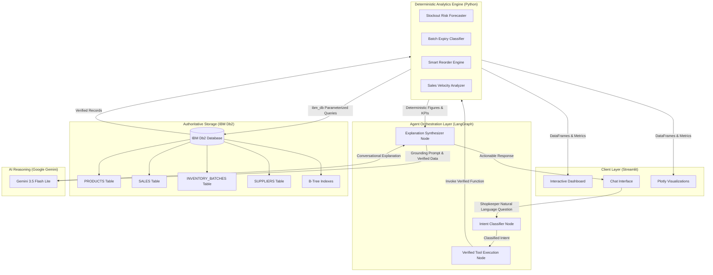

# System Architecture — StockSage

## 1. Overview
**StockSage** is an agentic AI inventory intelligence assistant designed specifically for small grocery and dairy retailers (kirana stores). It couples **IBM Db2** as the authoritative relational data engine with a **LangGraph state-graph workflow** and **Google Gemini LLM**. 

Crucially, StockSage enforces a strict **separation between deterministic mathematics and natural language generation**:
- All calculations (stock depletion rates, reorder thresholds, batch shelf-life countdowns, safety stock buffers) are performed deterministically in Python and IBM Db2 SQL.
- The LLM (Gemini) is never permitted to invent numbers or execute unrestricted SQL; it acts solely as the conversational comprehension and operational explanation layer.

---

## 2. Architecture Diagram



---

## 3. Component Breakdown

### 1. Presentation & UI Layer (`src/app.py`)
- **Technology:** Streamlit & Plotly.
- **Functionality:** Provides shop owners with a responsive, multi-tab interface:
  - *AI Assistant Chat:* Natural language conversational interface with quick suggestion chips.
  - *Low Stock & Stockout Risk:* Active low-stock alerts and days-of-inventory forecasts.
  - *Expiry & Perishables Tracker:* Visual countdown and status categorization (Critical, Warning, Safe) tailored for dairy and bakery.
  - *Smart Reorder Planner:* Safety-stock-aware purchase order generator with estimated costs and supplier details.
  - *Sales Trends & Velocity:* 14-day revenue trajectories and fast/slow-moving rankings.

### 2. Agent Orchestration Layer (`src/agent.py`)
- **Framework:** LangGraph (StateGraph).
- **Nodes:**
  1. `classify_intent_node`: Classifies shopkeeper questions into specialized actions (`low_stock`, `stockout_risk`, `expiry_risk`, `fast_slow_moving`, `reorder_advice`, `overview`).
  2. `fetch_verified_data_node`: Invokes the verified deterministic calculation tool matching the intent.
  3. `synthesize_explanation_node`: Synthesizes an actionable, concise markdown explanation using Gemini, grounded in the verified data.

### 3. Deterministic Decision Engine (`src/inventory_tools.py` & `src/sql_queries.py`)
- **Mathematical Formulations:**
  - **Days of Stock Remaining:**
    $$\text{Days Remaining} = \frac{\text{Current Available Stock}}{\text{Average Daily Sales (Last 7 Days)}}$$
  - **Stockout Risk:** $\text{Critical if Days Remaining} \le 3\text{ days}$.
  - **Safety Stock:**
    $$\text{Safety Stock} = \lceil \text{Daily Sales} \times \text{Lead Time (Days)} \times 0.5 \rceil$$
  - **Recommended Reorder Quantity:**
    $$\text{Reorder Quantity} = \max\left(0, \max(\text{reorder\_level}, \text{Lead Time Demand} + \text{Safety Stock}) - \text{Current Stock}\right)$$

### 4. Database Layer (`src/db_connection.py` & `src/database_setup.py`)
- **Engine:** IBM Db2 Community Edition (running via Docker on port `50000`).
- **Driver:** Official IBM native connector `ibm_db`.
- **Features Used:**
  - Relational tables with foreign key constraints.
  - Parameterized query execution protecting against SQL injection.
  - B-tree indexing on foreign keys and expiry dates (`idx_batches_expiry`, `idx_sales_date`).
  - Resilient test-harness fallback mode for zero-credential offline automated CI checks.

---

## 4. Data Flow

1. **User Interaction:** Shopkeeper inputs a question (e.g., *"What should I reorder today?"*).
2. **Intent Parsing:** LangGraph state machine receives the query and routes it to `reorder_advice`.
3. **Database Extraction:** `inventory_tools.py` issues parameterized SQL to IBM Db2 via `ibm_db` to retrieve current batch levels, lead times from `SUPPLIERS`, and recent sales velocity from `SALES`.
4. **Deterministic Calculation:** Python executes verified formulas for safety buffer, lead-time demand, and reorder amounts.
5. **Grounded Synthesis:** Gemini receives the exact calculated numbers in a zero-shot prompt and crafts a concise, friendly response.
6. **Delivery:** The structured response renders with urgency badges, suppliers, and order totals.

---

## 5. IBM Db2 Schema & Storage Design

```sql
-- 1. Suppliers Table
CREATE TABLE SUPPLIERS (
    supplier_id INT NOT NULL PRIMARY KEY,
    supplier_name VARCHAR(150) NOT NULL,
    lead_time_days INT NOT NULL,
    contact_details VARCHAR(150)
);

-- 2. Products Table
CREATE TABLE PRODUCTS (
    product_id INT NOT NULL PRIMARY KEY,
    product_name VARCHAR(150) NOT NULL,
    category VARCHAR(50) NOT NULL,
    unit_price DECIMAL(10,2) NOT NULL,
    reorder_level INT NOT NULL,
    supplier_id INT NOT NULL,
    CONSTRAINT fk_supplier FOREIGN KEY (supplier_id) REFERENCES SUPPLIERS(supplier_id)
);

-- 3. Inventory Batches Table (Supports expiry tracking)
CREATE TABLE INVENTORY_BATCHES (
    batch_id INT NOT NULL PRIMARY KEY,
    product_id INT NOT NULL,
    available_quantity INT NOT NULL,
    expiry_date DATE NOT NULL,
    received_date DATE NOT NULL,
    CONSTRAINT fk_batch_product FOREIGN KEY (product_id) REFERENCES PRODUCTS(product_id)
);

-- 4. Sales Transactions Table
CREATE TABLE SALES (
    sale_id INT NOT NULL PRIMARY KEY,
    product_id INT NOT NULL,
    quantity_sold INT NOT NULL,
    sale_date DATE NOT NULL,
    revenue DECIMAL(10,2) NOT NULL,
    CONSTRAINT fk_sale_product FOREIGN KEY (product_id) REFERENCES PRODUCTS(product_id)
);

-- Indexes for fast analytics & countdown queries
CREATE INDEX idx_batches_product ON INVENTORY_BATCHES(product_id);
CREATE INDEX idx_batches_expiry ON INVENTORY_BATCHES(expiry_date);
CREATE INDEX idx_sales_product ON SALES(product_id);
CREATE INDEX idx_sales_date ON SALES(sale_date);
```

---

## 6. Security & Secrets Management
- All database credentials (`DB2_HOST`, `DB2_PORT`, `DB2_USER`, `DB2_PASSWORD`, `DB2_SECURITY`) and API keys (`GEMINI_API_KEY`) are loaded at runtime from environment variables via `python-dotenv`.
- The real `.env` file is excluded in `.gitignore` and strictly prevented from being committed.
- A sanitized `.env.example` is committed with non-sensitive placeholder keys.
