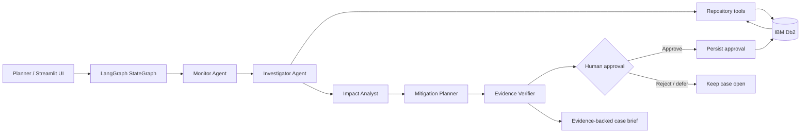

# System Architecture — SupplyChain Sentinel

## Overview
A Streamlit control-tower UI calls a LangGraph workflow. Specialist nodes invoke a narrow repository interface. In Db2 mode, the repository uses the `ibm_db` driver and parameterized SQL against IBM Db2. The workflow returns a structured case containing source evidence, deterministic impact calculations, ranked recovery options, and a verifier result. A human explicitly approves an option; only then is an approval audit row written.

## Architecture diagram

## Component breakdown
1. **UI:** Streamlit dashboard with risk queue, scenario selector, evidence tables, impact metrics, mitigation options, and approval action.
2. **Workflow:** LangGraph `StateGraph` with explicit state and named specialist nodes.
3. **Repository:** Allow-listed methods only: `get_disruption_context`, `create_risk_case`, `record_recommendation`, `record_approval`, `list_recent_cases`.
4. **Db2:** Operational source tables plus risk-case and audit tables. SQL uses bound parameters; no arbitrary SQL generated by an LLM.
5. **Impact logic:** Inventory runway and exposed production orders are computed deterministically from retrieved records.
6. **Verification:** Checks that every recommendation has supporting evidence and that no write is made before explicit approval.

## Data flow
1. The user selects a shipment or component risk signal.
2. Monitor normalizes the signal and assigns a case severity.
3. Investigator queries shipment, purchase order, supplier, inventory, quality and production tables.
4. Impact Analyst calculates days of inventory cover and exposed production demand.
5. Planner generates bounded recovery options with assumptions.
6. Verifier validates evidence references and flags missing data.
7. The UI presents the case. On explicit user approval, an approval audit record is written transactionally.

## Db2 schema
See `sql/schema_db2.sql`. Operational tables: `SUPPLIER`, `COMPONENT`, `INVENTORY`, `PURCHASE_ORDER`, `SHIPMENT_EVENT`, `QUALITY_INSPECTION`, `PRODUCTION_ORDER`. Governance tables: `RISK_CASE`, `RECOMMENDATION`, `APPROVAL_AUDIT`.

## Security and controls
- Secrets are loaded from environment variables.
- Parameterized SQL is used for all user-influenced values.
- The application exposes no unrestricted SQL tool to agents.
- The default workflow is read-only; only the separate approval action writes an approval audit row.
- Demo data is synthetic. Production use would require authentication, authorization, encryption, retention policies, and operational review.
