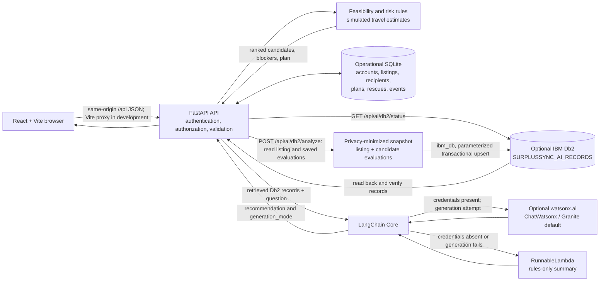

# System Architecture

## Overview
SurplusSync is a React/Vite client backed by a FastAPI service. SQLite is the operational source of truth for accounts, profiles, food listings, recipient configuration, rescue plans, assignments, and lifecycle history. A separate optional analysis route copies a restricted snapshot from SQLite into IBM Db2 with the `ibm_db` driver, reads it back, then asks LangChain for either a watsonx explanation or an explicitly identified deterministic rules-only summary. Db2 is not required for operational matching and no live Db2 or watsonx connectivity is claimed here.

## Architecture Diagram



## Component Breakdown

1. **User Interface / Client Layer**: React 18 and Vite provide role-aware donor, recipient, volunteer, and admin screens. The client sends credentialed JSON requests to `/api`; Vite proxies this path to FastAPI during local development.
2. **Application Backend Layer**: FastAPI validates request models, authenticates session cookies, applies role/profile authorization and CSRF checks for writes, runs feasibility and risk rules, and coordinates rescue lifecycle changes. The Db2 router is mounted under `/api/ai/db2`.
3. **Operational Database Layer (SQLite)**: `backend/database.py` initializes SQLite schema and migrations. Relevant tables include `listings`, `recipients`, `rescue_plans`, `candidate_evaluations`, `rescue_cases`, and `rescue_events`; account/profile/session and verification records also persist here. Capacity reservations and lifecycle are managed in this store. Db2 is not the source of truth for these operations.
4. **IBM Db2 Analysis Layer**: `backend/db2_ai.py` uses `ibm_db`, not SQLAlchemy. `/api/ai/db2/status` performs a connection check. `/api/ai/db2/analyze` requires an authenticated approved donor or admin; donor ownership is enforced. It selects the listing and latest saved candidate evaluations from SQLite, maps them to an allowlisted snapshot without account identifiers, contacts, or verifier names, writes and reads the snapshot in Db2, and verifies read-back before proceeding. Db2 failures return an explicit error; there is no fallback that pretends the analysis ran.
5. **AI / Explanation Layer**: LangChain Core builds a prompt from only the Db2 records retrieved for that listing. If `WATSONX_API_KEY` or its legacy alias `WATSONX_APIKEY` and `WATSONX_PROJECT_ID` are configured, `langchain-ibm` attempts the default watsonx model `ibm/granite-3-3-8b-instruct`. Otherwise, or if generation fails, a `RunnableLambda` summarizes ranked feasible candidates and recorded reasons. Results identify `generation_mode`; credentials and external generation are not verified in this submission environment.

## Data Flow

1. A donor submits or edits a food listing through the frontend; FastAPI validates it and persists it in SQLite.
2. On plan creation/recalculation, the rules engine checks recipient availability, food category, available capacity after active reservations, simulated travel estimate versus deadline, and required human safety checks. It ranks feasible candidates, records rejection reasons, and saves the plan/evaluations in SQLite. Risk scoring is a transparent rule set, not a trained model.
3. The donor proposes a rescue to a recipient. The recipient accepts/rejects and rejection reasons are retained; authorized users advance lifecycle states. An approved volunteer can be assigned and update collection/delivery states. These transactions and event history remain in SQLite.
4. For optional analysis, an approved donor/admin calls `GET /api/ai/db2/status` to inspect runtime connection state or `POST /api/ai/db2/analyze` with a listing ID and question. The latter reads the listing and latest saved evaluations from SQLite and builds an allowlisted snapshot.
5. The backend creates `SURPLUSSYNC_AI_RECORDS` if needed, transactionally replaces that listing's snapshot using parameterized statements, retrieves the keyed records, and verifies exact record read-back. The connection is configured to require SSL.
6. Retrieved Db2 records are passed to LangChain. The integration attempts watsonx only when both credential values are present; otherwise it uses a deterministic rules-only summary. A model failure also selects the rules-only summary. No generated result is written back into the operational workflow.

## IBM Db2 Schema & Storage Design

The integration creates this single table in the connected user's current schema when absent:

```sql
CREATE TABLE SURPLUSSYNC_AI_RECORDS (
    RECORD_TYPE VARCHAR(32) NOT NULL,
    RECORD_KEY VARCHAR(120) NOT NULL,
    RECORD_JSON CLOB(1M) NOT NULL,
    UPDATED_AT TIMESTAMP NOT NULL DEFAULT CURRENT TIMESTAMP,
    PRIMARY KEY (RECORD_TYPE, RECORD_KEY)
)
```

Rows store JSON snapshots with type `LISTING`, `CANDIDATE`, or `ASSESSMENT` (the latter when no candidate evaluations are available). The key is listing-scoped, such as `listing:<id>:listing` or `listing:<id>:recipient:<recipient_id>`. New analysis deletes prior keys for that listing, upserts the current records, reads them back, and commits only after verification; failures roll back. This design is relational JSON snapshot storage with no embeddings or vector search. Credentials are supplied only through the server environment using `DB2_CONNECTION_STRING` or `DB2_DATABASE`, `DB2_HOSTNAME`, `DB2_PORT`, `DB2_UID`, `DB2_PWD`, with `DB2_SECURITY=SSL`.

## Security & Secrets Management
- Do not store production Db2 or watsonx credentials in source control. Use environment secrets; the checked-in `.env.example` contains blank placeholders only.
- Db2 analysis is role-gated and donor listing ownership is checked. Snapshot fields are allowlisted and omit account identifiers, contact information, and verifier names.
- The watsonx prompt receives retrieved snapshot records and explicitly prohibits food-safety certification claims. Matching does not substitute for human verification.
- Status and error responses do not return connection strings or credential values. Operational rescue data remains in SQLite.
