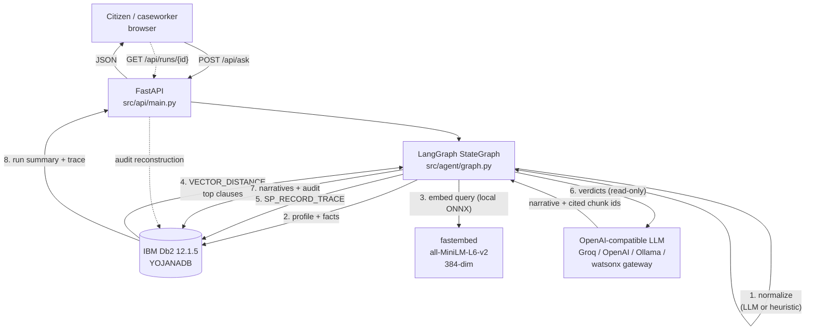
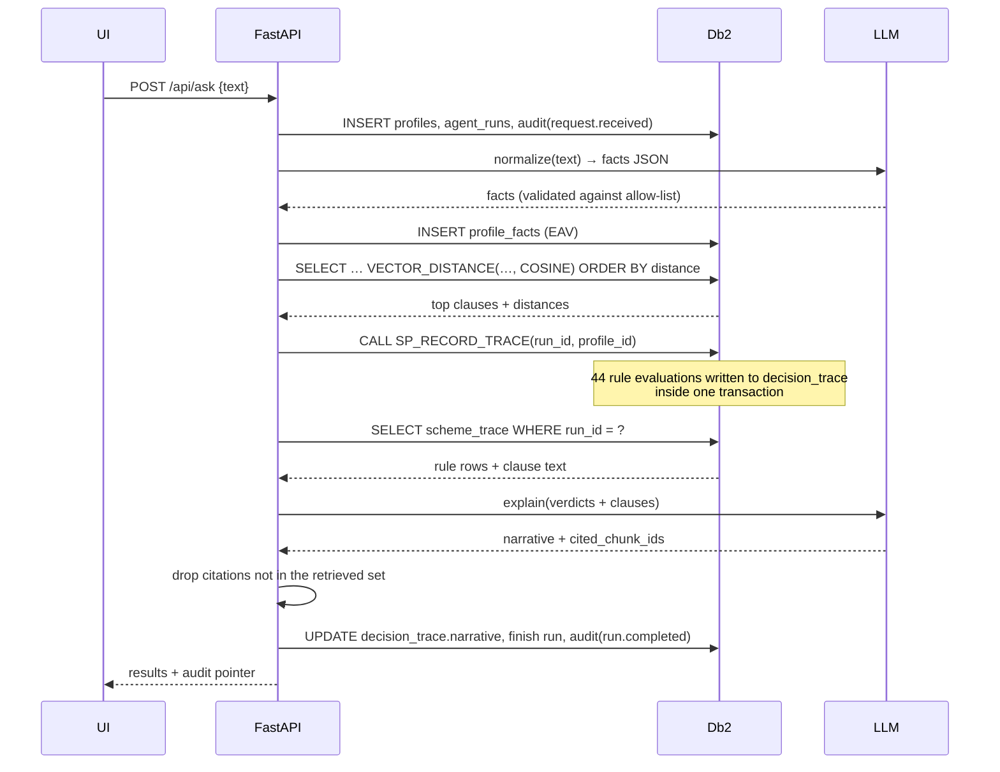

# System Architecture — YojanaLens

## Overview

YojanaLens is a two-plane system:

- **A decision plane built on IBM Db2.** Eligibility is expressed as data (`scheme_rules`) and evaluated by SQL against normalised applicant facts (`profile_facts`). Deterministic, fast, auditable.
- **An explanation plane built on LangGraph + an LLM.** Retrieval finds the clauses that justify the rules; the model narrates verdicts it cannot change.

The two planes meet in exactly one place: `decision_trace`, a table that holds one row per criterion evaluated, written by the `SP_RECORD_TRACE` stored procedure and later annotated with a narrative.

---

## Architecture Diagram



### Request sequence



---

## Component Breakdown

### 1. Client layer
A single server-rendered HTML file (`src/api/static/index.html`) with no build step and no CDN. It works offline, which matters when a judge runs the container on a laptop. It shows the four verdict groups, per-scheme rule traces, the retrieved clause quote, and an audit drawer backed by `GET /api/runs/{id}`.

### 2. Application layer
FastAPI. Endpoints: `/api/ask`, `/api/runs/{id}`, `/api/runs/{id}/trace`, `/api/runs`, `/api/schemes`, `/api/stats`, `/api/health`. Db2 failures return `503` with an actionable message rather than a stack trace. `/api/health` reports driver, database, engine and LLM mode independently.

### 3. Orchestration layer (LangGraph)

```python
StateGraph(AgentState)
  begin → normalize → persist_facts → retrieve → record_trace → explain → finalize
                 ↘ clarify (no facts extracted) → END
```

The state is a `TypedDict`; nodes return partial updates. `normalize` has a conditional edge, which is the one branch the data can take: if nothing extractable was said, the run ends as `NEEDS_INPUT` with a concrete follow-up question instead of an empty result.

A sequential fallback runs the same node functions if LangGraph cannot be imported. The graph is the real path; the fallback exists so a constrained environment degrades instead of dying.

### 4. Database layer (IBM Db2)
See [IBM Db2 Schema & Storage Design](#ibm-db2-schema--storage-design).

### 5. Retrieval layer
`fastembed` runs `all-MiniLM-L6-v2` through ONNX on CPU. The 384-dimension output is serialised as a bracketed literal and passed as a bound parameter to `VECTOR(CAST(? AS VARCHAR(32672)), 384, FLOAT32)`. Dimension mismatch raises before any write.

---

## Data Flow

1. **Ingestion (once).** `python -m src.cli seed` reads `data/schemes.json`, embeds 39 clauses in one batch, and inserts schemes, rules and chunks. Each rule is mapped to the chunk on the same `source_page`, so the rule and its justification are linked at ingestion time — deterministically, not by cosine similarity.
2. **Normalisation.** Prose becomes typed facts. The LLM path returns JSON that is validated against a closed vocabulary; the deterministic path uses regexes and is deliberately conservative. Unknown keys are dropped, unparsable numbers are dropped, and missing facts stay missing.
3. **Retrieval.** One statement: residency pre-filter (a `state_code` predicate) + optional category filter + `VECTOR_DISTANCE` ranking, capped at 12 rows.
4. **Decision.** `SP_RECORD_TRACE` evaluates every active scheme's rules against the applicant's facts and inserts the matrix into `decision_trace`.
5. **Explanation.** Python groups the matrix into schemes, labels each group (see policy below), and asks the model to narrate. Citations are filtered against the retrieved set.
6. **Persistence.** Narratives are written back to `decision_trace`, run metadata to `agent_runs`, events to `audit_log`.

---

## IBM Db2 Schema & Storage Design

```sql
CREATE TABLE schemes (
    scheme_id   VARCHAR(64)  NOT NULL PRIMARY KEY,
    name        VARCHAR(255) NOT NULL,
    gov_level   VARCHAR(16)  NOT NULL,      -- central | state
    state_code  VARCHAR(8)   NOT NULL,      -- 'ALL' or e.g. 'UP'
    category    VARCHAR(32)  NOT NULL,
    status      VARCHAR(16)  NOT NULL,
    source_url  VARCHAR(512),
    benefit_summary VARCHAR(1000),
    ingested_at TIMESTAMP NOT NULL DEFAULT CURRENT TIMESTAMP
);

CREATE TABLE scheme_rules (
    rule_id        INTEGER NOT NULL GENERATED ALWAYS AS IDENTITY,
    scheme_id      VARCHAR(64) NOT NULL REFERENCES schemes (scheme_id) ON DELETE CASCADE,
    criterion_code VARCHAR(48) NOT NULL,
    rule_op        VARCHAR(8)  NOT NULL CHECK (rule_op IN ('eq','in','lte','gte')),
    value_num      DOUBLE,
    value_text     VARCHAR(255),
    mandatory      SMALLINT    NOT NULL DEFAULT 1,
    clause_ref     VARCHAR(64) NOT NULL,
    source_page    INTEGER,
    chunk_id       VARCHAR(96),
    PRIMARY KEY (rule_id)
);

CREATE TABLE scheme_chunks (
    chunk_id   VARCHAR(96) NOT NULL PRIMARY KEY,
    scheme_id  VARCHAR(64) NOT NULL REFERENCES schemes (scheme_id) ON DELETE CASCADE,
    clause_ref VARCHAR(64) NOT NULL,
    section    VARCHAR(128),
    page_no    INTEGER,
    chunk_text CLOB(32768) NOT NULL,
    embedding  VECTOR(384, FLOAT32) NOT NULL
);

CREATE TABLE profile_facts (
    profile_id VARCHAR(64) NOT NULL REFERENCES profiles (profile_id) ON DELETE CASCADE,
    fact_key   VARCHAR(48) NOT NULL,
    fact_num   DOUBLE,
    fact_text  VARCHAR(255),
    confidence DOUBLE NOT NULL DEFAULT 1.0,
    evidence   VARCHAR(512),
    PRIMARY KEY (profile_id, fact_key)
);

CREATE TABLE decision_trace (
    trace_id       INTEGER NOT NULL GENERATED ALWAYS AS IDENTITY,
    run_id         VARCHAR(64) NOT NULL REFERENCES agent_runs (run_id) ON DELETE CASCADE,
    scheme_id      VARCHAR(64) NOT NULL,
    rule_id        INTEGER     NOT NULL,
    criterion_code VARCHAR(48) NOT NULL,
    rule_op        VARCHAR(8)  NOT NULL,
    mandatory      SMALLINT    NOT NULL,
    observed_value VARCHAR(255),
    verdict        VARCHAR(16) NOT NULL,     -- PASS | FAIL | UNKNOWN
    clause_ref     VARCHAR(64) NOT NULL,
    chunk_id       VARCHAR(96),
    narrative      VARCHAR(2000),
    created_at     TIMESTAMP NOT NULL DEFAULT CURRENT TIMESTAMP,
    PRIMARY KEY (trace_id)
);
```

Full DDL: `sql/01_schema.sql`. Canonical queries: `sql/03_queries.sql`. Stored procedure: `sql/04_procedure.sql`. Reset script: `sql/00_reset.sql`.

### Transaction boundaries

| Unit of work | Statements | Committed |
| --- | --- | --- |
| schema creation | all of `01_schema.sql` | once |
| corpus seed | per scheme: delete + insert scheme, chunks, rules | once per full seed |
| run start | profile + run + audit | together |
| facts | delete + insert `profile_facts` + update JSON | together |
| decision | `CALL SP_RECORD_TRACE` | with the trace read that follows |
| finalise | narratives + run summary + audit | together |

`db.connect()` is a context manager that commits on success and rolls back on exception, so a failed run never leaves a half-written matrix.

---

## Rule Semantics

| `rule_op` | SQL meaning | Example |
| --- | --- | --- |
| `eq` | `LOWER(fact_text) = LOWER(value_text)` | `gender = female` |
| `in` | `LOCATE(','||fact||',', ','||list||',') > 0` | `category in sc,st` |
| `lte` | `fact_num <= value_num` | `income_annual <= 250000` |
| `gte` | `fact_num >= value_num` | `age >= 18` |

`mandatory = 0` marks an advisory criterion: it never blocks, but it is still shown and can be mentioned in the narrative (for example, PM-JAY's BPL priority flag).

### Verdict policy (pure function, `src/rules.py`)

| Condition | Label |
| --- | --- |
| ≥1 mandatory failure, more than one **or** a categorical op (`eq`/`in`) | `NOT_ELIGIBLE` |
| exactly one mandatory failure and it is numeric (`lte`/`gte`) | `NEAR_MISS` |
| no failures, ≥1 mandatory unknown | `CLARIFY` |
| no failures, no unknown | `ELIGIBLE` |
| scheme's `state_code` not in `('ALL', applicant_state)` | filtered out, counted |

The rationale: a single numeric threshold is a door that can open (income falls, age arrives, land is subdivided). A categorical mismatch is a different door. Conflating them would produce false hope, which is the failure mode this project exists to avoid.

---

## Failure Modes & Degradation

| Failure | Behaviour |
| --- | --- |
| Db2 not reachable | `503` with the `docker compose` hint; `/api/health` reports `degraded` |
| `ibm_db` native client missing | import-time guard; a `Db2Error` explains the Docker path instead of a DLL traceback |
| No LLM key / provider down | templated narration from the rule trace; `llm_mode: "mock"` in the response |
| LLM returns malformed JSON | one parse retry, then the deterministic extractor/narrator |
| LLM cites an unknown chunk | citation dropped and replaced with the rule's grounding chunk |
| Nothing extractable from the text | run ends `NEEDS_INPUT` with a specific question; profile and audit are still persisted |
| Embedding dimension mismatch | raises before writing to the `VECTOR(384, …)` column |
| Partial run exception | run marked `FAILED`, `run.failed` audited, original exception re-raised |

---

## Security & Secrets Management

- Credentials and API keys come from environment variables only; `.env` is git-ignored and `.env.example` holds dummy values.
- All SQL uses parameter markers. The only dynamic fragment is the embedding dimension, interpolated from config as an integer and asserted before use.
- The UI escapes every value before insertion into the DOM.
- No personal data leaves the host except the free-text description sent to the configured LLM — in `mock` mode, nothing leaves at all. Production would need consent capture, encryption at rest and a retention policy (listed as a limitation).

---

## Why Db2 (and not a vector store plus a relational database)

| Alternative | What breaks |
| --- | --- |
| Pinecone/Chroma + Postgres | two systems, two consistency domains, and a clause can be retrieved while its rule row is stale. Here the clause, the rule and the decision share one transaction. |
| Rules in Python | the decision leaves the database, cannot be audited relationally, and drifts from the data it reads. |
| LLM decides from retrieved text | unauditable, non-deterministic, and hallucinates verdicts — the exact failure welfare clients cannot tolerate. |
| SQLite/JSON files | no native vector type, no SQL PL, no server-side rule matrix, no meaningful concurrency story. |

The design intentionally concentrates the decision in `SP_RECORD_TRACE`: one procedure, one join, one transaction, one table of evidence.

---

## Performance Notes

At this corpus size (15 schemes, 44 rules, 39 clauses, 384 dims) every operation is dominated by connection setup, not computation:

- vector scan: 39 × 384 floats — microseconds
- rule matrix: 44 comparisons in one `INSERT … SELECT`
- embeddings: local ONNX, one batch at seed time, one query vector per run
- end-to-end: reported live in the UI and in `agent_runs.latency_ms`

The retrieval query is written so that adding `VECTOR` index support or a larger corpus changes the physical plan, not the application logic.
